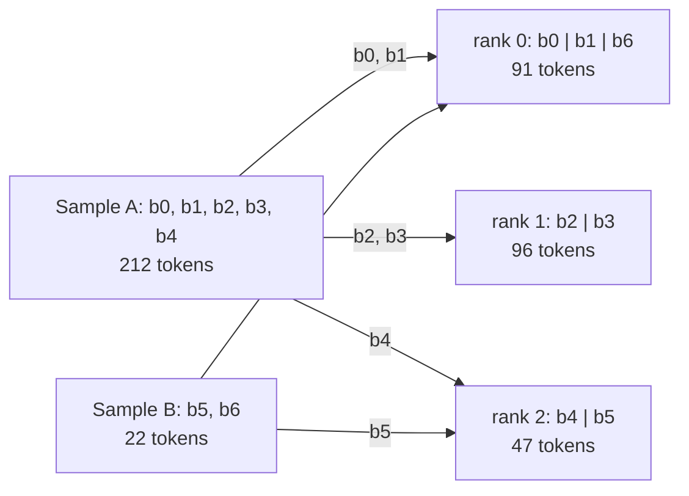
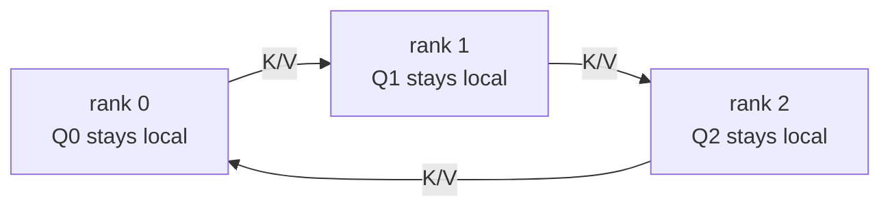

# cudnn_vsa

[English](README.md) | [简体中文](README.zh-CN.md)

<!-- Keep README.md and README.zh-CN.md synchronized, including examples and benchmark data. -->

Packed multimodal attention for DiT/MMDiT training:
**cuDNN block-sparse fine attention + FA4 varlen coarse attention**.

## Install

With CUDA-enabled PyTorch installed, run from the repository root:

```bash
python -m pip install -r requirements.txt
```

## Use

Inputs are separate, contiguous BF16 `q`, `k`, `v`, `gate` tensors of shape
`[T, H, 128]`. Output preserves the input token order.

```python
import torch
from vsa import vsa_attention
from vsa_layout import Segment, build_vsa_layout

# One 720p 5s video and two independent 720p images, each with text.
H, D = 2, 128
layout = build_vsa_layout(
    samples=[
        [Segment("video", (31, 45, 80), sparsity=0.9), Segment("text", 2048)],
        [Segment("video", (1, 45, 80), sparsity=None), Segment("text", 2048)],
        [Segment("video", (1, 45, 80), sparsity=None), Segment("text", 2048)],
    ],
    head_num=H,
    dense_query_full=False,
    device="cuda",
)
q, k, v, gate = [
    torch.randn(layout.tokens, H, D, device="cuda", dtype=torch.bfloat16,
                requires_grad=True)
    for _ in range(4)
]
out = vsa_attention(q, k, v, gate, layout)
out.backward(torch.randn_like(out))
```

Each inner list is one joint sample; different samples cannot attend to each
other. With the default raster order, inputs follow the sample and segment
order in `samples`. Each sample contains at least one video, with optional
additional video/image, text, audio
or keyframe segments. Video sizes are `(F, H, W)` token grids in raster order;
`F=1` is an image. Other segment kinds take token counts and use `sparsity=None`.
Reuse the layout across layers with the same geometry and settings.

Add this directory to `PYTHONPATH`, or copy `vsa.py`, `vsa_core.py`,
`vsa_layout.py` and `vsa_kernels.py` into your project and adjust imports.

## Input order

`layout.input_order` explicitly declares the token order:

| `input_order` | Input tokens | Slot conversion |
| --- | --- | --- |
| `"raster"` (default) | Original sample/segment order, video in FHW order | Reorder into blocks and add padding |
| `"block"` | Valid tokens in the block order below, no padding | Add padding only; skip conversion when every local slot is valid |

### Raster input

The default `input_order="raster"` accepts the original FHW sequence, as in
the example above. `vsa_attention` reorders and pads it internally, then
restores the output to the same raster order. No preprocessing is required.

### Block input

`input_order="block"` describes the tokens that `vsa_attention` expects;
setting the flag does not reorder a tensor. The global block order is:

1. Keep samples in their declared order.
2. Within each sample, put `sparsity=None` segments first, then numeric-sparsity
   video segments. Preserve declared segment order within each category.
   A dense image/video belongs to the first category; numeric `sparsity=0`
   still belongs to the second.
3. Split each None-sparsity segment into consecutive chunks of at most 64
   tokens. For numeric-sparsity video, visit 4×4×4 tile origins in F/H/W order
   (W changes fastest), then valid tokens within each tile in the same order.
   Clip edge tiles to the actual dimensions; concatenate their valid tokens
   without gaps. Blocks never cross segment or sample boundaries.

A Ring input keeps only this rank's owned blocks, in increasing global block-ID
order. Within each block, token order is unchanged. `layout.input_rows[i]`
maps supplied row `i` to the original **global raster** row; a full raster
layout has an identity map. Q/K/V, gate, position IDs and dO must all follow
the supplied order. Outputs and input gradients preserve it.

For example, declare `video=(1, 2, 5), sparsity=0.9`, followed by three text
tokens. Number the original raster rows `0..12`: video rows are `0..9`, and
text rows are `10..12`. The compact block stream is:

| Block | Original raster rows, in supplied order | Valid tokens |
| --- | --- | ---: |
| b0: text | `10, 11, 12` | 3 |
| b1: first video tile | `0, 1, 2, 3, 5, 6, 7, 8` | 8 |
| b2: edge video tile | `4, 9` | 2 |

For a full layout, the input has 13 rows and attention allocates 3×64 slots.
With `sparsity=None` on that video, both segments are dense: video stays before
text, giving blocks of 10 and 3 tokens in the original raster order.

For raster data, call `to_block_order` once before the entire VSA stack.
This repository provides the fused reorder kernel separately from
`vsa_attention`: it gathers rows from one token tensor in one kernel launch,
preserving dtype and trailing dimensions and adding **no padding**. Inputs
already in block order go directly to attention. Keep that order across layers.

`to_block_order(x, vsa_layout=layout)` accepts one contiguous CUDA
`[T_global, ...]` raster tensor. A full layout returns all rows in block order;
a Ring layout selects and reorders only this rank's rows, returning
`[layout.tokens, ...]`. Full layouts preserve the first dimension; Ring layouts
use the local valid-token count. In both cases the result equals
`x[layout.input_rows]` by value.
The inverse `to_raster_order(x, vsa_layout=layout)` requires a **full** layout.
Both helpers require `input_order="block"`: the layout describes the target
block order even when `x` enters in raster order.
Call the forward helper at the stack's input boundary and the inverse helper
at its output boundary if raster output is needed. Subsequent token-wise
projections produce Q/K/V/gate in block order directly. Positional coordinates
must follow the same order; callers can generate them in block order or
convert their coordinate tensor separately.

```python
import torch
from vsa import to_block_order, to_raster_order, vsa_attention
from vsa_layout import Segment, build_vsa_layout

H, D, C = 2, 128, 256
layout = build_vsa_layout(
    [[Segment("video", (5, 9, 11), sparsity=0.9), Segment("text", 67)]],
    head_num=H, input_order="block", device="cuda",
)
tokens_raster = torch.randn(layout.tokens, C, device="cuda", dtype=torch.bfloat16,
                            requires_grad=True)
projection = torch.nn.Linear(C, 4 * H * D, device="cuda", dtype=torch.bfloat16)

# One reorder at the input boundary, before the layers' projections.
tokens_block = to_block_order(tokens_raster, vsa_layout=layout)
assert tokens_block.shape == tokens_raster.shape  # Full layout: 562 valid tokens.

# One example VSA layer; intermediate layers retain block order.
projected = projection(tokens_block).view(layout.tokens, 4, H, D)
q, k, v, gate = (x.contiguous() for x in projected.unbind(1))
out = vsa_attention(q, k, v, gate, layout)

# Restore once at the output boundary if raster output is required.
out_raster = to_raster_order(out, vsa_layout=layout)
out_raster.backward(torch.randn_like(out_raster))
```

For this full layout, backward applies the inverse permutation, and
`to_raster_order` restores the original sample/segment/FHW order after the
stack. For a Ring layout, backward scatters to the global raster shape with
zeros at unowned rows; it performs no cross-rank reduction. Restoring a full
Ring output requires caller-owned communication; `to_raster_order` accepts
only full layouts.

Internally, blocks occupy 64 slots: `slot_row` maps slots to input rows, using
`-1` for padding, and `row_slot` is the inverse map for valid rows. Block inputs
use fused Q/K/V padding and fused dQ/dK/dV restoration; padding is zero and
excluded from means and attention. `slots_are_input` skips conversion only
for block inputs with `tokens == blocks * 64`, with no partial or dummy blocks.
Raster inputs use the raster-to-slot path even when all blocks are full.

## Examples with and without context parallelism

The following example uses two attention layers with residual connections and
one optimizer step. It supports all three modes through the same VSA API.
The entire process world is one context-parallel group; `H` must be divisible
by the Ulysses size `U`, and the world size must equal `U * R`.

| Mode | Input preparation before the layers | Q/K/V/gate passed to VSA |
| --- | --- | --- |
| No CP (`U=1, R=1`) | Keep raster order, or reorder once to block order | All tokens and all heads |
| Ulysses only (`U>1, R=1`) | Choose raster or block order, then split the stream into U token slices | All tokens and H/U heads after All-to-All |
| Ring + Ulysses (`U>1, R>1`) | Select whole Ring-owned blocks and reorder once; then split each compact Ring stream into U token slices | This Ring owner's valid tokens and H/U heads after All-to-All |

Ulysses token boundaries may split a block: All-to-All reconstructs the stream
before VSA runs. Its communication supports either input order, but the
reconstructed stream must match `layout.input_order`. Ring requires block order.
Only trailing **transport padding** is added to equalize Ulysses message sizes;
it is removed before attention and excluded from the loss. This is separate
from VSA's internal 64-slot block padding.

### No CP

Save the shared Python example below as `demo_cp.py` in this repository, then run:

```bash
python demo_cp.py
python demo_cp.py --input-order block
```

### Ulysses CP only

Four GPUs split tokens before the layers and exchange tokens for heads inside
each layer. Both raster and block inputs are supported:

```bash
torchrun --standalone --nproc-per-node=4 demo_cp.py --ulysses-size 4
torchrun --standalone --nproc-per-node=4 demo_cp.py --ulysses-size 4 --input-order block
```

### Ring + Ulysses CP

For eight GPUs with `U=4, R=2`, Ulysses groups are `[0,1,2,3]` and
`[4,5,6,7]`; Ring groups are `[0,4]`, `[1,5]`, `[2,6]`, `[3,7]`.
Each Ring pair handles the same head slice and complementary block ownership.
Both ownership policies use the same preparation and attention calls:

```bash
torchrun --standalone --nproc-per-node=8 demo_cp.py \
  --ulysses-size 4 --ring-size 2 --input-order block --ring-partition cyclic
torchrun --standalone --nproc-per-node=8 demo_cp.py \
  --ulysses-size 4 --ring-size 2 --input-order block --ring-partition contiguous
```

### Shared example

The example uses PyTorch's differentiable All-to-All. Ulysses, projections,
loss normalization and parameter-gradient reduction belong to the caller;
they are not new `cudnn_vsa` APIs. Here every rank starts with the same full
raster pack and replicated weights. Data loading can instead supply the final
local rows directly. The explicit reorder below materializes one Ring shard
per Ulysses rank for readability; a caller can combine its row map with the
Ulysses slice to gather only the final local rows.

```python
import argparse
import os

import torch
import torch.distributed as dist
import torch.nn.functional as F
from torch.distributed.nn.functional import all_to_all_single

from vsa import to_block_order, vsa_attention
from vsa_layout import Segment, build_vsa_layout


def exchange_heads(mixed, group):
    # [A,H,4,D] -> four [U*A,H/U,D] tensors; backward exchanges gradients.
    if group is None:
        return mixed.unbind(2)
    u = dist.get_world_size(group)
    a, h, n, d = mixed.shape
    send = mixed.reshape(a, u, h // u, n, d).transpose(0, 1).contiguous()
    recv = all_to_all_single(torch.empty_like(send), send, group=group)
    return recv.reshape(u * a, h // u, n, d).unbind(2)


def exchange_tokens(out, group):
    # [U*A,H/U,D] -> [A,H,D], reversing the forward head exchange.
    if group is None:
        return out
    u = dist.get_world_size(group)
    t, h, d = out.shape
    send = out.reshape(u, t // u, h, d).contiguous()
    recv = all_to_all_single(torch.empty_like(send), send, group=group)
    return recv.permute(1, 0, 2, 3).reshape(t // u, u * h, d)


parser = argparse.ArgumentParser()
parser.add_argument("--ulysses-size", type=int, default=1)
parser.add_argument("--ring-size", type=int, default=1)
parser.add_argument("--input-order", choices=("raster", "block"), default="raster")
parser.add_argument("--ring-partition", choices=("cyclic", "contiguous"), default="cyclic")
args = parser.parse_args()
U, R, H, D = args.ulysses_size, args.ring_size, 8, 128
C = H * D
world = int(os.environ.get("WORLD_SIZE", "1"))
if U < 1 or R < 1 or H % U or world != U * R:
    parser.error("Require U >= 1, R >= 1, H % U == 0 and WORLD_SIZE == U * R")
if R > 1 and args.input_order != "block":
    parser.error("Ring requires --input-order block")
device = torch.device("cuda", int(os.environ.get("LOCAL_RANK", "0")))
torch.cuda.set_device(device)
rank = 0
if world > 1:
    dist.init_process_group("nccl")
    rank = dist.get_rank()

# All ranks create all subgroups in the same order, once before the layers.
ulysses_group = ring_group = None
if U > 1:
    for r in range(R):
        group = dist.new_group(list(range(r * U, (r + 1) * U)))
        if rank // U == r:
            ulysses_group = group
if R > 1:
    for u in range(U):
        group = dist.new_group([r * U + u for r in range(R)])
        if rank % U == u:
            ring_group = group

samples = [
    [Segment("video", (5, 9, 11), sparsity=0.9), Segment("text", 67)],
    [Segment("video", (1, 3, 5)), Segment("text", 7)],
]
T = sum(segment.tokens for sample in samples for segment in sample)  # 584
layout = build_vsa_layout(
    samples, head_num=H // U, input_order=args.input_order, device=device,
    ring_cp_group=ring_group, ring_partition=args.ring_partition,
)
torch.manual_seed(1234)  # Identical mock input and replicated weights on all ranks.
tokens_global = torch.randn(T, C, device=device, dtype=torch.bfloat16)
# Row IDs illustrate the mapping; use the model's original coordinates for RoPE.
position_ids_global = torch.arange(T, device=device)

# One reorder/whole-block Ring selection, before any layer's Q/K/V projection.
tokens_attention = tokens_global
position_ids_attention = position_ids_global
if args.input_order == "block":
    tokens_attention = to_block_order(tokens_global, vsa_layout=layout)
    position_ids_attention = to_block_order(position_ids_global, vsa_layout=layout)

# Equal Ulysses capacity across Ring owners, including partial edge blocks.
max_tokens = layout.tokens
if layout.ring is not None:
    max_tokens = int(layout.ring.peer_block_sizes.sum(dim=1).max().item())
A = (max_tokens + U - 1) // U
tail = U * A - layout.tokens
start = (rank % U) * A
x = F.pad(tokens_attention, (0, 0, 0, tail))[start:start + A].contiguous()
position_ids_local = F.pad(position_ids_attention, (0, tail), value=-1)[start:start + A]
valid = torch.arange(start, start + A, device=device) < layout.tokens

layers = torch.nn.ModuleList([
    torch.nn.ModuleList([
        torch.nn.Linear(C, 4 * C, bias=False, device=device, dtype=torch.bfloat16),
        torch.nn.Linear(C, C, bias=False, device=device, dtype=torch.bfloat16),
    ]) for _ in range(2)
])
optimizer = torch.optim.SGD(layers.parameters(), lr=1e-3)
for qkvg_projection, output_projection in layers:
    mixed = qkvg_projection(x).view(A, H, 4, D)
    q, k, v, gate = (
        t[:layout.tokens].contiguous() for t in exchange_heads(mixed, ulysses_group)
    )
    # If applying RoPE here, use position_ids_attention for these unpadded rows.
    out = vsa_attention(q, k, v, gate, layout)
    out = F.pad(out, (0, 0, 0, 0, 0, tail))
    out = exchange_tokens(out, ulysses_group).reshape(A, C)
    x = (x + output_projection(out)).masked_fill(~valid[:, None], 0)

# Sum local contributions to a global-token-normalized illustrative loss.
loss = x.float().square().masked_fill(~valid[:, None], 0).sum() / (T * C)
loss.backward()
if world > 1:
    # SUM, not average: each local loss already uses the global denominator.
    for parameter in layers.parameters():
        dist.all_reduce(parameter.grad, op=dist.ReduceOp.SUM)
optimizer.step()
reported_loss = loss.detach()
if world > 1:
    dist.all_reduce(reported_loss, op=dist.ReduceOp.SUM)
if rank == 0:
    print(f"U={U}, R={R}, order={args.input_order}, loss={reported_loss.item():.6f}")
if world > 1:
    dist.destroy_process_group()
```

For the example, each layer projects `[A, 1024]` into Q/K/V/gate with shape
`[A, 8, 128]`. After Ulysses exchange and removal of transport padding, each
has shape `[layout.tokens, 8/U, 128]`; the inverse exchange and output
projection restore `[A, 1024]`. With no CP, `A = layout.tokens = 584`.
The output stays in the rank's input order across layers. Apply the same row
selection to targets and masks; preserve original position values rather than
renumbering the local shard. Final global output gathering is caller-owned.
When using a training framework's parameter-gradient reduction, use that
instead of the example's manual reduction, so gradients are not reduced twice.

## Code structure

| File | Responsibility |
| --- | --- |
| `vsa.py` | Public attention entry and explicit block/raster reorder helpers |
| `vsa_core.py` | Routing, cuDNN BSA/FA4 calls, single-device execution and ring communication/autograd |
| `vsa_layout.py` | Static sample/block geometry, row maps, routing templates and coarse boundaries |
| `vsa_kernels.py` | Fused token reordering, slot gathers, Q/K/V padding, FP32 pooling and gated merge kernels |

Both input orders share the core's attention math, per-region budgets and
fine-before-coarse schedule. The core does not import the public entry.

## Ring context parallelism

Ordinary VSA and Ring use the same forward API:

```python
layout = build_vsa_layout(
    samples, head_num=H, input_order="block", device=device,
    ring_cp_group=group,  # Existing caller-owned group; None selects ordinary VSA.
    ring_partition="cyclic",  # Default; "contiguous" is also supported.
)
out = vsa_attention(q, k, v, gate, layout)
```

`build_vsa_layout` returns `VSALayout` in both modes. `ring_cp_group=None`
builds a full layout (`layout.ring is None`) without distributed initialization,
including on CPU. A member process group builds a local Ring shard, including
size-one groups, and requires `input_order="block"`. Rank and size come from
the supplied group; nonmember handles are rejected.

All group ranks supply identical global sample geometry and head counts.
Create groups once during parallel initialization and share them across
micro-batch layouts; layers reuse each layout. VSA borrows group handles and
never creates or destroys them. Forward and backward share `ring_cp_group`
by default. Optional `ring_cp_bwd_group` must have identical members and rank
order. Groups and transport options are bound at construction; keep the groups
alive through backward and CUDA Graph replay. See **Forward communication
overlap** for stream-priority configuration.

Full layouts and Ring shards share slot maps, routing templates and coarse
metadata. `tokens`, `blocks` and row/slot maps describe local input;
`groups`, `sample_slices` and `sample_lengths` describe global samples.
`layout.ring` holds the bound groups, local rank/size, global token count,
block ownership, peer lengths and all-gather permutation. Coarse Q boundaries
are local; KV boundaries cover the corresponding global samples. Full layouts
share their Q/KV boundary and block-ID tensors.

### Compact input and block ownership

Ring layouts require `input_order="block"`, including size-one groups. Each
rank supplies only its valid local tokens in increasing owned-block order,
without padding. Keep Q/K/V/gate, position coordinates and gradients in that
same order; outputs preserve it. Reuse the layout across layers.

Plan blocks in the order described in **Input order**, numbering them across
packed samples. `ring_partition` selects their ownership independently of
`input_order`, and is recorded as `layout.ring.partition`:

| `ring_partition` | Global block ownership |
| --- | --- |
| `"cyclic"` (default) | Block `b` belongs to rank `b % R`; global numbering continues across samples |
| `"contiguous"` | Each sample contributes at most one consecutive block interval to each rank |

Cyclic ownership spreads neighboring Q/KV blocks across ranks, which can reduce
per-peer sparse-work concentration. Neither policy guarantees balanced dynamic
top-k work. Both share the same routing, attention and communication kernels.
All group ranks must select the same policy. Rebuild the layout and reshard the
input when changing it; do not reinterpret an existing local tensor.

For contiguous ownership, start the first sample at rank 0. For N blocks,
compute `base, extra = divmod(N, R)` and visit ranks cyclically from the
current start. The first `extra` ranks receive `base + 1` consecutive blocks;
the others receive `base`. Then advance the start by `extra` modulo R: the
next sample starts at the first rank that received fewer blocks. If N is
divisible by R, keep the start unchanged. A rank can receive no blocks from
an individual sample.

This rotation keeps both per-sample and cumulative block counts within one
block of each other, without searching for the globally least-loaded rank.
Every rank uses `C = ceil(global_blocks / R)` internal blocks. Valid token
lengths do not affect ownership; partial blocks can produce unequal token loads.
Each block stays within one segment and sample; samples remain isolated during
routing and attention. Neither a sample's token count nor its block count
needs to be a multiple of R. The total block count must be at least R; smaller
packs are rejected on every rank. Every rank receives valid input tokens.
Internal buffers pad partial and dummy blocks to 64 slots.

Ownership is explicit: `p = layout.ring.global_to_gather[b]` maps global block
`b` to rank-major storage, so `owner = p // C` and `local_block = p % C`.
`layout.ring.block_ids` lists this rank's global IDs, with `-1` for dummy blocks.
All ranks derive the same maps from the sample geometry, without communication.

For a Ring shard, `layout.input_rows` maps local compact rows to the original
global sample/segment/FHW stream. `to_block_order` uses this map to fuse **shard
selection and reordering**: it reads only owned rows and does not materialize
an intermediate full block-ordered tensor. If every rank has the full raster
pack, prepare inputs once before the stack:

```python
from vsa import to_block_order

layout = build_vsa_layout(
    samples, head_num=H, input_order="block", device="cuda",
    ring_cp_group=group,
)
# tokens_global: [layout.ring.global_tokens, hidden_size], in sample/segment/FHW order.
# position_ids_global: [T_global] or [T_global, axes], aligned with those tokens.
tokens_local = to_block_order(tokens_global, vsa_layout=layout)
position_ids_local = to_block_order(position_ids_global, vsa_layout=layout)
# Build local RoPE cos/sin from position_ids_local; reuse across layers with
# the same RoPE configuration. Preserve each sample's original position values.
# Use the same helper for aligned target/mask tensors when needed.
assert tokens_local.shape == (layout.tokens, tokens_global.shape[1])
# Token-wise projections and all VSA layers now consume the local block order.
```

The helper adds no padding and performs no communication. Its backward scatters
into the original global shape, with zero gradients at unowned rows; it does
not reduce gradients across ranks. Data loading and final output gathering
remain caller-owned. Already local block-ordered tensors bypass this helper.
A global block-ordered tensor is not a raster input: distribute whole blocks
using their ownership maps without applying the FHW conversion again.
Any Ulysses all-to-all is also caller-owned and must preserve local block order.

### Worked example: two samples on three ranks

Pack these independent samples, with R=3. The diagram below uses
`ring_partition="contiguous"`:

- **A:** sparse video `(4, 6, 8)` with `sparsity=0.5`, then 20 text tokens.
  Block order places text first: `b0` has 20 tokens; the four video tiles
  `b1..b4` have 64, 64, 32 and 32 tokens.
- **B:** a dense image `(1, 3, 5)` with `sparsity=None`, then 7 text tokens.
  Both segments are dense, so their declared order is retained: `b5` has
  15 image tokens and `b6` has 7 text tokens.

Block IDs continue across samples. A has five blocks and B has two; neither
count is divisible by R. Arrows below show the one-time distribution at the
dataset/model boundary. The rank boxes contain **only valid input tokens**.



Each rank concatenates its blocks in increasing global-ID order, preserving
valid-token order within each block. Rank 0 supplies 20 tokens from `b0`,
then 64 from `b1` and 7 from `b6`, with no gaps. A starts at rank 0 and gives
`[2, 2, 1]` blocks to ranks 0/1/2. B therefore starts at rank 2: it gives `b5`
to rank 2 and `b6` to rank 0. The cumulative counts become `[3, 2, 2]`, and a
third sample would start at rank 1. No token-load calculation or rank sorting
is needed. A's partial blocks deliberately make the token totals unequal in
this example; ownership balances block counts.

Concatenating rank outputs in rank order gives blocks
`[b0, b1, b6, b2, b3, b4, b5]`. To reconstruct global order, use the ownership
and row maps; `input_rows` gives each local row's destination in global raster
order. A rank-order concatenation alone is insufficient for the full layout's
inverse reorder helper.

Attention internally allocates `ceil(7 / 3) = 3` blocks of 64 slots per rank:

| Group rank | Global block IDs in local slot order | Valid sizes per slot block | Compact input rows | Internal slot rows |
| --- | --- | --- | ---: | ---: |
| 0 | `b0, b1, b6` | `20, 64, 7` | 91 | 192 |
| 1 | `b2, b3, dummy` | `64, 32, 0` | 96 | 192 |
| 2 | `b4, b5, dummy` | `32, 15, 0` | 47 | 192 |

Unused slots are zero-filled and excluded from attention and pooling. The
caller supplies 234 valid tokens in total, not 576 slot rows. Q/K/V/gate and
positions use the same local order; the output and its gradients retain it.

With the default `ring_partition="cyclic"`, the same global blocks instead give:

| Group rank | Owned global blocks | Valid tokens |
| --- | --- | ---: |
| 0 | `b0, b3, b6` | 59 |
| 1 | `b1, b4` | 96 |
| 2 | `b2, b5` | 79 |

The total remains 234 tokens and internal capacity remains three blocks per
rank. The following routing example uses the contiguous ownership diagram.

### Routing and top-k

The routing code follows this sequence:

1. `_build_sample_blocks` in [vsa_layout.py](vsa_layout.py) records a separate
   budget for each numeric-sparsity video region: `keep = max(1, ceil((1 -
   sparsity) * region_blocks))`. Dense KV blocks are always included. These
   budgets and sample boundaries are static; selected video block IDs change
   with Q/K on each forward call.
2. `ring_attention_slots` in [vsa_core.py](vsa_core.py) computes local Q/K/V
   block means in FP32, dividing by valid token counts. Padding is zero and
   dummy blocks have zero means. Pooled K/V is all-gathered in rank order,
   then `layout.ring.global_to_gather` restores global block order and removes
   dummy blocks. Routing uses local Q means and globally ordered K means.
3. `route` is shared by full and Ring layouts. The layout precomputes each
   sample's local routing rows and offsets into pooled Q/K; `route` calls
   `_route_group` for those rows. For each video KV region and head, it forms FP32 scores
   `Q_mean @ K_mean.T`, with TF32 and autocast disabled, then selects that
   region's `keep` largest scores independently for every Q block. Routing
   uses unscaled dot products; attention applies its softmax scale later.
   Every peer's candidate blocks in that region participate in this one
   selection. No score or top-k-index collective is needed because each Q
   block has one owner and the K means are already global.
4. `topk(..., sorted=False)` chooses region-relative IDs; `selected.sort(-1)`
   sorts those IDs, and `+ start` converts them to global block IDs. Dense
   keys and fully retained regions come from the layout's template. With
   `dense_query_full=True`, dense Q rows keep their full-sample template and
   skip top-k; sparse video Q rows keep their regional budgets. Layouts with
   no dynamic selections reuse the template directly. Routing runs under
   `no_grad`: gradients flow through the selected fine attention and the
   coarse branch, not through discrete top-k decisions.
5. `partition_indices` in [vsa_kernels.py](vsa_kernels.py) groups selected IDs
   using the same `global_to_gather` map as pooled K/V. With capacity C, mapped
   position `p` gives `owner = p // C` and `local_block = p % C`. It records
   each peer's valid count. A peer may contribute zero selected keys. These
   per-peer lists drive fine attention as K/V shards arrive.

For sample A above, four video blocks at sparsity 0.5 give `keep=2`. Suppose
one head of query block `b3` has these scores:

```text
Video KV block       b1    b2    b3    b4
Q_mean @ K_mean.T   0.2   0.8   0.1   0.9
Selected video IDs        b2          b4
Final global IDs:   [b0, b2, b4]   (b0 is the always-visible text block)
```

For R=3, the peer lists are rank 0 `[0]` (global `b0`), rank 1 `[0]` (global
`b2`) and rank 2 `[0]` (global `b4`). A Q block in sample A never considers B's
`b5/b6`. With multiple video regions, each region gets its own top-k budget;
there is no single top-k across all video regions in the pack.

### Execution

Single-device and ring execution share `block_means`, which returns
differentiable FP32 Q/K/V means. Single-device execution selects coarse blocks
and fuses routing detach and coarse dtype conversion in `routing_and_coarse_means`.
Ring execution pools all local slots, including zero-filled dummy blocks;
`_GatherMeans` communicates K means in FP32 for routing and V means in BF16
for coarse attention, packing their raw bytes into one all-gather. This byte
packing preserves each field's bits without quantizing K. V is cast inside the
communication autograd boundary; backward combines dK/dV into one FP32
reduce-scatter SUM and returns FP32 gradients to pooling. Forward pooled K/V
payload is 25% smaller than sending both in FP32; the forward and backward
collective counts remain one each. End-to-end latency must still be measured.

For the example above, let `KV_r` be rank r's entire internal K/V shard,
including its slot padding. Q stays on its original rank throughout fine
attention; K/V moves to the next group rank:



| Fine-attention step | Rank 0 uses | Rank 1 uses | Rank 2 uses |
| --- | --- | --- | --- |
| 0: own shard | `Q0, KV0` | `Q1, KV1` | `Q2, KV2` |
| 1: after one hop | `Q0, KV2` | `Q1, KV0` | `Q2, KV1` |
| 2: after two hops | `Q0, KV1` | `Q1, KV2` | `Q2, KV0` |

Each step evaluates only the selected KV blocks owned by that peer. For
example, global `b5` maps to rank-major position 7: owner `7 // 3 = 2`,
local block `7 % 3 = 1`. When rank 0 receives `KV2`, its B query block `b6`
may attend to B's `b5`; its A query blocks cannot attend to `b5`. The **layout/router** enforce this
sample isolation through the block lists. The **transport** just moves
buffers; it does not interpret FHW coordinates or infer THD sample boundaries.
Partial outputs are weighted using their log-sum-exp normalizers so the final
fine output has one softmax normalization over all selected KV blocks.

After enqueuing the fine pass, `coarse_attention` uses local pooled Q and
global pooled K/V in BF16, with separate per-sample Q/KV boundaries. Q/K means
are cast at the coarse boundary; V means already arrive in BF16.
Coarse attention covers all blocks in each participating sample, independently
of the fine top-k lists. `vsa_attention` restores compact valid rows and merges
`fine + gate * coarse[query_block]`. Entirely dense samples use fine only.

Backward traverses the ring in reverse, using the final fine output and
log-sum-exp, and accumulates dQ/dK/dV in FP32. The pooled-mean gather has a
reduce-scatter adjoint. Ranks without local coarse queries still participate
in the required collectives; saved receive buffers support retained-graph
backward.

Set transport options on `build_vsa_layout`, alongside `ring_cp_group`.
`ring_cp_batch_p2p=None` uses individual P2P for lazy NCCL groups and batched
P2P for device-bound groups, resolved independently for forward and backward.
A boolean selects that mode for both groups explicitly.
`ring_cp_bwd_bucket_size="auto"` uses 64 query blocks per backward bucket for
SM100, H=2, one sample and 128 physical local blocks; other shapes use the
backend default. Pass `None` for the backend default everywhere, or a positive
integer to select a bucket size.

### Forward communication overlap

To give Ring P2P communication a high-priority NCCL stream, create the group
once during parallel initialization. Reuse it across layouts and layers:

```python
import torch.distributed as dist

# Call on all WORLD ranks in the same group-creation order, before building layouts.
options = dist.ProcessGroupNCCL.Options()
options.is_high_priority_stream = True
group = dist.new_group(ranks=ring_ranks, backend="nccl", pg_options=options)
# Member ranks reuse this group for every micro-batch's layout.
layout = build_vsa_layout(
    samples, head_num=H, input_order="block", device="cuda",
    ring_cp_group=group,
)
out = vsa_attention(q, k, v, gate, layout)
```

Forward and backward use the same group by default. To choose a different
backward NCCL stream priority, create a second group with the same members
and rank order, then pass it as `ring_cp_bwd_group`. Forward pooled all-gather
and fine KV P2P use `ring_cp_group`; backward fine P2P and pooled-gradient
reduce-scatter use `ring_cp_bwd_group`. VSA borrows the handles; the caller
owns creation and destruction and keeps them alive through backward and
CUDA Graph replay.

Enqueuing P2P before BSA does not guarantee that its GPU kernel starts first.
BSA and NCCL can compete for SM resources, including shared memory. With
ordinary-priority streams, a pending NCCL kernel can wait until BSA's last
thread blocks. High priority lets pending NCCL work acquire freed resources
earlier; it does not preempt already running thread blocks. CUDA Graph replay
must honor captured node priorities (`cudaGraphInstantiateFlagUseNodePriority`);
check this in the PyTorch build used for training.

Priority belongs to the process group's internal NCCL stream. Changing only
the stream around `isend`/`irecv` is insufficient. VSA borrows the supplied
groups and does not replace them or modify global scheduling settings. The
benchmark's `--high-priority-group` uses the configuration above.
`--forward-only-high-priority` creates a high-priority forward group and an
ordinary-priority backward group; omitting both flags uses one
ordinary-priority group. The flags are mutually exclusive. A high-priority
group also affects backward when reused there, even if backward P2P was
already overlapped.
The pooled collectives use synchronous APIs. Some PyTorch versions run them
on the current CUDA stream, so their kernel priorities can differ from the
group's asynchronous P2P stream. Inspect the captured nodes in the target build.
Compare full forward/backward latency as well as trace overlap: communication
still consumes SM and memory bandwidth, and pooled-mean collectives have their
own data dependencies.

### Why this design

- **Keep the sparse-attention unit intact.** Pooling, routing and cuDNN BSA
  operate on whole blocks. A contiguous FHW sequence shard can split one
  4×4×4 tile across ranks. Ordering and distributing whole blocks once at the
  dataset/model boundary gives every block a single owner; subsequent layers
  can pool and project local tokens directly. Compact input also keeps slot
  padding out of the surrounding projections and MLPs.
- **Keep each sample's local blocks contiguous.** Assigning a single interval
  per sample/rank preserves local block order and simplifies the dataset's
  slicing. Divide by block count and rotate the extra-block recipients across
  samples. This balances cumulative block counts with a single carried start
  rank, independent of partial-block lengths. Layout construction computes one
  ownership map, reused by pooled gather, routing and every VSA layer.
- **Keep global routing information small.** Local Q blocks need pooled K
  from candidate blocks across the full sample to preserve the per-region
  top-k budgets. Coarse attention also needs pooled K/V. Gathering one summary
  per block provides that view, while fine attention streams token-level K/V
  through two receive/compute buffers instead of storing all peers' full K/V
  at once. Q, output accumulation and dQ stay local.
- **Keep communication shapes predictable.** Equal internal slot capacities
  make P2P transfers match and support CUDA Graph reuse. Valid sizes and
  routing counts exclude partial/dummy slots from the math. Sample boundaries
  remain explicit metadata even when one rank holds blocks from several
  samples. Ranks with only fine-attention queries still participate in the
  pooled-gradient collective when other samples use coarse attention.

The tradeoff is that fine attention circulates **whole padded K/V shards**,
even when routing selects few blocks from a peer. Sparsity reduces attention
work but does not proportionally reduce these transferred bytes. Pooled K/V
is still gathered globally, and additional ranks add communication steps.
Balancing block counts does not guarantee equal valid token totals or attention
work: partial blocks, sample lengths, sparsity and selected KV owners also
affect compute and overlap. Benchmark the complete workload when changing its
distribution policy.

## Attention semantics

`sparsity` is a video segment's **KV-block drop fraction**. By default, every
query block and head independently selects top-k blocks from **each** video KV
region, including cross-video attention:

```text
k = max(1, ceil((1 - sparsity) * video_region_blocks))
```

The KV segment sets the budget; Q/K determines the selected blocks.
`sparsity=None` makes a region dense: its KV blocks are always visible, with
padding only. Numeric sparsity uses 4×4×4 video tiles; `0` keeps all those blocks.

[FastH3](https://github.com/hao-ai-lab/FastVideo/blob/d5253fd71055927f12aa6c4aa679b93a00238851/fastvideo/attention/backends/video_sparse_attn_h3.py#L27-L31)
adds a query-side exception: dense queries see **all** KV blocks.
`dense_query_full=True` enables that exception; the default `False` applies
video KV sparsity to every query. Dense queries come from `sparsity=None` regions.

Example fine masks for one sample/head at sparsity 0.5. Both axes follow the
internal block order: **None-sparsity segments first, numeric-sparsity video
segments second**. `■` visible; `□` masked.
Top-k selections are illustrative.

**`dense_query_full=False` (default)**

```text
           Dense KV    Video KV
           0 1         2 3 4 5
Dense Q0   ■ ■         □ ■ ■ □
Dense Q1   ■ ■         ■ □ □ ■
Video Q2   ■ ■         ■ □ ■ □
Video Q3   ■ ■         □ ■ □ ■
Video Q4   ■ ■         ■ ■ □ □
Video Q5   ■ ■         □ □ ■ ■
```

**`dense_query_full=True` (FastH3 dense-query rule)**

```text
           Dense KV    Video KV
           0 1         2 3 4 5
Dense Q0   ■ ■         ■ ■ ■ ■
Dense Q1   ■ ■         ■ ■ ■ ■
Video Q2   ■ ■         ■ □ ■ □
Video Q3   ■ ■         □ ■ □ ■
Video Q4   ■ ■         ■ ■ □ □
Video Q5   ■ ■         □ □ ■ ■
```

For samples with numeric sparsity, coarse attention covers BF16-pooled blocks
from **all segments**, producing `fine + gate * coarse[its_block]` per token.
A sample whose segments all have `sparsity=None` uses **full attention through
BSA**, with no coarse branch. This is how the independent images above are
handled; a dense image inside a VSA sample still participates in coarse.

## Performance

MFU counts valid attention GEMM FLOPs; backward is twice forward. Padding,
routing and non-GEMM operations are excluded from the FLOP numerator. Per-GPU
TFLOP/s divides global FLOPs by latency and GPU count; MFU divides that value
by the dense BF16 peak (`--peak-tflops`). Phase medians are independent.
One-time input sharding/reordering, graph capture and profiling are outside
timing; attention's slot conversion and padding are included.

Environment: GB200 (2500 TFLOP/s BF16), PyTorch 2.12.0a0/NV26.04, CUDA 13.2, cuDNN 9.22 / frontend 1.28.0, Triton 3.6, CuTe 4.6.2, FA4 4.0.0b35.

`benchmark.perf_vsa` supports ordinary and distributed workloads (`--ring`).
Both modes share input generation, numerical checks, graph capture and timing.
`--cases` selects workloads, `--heads` selects head counts, `--check-only` runs
reference and retained-backward checks, and `--output` accepts a JSON file or
directory. The `vsa-perf/v4` JSON uses `<case>-h<heads>` keys; each case records
checks, global useful FLOPs and per-GPU throughput/MFU. Ring timing samples are
reduced across ranks before summarizing. Ring defaults to H=2 and omits traces;
add `--profile` to save a trace per rank.
Use the same explicit `--seed` in both modes when comparing performance:
the defaults are 2026 for ordinary VSA and 937 for Ring. Matched seeds,
geometry and head counts generate identical global Q/K/V/gate tensors and
upstream output gradients (dY).

### Single-device 720p5s: FA4 full and VSA

The benchmark packs one 720p 5-second video and two independent 720p images,
each with text: 121 video frames, 4× temporal and 16× spatial compression,
2048 text tokens per sample, 124944 tokens total, H=2/4, D=128, video sparsity
0.9, `dense_query_full=False`. VSA uses the default `input_order="raster"`.

```bash
# VSA forward/backward time, MFU and torch traces.
python -m benchmark.perf_vsa --peak-tflops 2500
# FA4 full vs VSA, alternating order on the same GPU.
python -m benchmark.compare --peak-tflops 2500 --warmup 30 --repeats 500 --rounds 2
```

Both use CUDA Graph and validate replay against eager execution. VSA timing
covers slot conversion, pooling, routing, fine, coarse, restoration and merge.
`benchmark/results/perf_vsa/` contains `perf.json` and
`perf-default-h{2,4}-rank0.trace.json`; traces are collected after timing.
Use `--input-order block` to measure compact block inputs, `--eager` for eager
execution, or `--no-profile` to omit traces. Input generation/reordering is
outside timing. The comparison writes `benchmark/results/compare.json`.

| Method | H | Forward ms | Forward MFU | Backward ms | Backward MFU | F+B ms | F+B TFLOP/s | F+B MFU |
|---|---:|---:|---:|---:|---:|---:|---:|---:|
| FA4 full | 2 | 9.357 | 56.82% | 25.409 | 41.85% | 34.772 | 1146.72 | 45.87% |
| cuDNN VSA (raster) | 2 | 2.366 | 24.81% | 6.746 | 17.40% | 9.114 | 482.91 | 19.32% |
| FA4 full | 4 | 19.001 | 55.96% | 50.988 | 41.71% | 70.019 | 1138.94 | 45.56% |
| cuDNN VSA (raster) | 4 | 4.665 | 25.15% | 13.352 | 17.57% | 18.017 | 488.36 | 19.53% |

CUDA Graph, 30 warmups per measurement, two rounds of 500 timed replays per
method. FA4 full and VSA alternate order on the same GPU. Each time column is
an independent median over 1000 replays. These are standalone operator
measurements; raster-to-slot reordering and padding are included in VSA time.

### Single-head 720p44s: ordinary VSA and Ring4

The `thd720p44s` case matches the attention geometry inside the 128-GPU
DiT U32/R4 configuration, after the Ulysses exchange. It runs only VSA:
pooling, routing, fine/coarse attention, gated merge and their backward,
with Ring communication. QKV/output projections, Ulysses, MoE and optimizer
work are outside this benchmark.

| Setting | Value |
|---|---|
| Video token grid | `265 x 45 x 80`, sparsity `0.9` |
| Independent image token grid | `1 x 45 x 80`, dense attention |
| Text | 2048 tokens per sample |
| Global packed tokens | 961696: video/text 956048, image/text 5648 |
| Ring size / heads / head dimension | `4 / 1 / 128` |
| Compact tokens, cyclic ranks 0/1/2/3 | `240436 / 240420 / 240420 / 240420` |
| Compact tokens, contiguous ranks 0/1/2/3 | `243904 / 242880 / 242832 / 232080` |
| Input order / precision | Compact block order / BF16 |

One head is correct here: the model's 32 heads have already been divided by
U32. Contiguous Ring ranks receive 232k–244k valid tokens for that head, averaging
240,424. The ranks own `4051 / 4050 / 4050 / 4050` blocks; partial blocks
account for the unequal valid token counts. These are token counts after the
Ulysses exchange; input tensors have no padding, and VSA manages its internal
64-token attention slots.

```bash
# Full sequence on one GPU, with the same global inputs and block order.
python -m benchmark.perf_vsa --heads 1 --cases thd720p44s --seed 937 \
  --input-order block --warmup 10 --repeats 50 --profile \
  --peak-tflops 2500 --output benchmark/results/single_720p44s/perf.json

# Compare both ownership policies on the same four GPUs and global inputs.
for partition in cyclic contiguous; do
  torchrun --standalone --nproc-per-node=4 --module benchmark.perf_vsa --ring \
    --ring-size 4 --ring-partition "$partition" --heads 1 --cases thd720p44s \
    --seed 937 --batch-p2p --high-priority-group --bwd-bucket-size backend \
    --warmup 10 --repeats 50 --profile --peak-tflops 2500 \
    --output "benchmark/results/ring4_720p44s/$partition/perf.json"
done
```

CUDA Graph is enabled by default. Both commands validate outputs and all
input gradients against single-device VSA, retained backward, and graph
replay with original/changed inputs before timing. The Ring command writes
`perf-group0.json` and `perf-group0-thd720p44s-h1-rank{0,1,2,3}.trace.json`.
Each trace captures one additional full forward/backward replay after the
timed samples. JSON records `ring_partition`, phase latency, TFLOP/s/GPU and MFU.
Inputs are seeded random tensors; matching geometry does not reproduce a
particular model layer's routing decisions.

The two supported ownership policies were compared in a separate four-GB200
allocation, in cyclic / contiguous / contiguous / cyclic order. Each run uses
10 warmups and 50 timed graph replays; values are medians of two run medians,
with maximum rank latency per replay. All reference and graph checks passed.

| Ring4 ownership | Forward ms | Backward ms | F+B ms | F+B TFLOP/s/GPU | F+B MFU |
|---|---:|---:|---:|---:|---:|
| Contiguous | 16.090 | 51.370 | 66.661 | 477.54 | 19.10% |
| Cyclic | 16.186 | 51.691 | 67.197 | 473.73 | 18.95% |

The 0.8% total-time difference applies to these random inputs. Actual model
routing can concentrate selected KV blocks by peer, so benchmark both policies
in the model as well. This allocation did not repeat ordinary VSA; the matched
ordinary/Ring comparison below is a separate measurement.

Measured in one four-GB200 allocation with the software environment above.
Ordinary VSA runs the full sequence on one GPU without a process group;
Ring4 in the table uses **contiguous ownership**, all four GPUs, the high-priority group and
backend-default backward buckets above. Both use **961,696 global tokens,
H=1, D=128, compact block input and seed 937**. Global input hashes and useful
FLOP counts match.

| Phase | Ordinary ms | Ordinary TFLOP/s | Ordinary MFU | Ring4 ms | Ring4 TFLOP/s/GPU | Ring4 MFU | Parallel efficiency |
|---|---:|---:|---:|---:|---:|---:|---:|
| Forward | 58.193 | 729.38 | 29.18% | 15.556 | 682.14 | 27.29% | 93.52% |
| Backward | 179.412 | 473.15 | 18.93% | 50.403 | 421.05 | 16.84% | 88.99% |
| Forward + backward | 237.707 | 535.68 | 21.43% | 65.210 | 488.17 | 19.53% | 91.13% |

Each mode has two runs of 10 warmups and 50 timed CUDA Graph replays. Ring
timing takes the maximum rank latency for each replay; the table reports the
median of each mode's two run medians.

With fixed global work, speedup is `T1 / T4` and parallel efficiency is
`T1 / (4 * T4)`, equivalently `MFU4 / MFU1`. Here the full pass achieves
**3.645x speedup and 91.13% efficiency**. This comparison includes
communication, changes in kernel shape, extra accumulation and load imbalance;
it does not isolate communication cost. P2P overlap alone does not establish
zero communication overhead.

The example uses four GPUs on one host. To measure a Ring spanning hosts,
use one process per GPU and the normal torchrun rendezvous arguments,
keeping the same benchmark flags. Record the actual fabric placement:
single-host NVLink overlap is not representative of a Ring crossing NVLink
domains, and a four-GPU run does not reproduce 32 concurrent Ring groups.
Standalone useful-FLOP MFU counts valid attention pairs only; the DiT model
ledger also includes projections/MoE and counts physical fine-attention
block slots, so their MFU values have different numerators.

## Tests

The tests cover both input orders against independent token math, fused
single-tensor reorder round trips across row shapes/dtypes, padding and their adjoints,
and CUDA Graph replay of reorder/attention/restore with original and changed
inputs. GPU tests are skipped when CUDA is unavailable.

```bash
python -m pip install 'pytest>=8'
python -m pytest -q -m 'not fastvideo'

# Optional FastH3 reference
python -m pip install -r tests/requirements-fastvideo.txt
python -m pytest -q tests/test_fastvideo.py
```

For ring validation, all workers must have CUDA and NCCL. Small cases compare
output and Q/K/V/gate gradients with independent token math; 64k cases compare
against single-device VSA. Retained backward and CUDA Graph replay with
original/changed inputs are checked before timing. Repeat with
`--dense-query-full` for the alternate dense-query policy.

```bash
# Ragged samples and partial/dummy slots; every rank owns valid blocks.
torchrun --standalone --nproc-per-node=8 --module benchmark.perf_vsa --ring \
  --cases ragged
# Interleaved groups; partial_blocks has three blocks and requires R<=3.
torchrun --standalone --nproc-per-node=8 --module benchmark.perf_vsa --ring \
  --ring-size 2 --cases ragged partial_blocks dense
# Device-bound groups and batched P2P.
torchrun --standalone --nproc-per-node=4 --module benchmark.perf_vsa --ring \
  --eager-group --cases ragged dense
# Single/packed 64k workloads, plus timing after numerical checks.
torchrun --standalone --nproc-per-node=8 --module benchmark.perf_vsa --ring \
  --high-priority-group --cases single64k thd64k --warmup 30 --repeats 500
# Strict reproduction of the known fine-only-sample numerical failure.
torchrun --standalone --nproc-per-node=8 --module benchmark.perf_vsa --ring \
  --ring-size 2 --cases fine_only_peer --check-only
```

Ring input defaults to block order and rejects raster order. The default ring
cases are `ragged`, `single64k` and `thd64k`. Each chosen case must contain at
least R global blocks; undersized packs raise an error instead of creating
empty ranks. The small `partial_blocks`, `fine_only_peer` and `dense` cases
contain three, two and six blocks respectively. For multiple
nodes, replace `--standalone` with the usual torchrun rendezvous arguments.
Each JSON result records numerical/graph checks and source hashes. Distributed
timing takes the maximum latency across ranks for each replay; per-GPU MFU
divides global valid attention GEMM FLOPs by that time and R times the dense
BF16 GPU peak. Use `thd720p44s` for the long-sequence profile described above.

The strict BF16 `fine_only_peer` case has an unresolved numerical failure:
dQ and dK for a six-token fine-only sample can fall below the 0.99999 native
reference similarity threshold. The command above reports this failure;
the case and threshold remain unchanged.

[MIT License](LICENSE).

## Acknowledgements

Thanks to [FastVideo / FastH3](https://github.com/hao-ai-lab/FastVideo/blob/d5253fd71055927f12aa6c4aa679b93a00238851/fastvideo/attention/backends/video_sparse_attn_h3.py)
for the VSA reference and semantics, and
[NVIDIA cuDNN BSA](https://github.com/NVIDIA/cudnn-frontend/blob/v1.28.0/python/cudnn/block_sparse_attention/_interface.py)
for the core block-sparse attention kernels used by this implementation.
