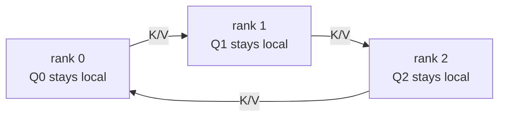

# cudnn_vsa

[English](README.md) | [简体中文](README.zh-CN.md)

<!-- Keep README.md and README.zh-CN.md synchronized, including examples and benchmark data. -->

Packed multimodal attention for DiT/MMDiT training:
**cuDNN block-sparse fine attention + FA4 varlen coarse attention**.

## Install

With CUDA-enabled PyTorch installed, run from the repository root:

```bash
python -m pip install -r requirements.txt
```

## Use

Inputs are separate, contiguous BF16 `q`, `k`, `v`, `gate` tensors of shape
`[T, H, 128]`. Output preserves the input token order.

```python
import torch
from vsa import vsa_attention
from vsa_layout import Segment, build_vsa_layout

# One 720p 5s video and two independent 720p images, each with text.
H, D = 2, 128
layout = build_vsa_layout(
    samples=[
        [Segment("video", (31, 45, 80), sparsity=0.9), Segment("text", 2048)],
        [Segment("video", (1, 45, 80), sparsity=None), Segment("text", 2048)],
        [Segment("video", (1, 45, 80), sparsity=None), Segment("text", 2048)],
    ],
    head_num=H,
    dense_query_full=False,
    device="cuda",
)
q, k, v, gate = [
    torch.randn(layout.tokens, H, D, device="cuda", dtype=torch.bfloat16,
                requires_grad=True)
    for _ in range(4)
]
out = vsa_attention(q, k, v, gate, layout)
out.backward(torch.randn_like(out))
```

Each inner list is an independent sample; attention never crosses samples.
Inputs follow the declared sample/segment order, with video in FHW raster order.
Each sample needs at least one video: `(F, H, W)` gives its token grid, and
`F=1` denotes an image. Text, audio and keyframe segments use token counts and
`sparsity=None`; additional video/image segments are allowed. Reuse layouts
across layers with the same geometry and settings.

Add this directory to `PYTHONPATH`, or copy `vsa.py`, `vsa_core.py`,
`vsa_layout.py` and `vsa_kernels.py` into your project and adjust imports.

## Input order

`layout.input_order` explicitly declares the token order:

| `input_order` | Input tokens | Slot conversion |
| --- | --- | --- |
| `"raster"` (default) | Original sample/segment order, video in FHW order | Reorder into blocks and add padding |
| `"block"` | Valid tokens in the block order below, no padding | Add padding only; skip conversion when every local slot is valid |

### Raster input

The default `input_order="raster"` accepts the original FHW sequence, as in
the example above. `vsa_attention` reorders and pads it internally, then
restores the output to the same raster order. No preprocessing is required.

### Block input

Block input contains only valid tokens in block order, without padding.
For raster data, reorder **once before the layer stack**, then keep this order:

```python
from vsa import raster_to_block_wo_padding

layout = build_vsa_layout(samples, head_num=H, input_order="block", device="cuda")
tokens_block = raster_to_block_wo_padding(tokens_global, vsa_layout=layout)
position_ids_block = raster_to_block_wo_padding(position_ids_global, vsa_layout=layout)
```

The caller declares `input_order`; VSA does not detect the tensor's actual row
order. Positions, targets and masks must use the same row mapping.

## Attention semantics

`sparsity` is a video segment's **KV-block drop fraction**. By default, every
query block and head independently selects top-k blocks from **each** video KV
region, including cross-video attention:

```text
k = max(1, ceil((1 - sparsity) * video_region_blocks))
```

The KV segment sets the budget; Q/K determines the selected blocks.
`sparsity=None` makes a region dense: its KV blocks are always visible, with
padding only. Numeric sparsity uses 4×4×4 video tiles; `0` keeps all those blocks.

[FastH3](https://github.com/hao-ai-lab/FastVideo/blob/d5253fd71055927f12aa6c4aa679b93a00238851/fastvideo/attention/backends/video_sparse_attn_h3.py#L27-L31)
adds a query-side exception: dense queries see **all** KV blocks.
`dense_query_full=True` enables that exception; the default `False` applies
video KV sparsity to every query. Dense queries come from `sparsity=None` regions.

Example fine masks for one sample/head at sparsity 0.5. Both axes follow the
internal block order: **None-sparsity segments first, numeric-sparsity video
segments second**. `■` visible; `□` masked.
Top-k selections are illustrative.

**`dense_query_full=False` (default)**

```text
           Dense KV    Video KV
           0 1         2 3 4 5
Dense Q0   ■ ■         □ ■ ■ □
Dense Q1   ■ ■         ■ □ □ ■
Video Q2   ■ ■         ■ □ ■ □
Video Q3   ■ ■         □ ■ □ ■
Video Q4   ■ ■         ■ ■ □ □
Video Q5   ■ ■         □ □ ■ ■
```

**`dense_query_full=True` (FastH3 dense-query rule)**

```text
           Dense KV    Video KV
           0 1         2 3 4 5
Dense Q0   ■ ■         ■ ■ ■ ■
Dense Q1   ■ ■         ■ ■ ■ ■
Video Q2   ■ ■         ■ □ ■ □
Video Q3   ■ ■         □ ■ □ ■
Video Q4   ■ ■         ■ ■ □ □
Video Q5   ■ ■         □ □ ■ ■
```

For samples with numeric sparsity, coarse attention covers BF16-pooled blocks
from **all segments**, producing `fine + gate * coarse[its_block]` per token.
A sample whose segments all have `sparsity=None` uses **full attention through
BSA**, with no coarse branch. This is how the independent images above are
handled; a dense image inside a VSA sample still participates in coarse.

## Ring context parallelism

Pass an existing Ring process group to the same layout builder and attention API:

```python
layout = build_vsa_layout(
    samples, head_num=H, input_order="block", device="cuda",
    ring_cp_group=group, ring_partition="cyclic",  # Or "contiguous".
)
# Global raster inputs -> this Ring rank's compact block stream, once per pack.
tokens_local = raster_to_block_wo_padding(tokens_global, vsa_layout=layout)
position_ids_local = raster_to_block_wo_padding(position_ids_global, vsa_layout=layout)
# Project tokens_local into local Q/K/V/gate before attention:
out = vsa_attention(q, k, v, gate, layout)
```

Here `H` is the head count seen by VSA.
`ring_cp_group=None` creates a full `VSALayout` (`layout.ring is None`),
without distributed initialization, including on CPU. A member group creates
a local Ring layout and supplies its rank and size. Nonmember handles are
rejected; even a size-one group requires block input.

Create groups once, share them across micro-batch layouts, and reuse each
layout across layers. All group members must supply the same global sample
geometry, head count and partition policy. Forward and backward share the
same `ring_cp_group`.

### Block ownership

When calling `vsa_attention` in Ring mode, Q/K/V/gate must follow the layout's
local block order: only valid tokens from this rank's owned blocks, in
increasing global block-ID order, without padding.
`raster_to_block_wo_padding` fuses selection and reordering without a full
block-ordered intermediate or communication.

`ring_partition` chooses ownership independently of `input_order`; the choice
is stored in `layout.ring.partition`:

| `ring_partition` | Global block ownership |
| --- | --- |
| `"cyclic"` (default) | Block `b` belongs to rank `b % R`; global numbering continues across samples |
| `"contiguous"` | Each sample contributes at most one consecutive block interval to each rank |

For contiguous ownership, start at rank 0. For each sample's N blocks, compute
`base, extra = divmod(N, R)`: visiting ranks cyclically from the current start,
assign `base + 1` consecutive blocks to the first `extra` ranks and `base` to
the rest. Advance the start by `extra` modulo R, so the next sample begins at
the first rank that received fewer blocks. If `extra=0`, keep the start.

Both policies balance per-sample and cumulative block counts within one.
They do not balance valid-token counts or dynamic top-k work. Cyclic ownership
spreads neighboring blocks across ranks; contiguous ownership makes each
sample's rank-local interval simple to slice. Both use the same attention
kernels. Changing policy requires rebuilding the layout and resharding inputs.

The pack must contain at least R blocks so every Ring rank owns valid data.
Individual samples need no token/block divisibility by R and may be absent
from some ranks. Internally every rank has `C = ceil(global_blocks / R)`
blocks of 64 slots; partial and dummy slots are excluded from the math.

### Worked example: two samples on three ranks

With `R=3`, sample A contains text block `b0` and video blocks `b1..b4`
(`sparsity=0.5`). Sample B has two blocks: `b5` contains dense image tokens,
and `b6` contains text tokens.
Global block IDs continue across samples.

| Policy | Sample / count | Rank 0 | Rank 1 | Rank 2 |
| --- | --- | --- | --- | --- |
| `contiguous` | A | `b0, b1` | `b2, b3` | `b4` |
| `contiguous` | B | `b6` | — | `b5` |
| `contiguous` | Total blocks | 3 | 2 | 2 |
| `cyclic` | A | `b0, b3` | `b1, b4` | `b2` |
| `cyclic` | B | `b6` | — | `b5` |
| `cyclic` | Total blocks | 3 | 2 | 2 |

With `contiguous`, A starts at rank 0 and gives `[2, 2, 1]` blocks to ranks
0/1/2. B starts at rank 2, which received fewer blocks, and gives one block
each to ranks 2 and 0. The next sample starts at rank 1.
The routing and execution examples below use the `contiguous` allocation.

### Routing and top-k

1. [vsa_layout.py](vsa_layout.py)'s `_build_sample_blocks` fixes sample boundaries
   and each video's `keep = max(1, ceil((1 - sparsity) * region_blocks))` budget.
   Selected IDs change with Q/K on every forward; dense KV is always included.
2. [vsa_core.py](vsa_core.py)'s `ring_attention_slots` pools local Q/K/V in FP32
   using valid token counts; dummy means are zero. K/V summaries are all-gathered
   in rank order, then `global_to_gather` restores global block order and removes
   dummies. Local Q means now see all candidate K means in their own sample.
3. The shared `route` / `_route_group` computes unscaled FP32 `Q_mean @ K_mean.T`
   with TF32/autocast disabled. Each Q block/head selects top-k independently
   within each video region, across all peers. `topk(..., sorted=False)` returns
   relative IDs; `selected.sort(-1)` and `+ start` produce sorted global IDs.
   Dense KV and fully retained regions use static templates; exempt dense Q
   rows (`dense_query_full=True`) skip top-k. No dynamic selections means the
   template is reused directly. Routing runs under `no_grad`; gradients pass
   through fine/coarse attention, not discrete selection. Global K means avoid
   any extra score/index collective. Attention applies softmax scaling later.
4. [vsa_kernels.py](vsa_kernels.py)'s `partition_indices` maps selected global IDs
   to each owner's local block IDs and valid counts, using `global_to_gather`.
   A peer can contribute zero keys. These lists drive fine attention as K/V arrives.

For sample A above, four video blocks at sparsity 0.5 give `keep=2`. Suppose
one head of query block `b3` has these scores:

```text
Video KV block       b1    b2    b3    b4
Q_mean @ K_mean.T   0.2   0.8   0.1   0.9
Selected video IDs        b2          b4
Final global IDs:   [b0, b2, b4]   (b0 is the always-visible text block)
```

For R=3, the peer lists are rank 0 `[0]` (global `b0`), rank 1 `[0]` (global
`b2`) and rank 2 `[0]` (global `b4`). A Q block in sample A never considers B's
`b5/b6`. With multiple video regions, each region gets its own top-k budget;
there is no single top-k across all video regions in the pack.

### Execution

Both modes share differentiable FP32 `block_means`. Single-device execution
selects coarse blocks and fuses routing detach/coarse casts in
`routing_and_coarse_means`. Ring pools all local slots, including zero dummies.
Its `_GatherMeans` packs **FP32 K + BF16 V** as raw bytes in one all-gather,
without quantizing K. V is cast inside the communication autograd boundary;
backward combines dK/dV in one **FP32 reduce-scatter SUM**, returning FP32
pooling gradients. Forward summary traffic is 25% smaller than FP32 K/V;
collective counts remain one forward and one backward.

For the example above, let `KV_r` be rank r's entire internal K/V shard,
including its slot padding. Q stays on its original rank throughout fine
attention; K/V moves to the next group rank:



| Fine-attention step | Rank 0 uses | Rank 1 uses | Rank 2 uses |
| --- | --- | --- | --- |
| 0: own shard | `Q0, KV0` | `Q1, KV1` | `Q2, KV2` |
| 1: after one hop | `Q0, KV2` | `Q1, KV0` | `Q2, KV1` |
| 2: after two hops | `Q0, KV1` | `Q1, KV2` | `Q2, KV0` |

Each step evaluates only the selected KV blocks owned by that peer. For
example, global `b5` maps to rank-major position 7: owner `7 // 3 = 2`,
local block `7 % 3 = 1`. When rank 0 receives `KV2`, its B query block `b6`
may attend to B's `b5`; its A query blocks cannot attend to `b5`. The **layout/router** enforce this
sample isolation through the block lists. The **transport** just moves
buffers; it does not interpret FHW coordinates or infer THD sample boundaries.
Partial outputs are weighted using their log-sum-exp normalizers so the final
fine output has one softmax normalization over all selected KV blocks.

After enqueuing the fine pass, `coarse_attention` uses local pooled Q and
global pooled K/V in BF16, with separate per-sample Q/KV boundaries. Q/K means
are cast at the coarse boundary; V means already arrive in BF16.
Coarse attention covers all blocks in each participating sample, independently
of the fine top-k lists. `vsa_attention` restores compact valid rows and merges
`fine + gate * coarse[query_block]`. Entirely dense samples use fine only.

Backward traverses the ring in reverse, using the final fine output and
log-sum-exp, and accumulates dQ/dK/dV in FP32. The pooled-mean gather has a
reduce-scatter adjoint. Ranks without local coarse queries still participate
in the required collectives; saved receive buffers support retained-graph
backward.

Set transport options on `build_vsa_layout`, alongside `ring_cp_group`.
`ring_cp_batch_p2p=None` uses individual P2P for lazy NCCL groups and batched
P2P for device-bound groups, using the same mode in forward and backward.
A boolean selects that mode explicitly.
`ring_cp_bwd_bucket_size="auto"` uses 64 query blocks per backward bucket for
SM100, H=2, one sample and 128 physical local blocks; other shapes use the
backend default. Pass `None` for the backend default everywhere, or a positive
integer to select a bucket size.

### Forward communication overlap

To give Ring P2P communication a high-priority NCCL stream, create the group
once during parallel initialization. Reuse it across layouts and layers:

```python
import torch.distributed as dist

# Call on all WORLD ranks in the same group-creation order, before building layouts.
options = dist.ProcessGroupNCCL.Options()
options.is_high_priority_stream = True
group = dist.new_group(ranks=ring_ranks, backend="nccl", pg_options=options)
# Member ranks reuse this group for every micro-batch's layout.
layout = build_vsa_layout(
    samples, head_num=H, input_order="block", device="cuda",
    ring_cp_group=group,
)
out = vsa_attention(q, k, v, gate, layout)
```

`ring_cp_group` carries forward pooled all-gather and fine P2P, and backward
P2P and pooled-gradient reduce-scatter. Its priority applies to both directions.

Enqueuing P2P before BSA does not guarantee that its GPU kernel starts first.
BSA and NCCL can compete for SM resources, including shared memory. With
ordinary-priority streams, a pending NCCL kernel can wait until BSA's last
thread blocks. High priority lets pending NCCL work acquire freed resources
earlier; it does not preempt already running thread blocks. CUDA Graph replay
must honor captured node priorities (`cudaGraphInstantiateFlagUseNodePriority`);
check this in the PyTorch build used for training.

Priority belongs to the process group's internal NCCL stream. Changing only
the stream around `isend`/`irecv` is insufficient. VSA borrows the supplied
groups and does not replace them or modify global scheduling settings. The
benchmark's `--high-priority-group` uses the configuration above.
Omitting `--high-priority-group` uses an ordinary-priority group. High priority
also affects backward, even if backward P2P was already overlapped.
The pooled collectives use synchronous APIs. Some PyTorch versions run them
on the current CUDA stream, so their kernel priorities can differ from the
group's asynchronous P2P stream. Inspect the captured nodes in the target build.
Compare full forward/backward latency as well as trace overlap: communication
still consumes SM and memory bandwidth, and pooled-mean collectives have their
own data dependencies.

### Why this design

- **Whole-block ownership** keeps each pooling/routing/BSA unit on one Ring
  rank. Compact inputs avoid sending attention-slot padding through projections
  and MLPs; reordering happens once at the model boundary.
- **Two ownership policies** support different workloads. Cyclic spreads
  neighboring blocks; contiguous gives each sample/rank one interval and rotates
  remainder recipients. Both compute ownership once and reuse the maps in all layers.
- **Global block summaries** let local Q choose top-k over the full sample and
  compute coarse attention. Fine attention circulates token-level K/V through
  two receive/compute buffers; Q, output accumulation and dQ stay local.
- **Equal internal capacities** give matching P2P shapes and support CUDA Graph
  reuse. Valid sizes and explicit sample boundaries exclude padding and prevent
  cross-sample attention, including when fine-only and coarse samples share ranks.

Fine attention sends **whole padded K/V shards**, even when few blocks from a
peer are selected. Sparsity reduces compute, not these bytes; pooled K/V still
requires a global gather, and larger rings add hops. Partial blocks, sample
lengths, sparsity and selected owners affect load balance and overlap.
Compare full-workload latency for both policies; balanced block counts and
visible P2P overlap alone do not guarantee better throughput.

## Examples with and without context parallelism

The following example uses two attention layers with residual connections and
one optimizer step. It supports all three modes through the same VSA API.
The entire process world is one context-parallel group; `H` must be divisible
by the Ulysses size `U`, and the world size must equal `U * R`.

| Mode | Input preparation before the layers | Q/K/V/gate passed to VSA |
| --- | --- | --- |
| No CP (`U=1, R=1`) | Keep raster order | All tokens and all heads |
| Ulysses only (`U>1, R=1`) | Split the raster stream into U token slices | All tokens and H/U heads after All-to-All |
| Ring + Ulysses (`U>1, R>1`) | Select whole Ring-owned blocks and reorder once; then split each compact Ring stream into U token slices | This Ring owner's valid tokens and H/U heads after All-to-All |

Ulysses All-to-All reconstructs the token stream before VSA runs: raster order
without Ring, compact block order with Ring.
Only trailing **transport padding** is added to equalize Ulysses message sizes;
it is removed before attention and excluded from the loss. This is separate
from VSA's internal 64-slot block padding.

### No CP

Save the shared Python example below as `demo_cp.py` in this repository, then run:

```bash
python demo_cp.py
```

### Ulysses CP only

Use raster input as in the no-CP example. Four GPUs split tokens before the
layers and exchange tokens for heads inside each layer; no input reorder is needed:

```bash
torchrun --standalone --nproc-per-node=4 demo_cp.py --ulysses-size 4
```

### Ring + Ulysses CP

For eight GPUs with `U=4, R=2`, Ulysses groups are `[0,1,2,3]` and
`[4,5,6,7]`; Ring groups are `[0,4]`, `[1,5]`, `[2,6]`, `[3,7]`.
Each Ring pair handles the same head slice and complementary block ownership.
Both ownership policies use the same preparation and attention calls:

```bash
torchrun --standalone --nproc-per-node=8 demo_cp.py \
  --ulysses-size 4 --ring-size 2 --ring-partition cyclic
torchrun --standalone --nproc-per-node=8 demo_cp.py \
  --ulysses-size 4 --ring-size 2 --ring-partition contiguous
```

### Shared example

This example uses PyTorch's differentiable All-to-All, replicated weights and
the same full raster pack on every rank. Ulysses, projections, loss normalization
and gradient reduction are caller code. For clarity, it materializes a Ring
shard before the Ulysses slice; data loading can gather the final local rows
directly by composing those maps.

<details>
<summary>Complete Python example: demo_cp.py</summary>

```python
import argparse
import os

import torch
import torch.distributed as dist
import torch.nn.functional as F
from torch.distributed.nn.functional import all_to_all_single

from vsa import raster_to_block_wo_padding, vsa_attention
from vsa_layout import Segment, build_vsa_layout


def exchange_heads(mixed, group):
    # [A,H,4,D] -> four [U*A,H/U,D] tensors; backward exchanges gradients.
    if group is None:
        return mixed.unbind(2)
    u = dist.get_world_size(group)
    a, h, n, d = mixed.shape
    send = mixed.reshape(a, u, h // u, n, d).transpose(0, 1).contiguous()
    recv = all_to_all_single(torch.empty_like(send), send, group=group)
    return recv.reshape(u * a, h // u, n, d).unbind(2)


def exchange_tokens(out, group):
    # [U*A,H/U,D] -> [A,H,D], reversing the forward head exchange.
    if group is None:
        return out
    u = dist.get_world_size(group)
    t, h, d = out.shape
    send = out.reshape(u, t // u, h, d).contiguous()
    recv = all_to_all_single(torch.empty_like(send), send, group=group)
    return recv.permute(1, 0, 2, 3).reshape(t // u, u * h, d)


parser = argparse.ArgumentParser()
parser.add_argument("--ulysses-size", type=int, default=1)
parser.add_argument("--ring-size", type=int, default=1)
parser.add_argument("--ring-partition", choices=("cyclic", "contiguous"), default="cyclic")
args = parser.parse_args()
U, R, H, D = args.ulysses_size, args.ring_size, 8, 128
input_order = "block" if R > 1 else "raster"
C = H * D
world = int(os.environ.get("WORLD_SIZE", "1"))
if U < 1 or R < 1 or H % U or world != U * R:
    parser.error("Require U >= 1, R >= 1, H % U == 0 and WORLD_SIZE == U * R")
device = torch.device("cuda", int(os.environ.get("LOCAL_RANK", "0")))
torch.cuda.set_device(device)
rank = 0
if world > 1:
    dist.init_process_group("nccl")
    rank = dist.get_rank()

# All ranks create all subgroups in the same order, once before the layers.
ulysses_group = ring_group = None
if U > 1:
    for r in range(R):
        group = dist.new_group(list(range(r * U, (r + 1) * U)))
        if rank // U == r:
            ulysses_group = group
if R > 1:
    for u in range(U):
        group = dist.new_group([r * U + u for r in range(R)])
        if rank % U == u:
            ring_group = group

samples = [
    [Segment("video", (5, 9, 11), sparsity=0.9), Segment("text", 67)],
    [Segment("video", (1, 3, 5)), Segment("text", 7)],
]
T = sum(segment.tokens for sample in samples for segment in sample)  # 584
layout = build_vsa_layout(
    samples, head_num=H // U, input_order=input_order, device=device,
    ring_cp_group=ring_group, ring_partition=args.ring_partition,
)
torch.manual_seed(1234)  # Identical mock input and replicated weights on all ranks.
tokens_global = torch.randn(T, C, device=device, dtype=torch.bfloat16)
# Row IDs illustrate the mapping; use the model's original coordinates for RoPE.
position_ids_global = torch.arange(T, device=device)

# Ring only: reorder and select whole blocks before the layers.
tokens_attention = tokens_global
position_ids_attention = position_ids_global
if R > 1:
    tokens_attention = raster_to_block_wo_padding(tokens_global, vsa_layout=layout)
    position_ids_attention = raster_to_block_wo_padding(position_ids_global, vsa_layout=layout)

# Equal Ulysses capacity across Ring owners, including partial edge blocks.
max_tokens = layout.tokens
if layout.ring is not None:
    max_tokens = int(layout.ring.peer_block_sizes.sum(dim=1).max().item())
A = (max_tokens + U - 1) // U
tail = U * A - layout.tokens
start = (rank % U) * A
x = F.pad(tokens_attention, (0, 0, 0, tail))[start:start + A].contiguous()
position_ids_local = F.pad(position_ids_attention, (0, tail), value=-1)[start:start + A]
valid = torch.arange(start, start + A, device=device) < layout.tokens

layers = torch.nn.ModuleList([
    torch.nn.ModuleList([
        torch.nn.Linear(C, 4 * C, bias=False, device=device, dtype=torch.bfloat16),
        torch.nn.Linear(C, C, bias=False, device=device, dtype=torch.bfloat16),
    ]) for _ in range(2)
])
optimizer = torch.optim.SGD(layers.parameters(), lr=1e-3)
for qkvg_projection, output_projection in layers:
    mixed = qkvg_projection(x).view(A, H, 4, D)
    q, k, v, gate = (
        t[:layout.tokens].contiguous() for t in exchange_heads(mixed, ulysses_group)
    )
    # If applying RoPE here, use position_ids_attention for these unpadded rows.
    out = vsa_attention(q, k, v, gate, layout)
    out = F.pad(out, (0, 0, 0, 0, 0, tail))
    out = exchange_tokens(out, ulysses_group).reshape(A, C)
    x = (x + output_projection(out)).masked_fill(~valid[:, None], 0)

# Sum local contributions to a global-token-normalized illustrative loss.
loss = x.float().square().masked_fill(~valid[:, None], 0).sum() / (T * C)
loss.backward()
if world > 1:
    # SUM, not average: each local loss already uses the global denominator.
    for parameter in layers.parameters():
        dist.all_reduce(parameter.grad, op=dist.ReduceOp.SUM)
optimizer.step()
reported_loss = loss.detach()
if world > 1:
    dist.all_reduce(reported_loss, op=dist.ReduceOp.SUM)
if rank == 0:
    print(f"U={U}, R={R}, order={input_order}, loss={reported_loss.item():.6f}")
if world > 1:
    dist.destroy_process_group()
```

</details>

For the example, each layer projects `[A, 1024]` into Q/K/V/gate with shape
`[A, 8, 128]`. After Ulysses exchange and removal of transport padding, each
has shape `[layout.tokens, 8/U, 128]`; the inverse exchange and output
projection restore `[A, 1024]`. With no CP, `A = layout.tokens = 584`.
The output stays in the rank's input order across layers. Apply the same row
selection to targets and masks; preserve original position values rather than
renumbering the local shard. Collect output token shards only if the application
needs a full global tensor after the stack; attention's internal Ring merging
is already handled by VSA.
When using a training framework's parameter-gradient reduction, use that
instead of the example's manual reduction, so gradients are not reduced twice.

## Performance

MFU counts valid attention GEMM FLOPs; backward is twice forward. Padding,
routing and non-GEMM operations are excluded from the FLOP numerator. Per-GPU
TFLOP/s divides global FLOPs by latency and GPU count; MFU divides that value
by the dense BF16 peak (`--peak-tflops`). Phase medians are independent.
One-time input sharding/reordering, graph capture and profiling are outside
timing; attention's slot conversion and padding are included.

Environment: GB200 (2500 TFLOP/s BF16), PyTorch 2.12.0a0/NV26.04, CUDA 13.2, cuDNN 9.22 / frontend 1.28.0, Triton 3.6, CuTe 4.6.2, FA4 4.0.0b35.

`benchmark.perf_vsa` supports ordinary and distributed workloads (`--ring`).
Both modes share input generation, numerical checks, graph capture and timing.
`--cases` selects workloads, `--heads` selects head counts, `--check-only` runs
reference and retained-backward checks, and `--output` accepts a JSON file or
directory. The `vsa-perf/v4` JSON uses `<case>-h<heads>` keys; each case records
checks, global useful FLOPs and per-GPU throughput/MFU. Ring timing takes the
maximum rank latency for each replay before summarizing. Ring defaults to H=2 and omits traces;
add `--profile` to save a trace per rank.
Use the same explicit `--seed` in both modes when comparing performance:
the defaults are 2026 for ordinary VSA and 937 for Ring. Matched seeds,
geometry and head counts generate identical global Q/K/V/gate tensors and
upstream output gradients (dY).

### Single-device 720p5s: FA4 full and VSA

The benchmark packs one 720p 5-second video and two independent 720p images,
each with text: 121 video frames, 4× temporal and 16× spatial compression,
2048 text tokens per sample, 124944 tokens total, H=2/4, D=128, video sparsity
0.9, `dense_query_full=False`. VSA uses the default `input_order="raster"`.

```bash
# VSA forward/backward time, MFU and torch traces.
python -m benchmark.perf_vsa --peak-tflops 2500
# FA4 full vs VSA, alternating order on the same GPU.
python -m benchmark.compare --peak-tflops 2500 --warmup 30 --repeats 500 --rounds 2
```

Both use CUDA Graph and validate replay against eager execution. VSA timing
covers slot conversion, pooling, routing, fine, coarse, restoration and merge.
`benchmark/results/perf_vsa/` contains `perf.json` and
`perf-default-h{2,4}-rank0.trace.json`; traces are collected after timing.
Use `--input-order block` to measure compact block inputs, `--eager` for eager
execution, or `--no-profile` to omit traces. Input generation/reordering is
outside timing. The comparison writes `benchmark/results/compare.json`.

| Method | H | Forward ms | Forward MFU | Backward ms | Backward MFU | F+B ms | F+B TFLOP/s | F+B MFU |
|---|---:|---:|---:|---:|---:|---:|---:|---:|
| FA4 full | 2 | 9.357 | 56.82% | 25.409 | 41.85% | 34.772 | 1146.72 | 45.87% |
| cuDNN VSA (raster) | 2 | 2.366 | 24.81% | 6.746 | 17.40% | 9.114 | 482.91 | 19.32% |
| FA4 full | 4 | 19.001 | 55.96% | 50.988 | 41.71% | 70.019 | 1138.94 | 45.56% |
| cuDNN VSA (raster) | 4 | 4.665 | 25.15% | 13.352 | 17.57% | 18.017 | 488.36 | 19.53% |

CUDA Graph, 30 warmups per measurement, two rounds of 500 timed replays per
method. FA4 full and VSA alternate order on the same GPU. Each time column is
an independent median over 1000 replays. These are standalone operator
measurements; raster-to-slot reordering and padding are included in VSA time.

### Single-head 720p44s: ordinary VSA and Ring4

The `thd720p44s` case matches the attention geometry inside the 128-GPU
DiT U32/R4 configuration, after the Ulysses exchange. It runs only VSA:
pooling, routing, fine/coarse attention, gated merge and their backward,
with Ring communication. QKV/output projections, Ulysses, MoE and optimizer
work are outside this benchmark.

| Setting | Value |
|---|---|
| Video token grid | `265 x 45 x 80`, sparsity `0.9` |
| Independent image token grid | `1 x 45 x 80`, dense attention |
| Text | 2048 tokens per sample |
| Global packed tokens | 961696: video/text 956048, image/text 5648 |
| Ring size / heads / head dimension | `4 / 1 / 128` |
| Compact tokens, cyclic ranks 0/1/2/3 | `240436 / 240420 / 240420 / 240420` |
| Compact tokens, contiguous ranks 0/1/2/3 | `243904 / 242880 / 242832 / 232080` |
| Input order / precision | Compact block order / BF16 |

One head is correct here: the model's 32 heads have already been divided by
U32. Contiguous Ring ranks receive 232k–244k valid tokens for that head, averaging
240,424. The ranks own `4051 / 4050 / 4050 / 4050` blocks; partial blocks
account for the unequal valid token counts. These are token counts after the
Ulysses exchange; input tensors have no padding, and VSA manages its internal
64-token attention slots.

```bash
# Full sequence on one GPU, with the same global inputs and block order.
python -m benchmark.perf_vsa --heads 1 --cases thd720p44s --seed 937 \
  --input-order block --warmup 10 --repeats 50 --profile \
  --peak-tflops 2500 --output benchmark/results/single_720p44s/perf.json

# Compare both ownership policies on the same four GPUs and global inputs.
for partition in cyclic contiguous; do
  torchrun --standalone --nproc-per-node=4 --module benchmark.perf_vsa --ring \
    --ring-size 4 --ring-partition "$partition" --heads 1 --cases thd720p44s \
    --seed 937 --batch-p2p --high-priority-group --bwd-bucket-size backend \
    --warmup 10 --repeats 50 --profile --peak-tflops 2500 \
    --output "benchmark/results/ring4_720p44s/$partition/perf.json"
done
```

CUDA Graph is enabled by default. Both commands validate outputs and all
input gradients against single-device VSA, retained backward, and graph
replay with original/changed inputs before timing. The Ring command writes
`perf-group0.json` and `perf-group0-thd720p44s-h1-rank{0,1,2,3}.trace.json`.
Each trace captures one additional full forward/backward replay after the
timed samples. JSON records `ring_partition`, phase latency, TFLOP/s/GPU and MFU.
Inputs are seeded random tensors; matching geometry does not reproduce a
particular model layer's routing decisions.

#### Cyclic versus contiguous

The two supported ownership policies were compared in a separate four-GB200
allocation, in cyclic / contiguous / contiguous / cyclic order. Each run uses
10 warmups and 50 timed graph replays; values are medians of two run medians,
with maximum rank latency per replay. All reference and graph checks passed.

| Ring4 ownership | Forward ms | Backward ms | F+B ms | F+B TFLOP/s/GPU | F+B MFU |
|---|---:|---:|---:|---:|---:|
| Contiguous | 16.090 | 51.370 | 66.661 | 477.54 | 19.10% |
| Cyclic | 16.186 | 51.691 | 67.197 | 473.73 | 18.95% |

The 0.8% total-time difference applies to these random inputs. Actual model
routing can concentrate selected KV blocks by peer, so benchmark both policies
in the model as well. This allocation did not repeat ordinary VSA; the matched
ordinary/Ring comparison below is a separate measurement.

#### Ordinary VSA versus Ring4

Measured in one four-GB200 allocation with the software environment above.
Ordinary VSA runs the full sequence on one GPU without a process group;
Ring4 in the table uses **contiguous ownership**, all four GPUs, the high-priority group and
backend-default backward buckets above. Both use **961,696 global tokens,
H=1, D=128, compact block input and seed 937**. Global input hashes and useful
FLOP counts match.

| Phase | Ordinary ms | Ordinary TFLOP/s | Ordinary MFU | Ring4 ms | Ring4 TFLOP/s/GPU | Ring4 MFU | Parallel efficiency |
|---|---:|---:|---:|---:|---:|---:|---:|
| Forward | 58.193 | 729.38 | 29.18% | 15.556 | 682.14 | 27.29% | 93.52% |
| Backward | 179.412 | 473.15 | 18.93% | 50.403 | 421.05 | 16.84% | 88.99% |
| Forward + backward | 237.707 | 535.68 | 21.43% | 65.210 | 488.17 | 19.53% | 91.13% |

Each mode has two runs of 10 warmups and 50 timed CUDA Graph replays. Ring
timing takes the maximum rank latency for each replay; the table reports the
median of each mode's two run medians.

With fixed global work, speedup is `T1 / T4` and parallel efficiency is
`T1 / (4 * T4)`, equivalently `MFU4 / MFU1`. Here the full pass achieves
**3.645x speedup and 91.13% efficiency**. This comparison includes
communication, changes in kernel shape, extra accumulation and load imbalance;
it does not isolate communication cost. P2P overlap alone does not establish
zero communication overhead.

The example uses four GPUs on one host. To measure a Ring spanning hosts,
use one process per GPU and the normal torchrun rendezvous arguments,
keeping the same benchmark flags. Record the actual fabric placement:
single-host NVLink overlap is not representative of a Ring crossing NVLink
domains, and a four-GPU run does not reproduce 32 concurrent Ring groups.
Standalone useful-FLOP MFU counts valid attention pairs only; the DiT model
ledger also includes projections/MoE and counts physical fine-attention
block slots, so their MFU values have different numerators.

## Tests

The tests cover both input orders against independent token math, fused
single-tensor reorder round trips across row shapes/dtypes, padding and their adjoints,
and CUDA Graph replay of reorder/attention/restore with original and changed
inputs. GPU tests are skipped when CUDA is unavailable.

```bash
python -m pip install 'pytest>=8'
python -m pytest -q -m 'not fastvideo'

# Optional FastH3 reference
python -m pip install -r tests/requirements-fastvideo.txt
python -m pytest -q tests/test_fastvideo.py
```

For ring validation, all workers must have CUDA and NCCL. Small cases compare
output and Q/K/V/gate gradients with independent token math; 64k cases compare
against single-device VSA. Retained backward and CUDA Graph replay with
original/changed inputs are checked before timing. Repeat with
`--dense-query-full` for the alternate dense-query policy.

```bash
# Ragged samples and partial/dummy slots; every rank owns valid blocks.
torchrun --standalone --nproc-per-node=8 --module benchmark.perf_vsa --ring \
  --cases ragged
# Interleaved groups; partial_blocks has three blocks and requires R<=3.
torchrun --standalone --nproc-per-node=8 --module benchmark.perf_vsa --ring \
  --ring-size 2 --cases ragged partial_blocks dense
# Device-bound groups and batched P2P.
torchrun --standalone --nproc-per-node=4 --module benchmark.perf_vsa --ring \
  --eager-group --cases ragged dense
# Single/packed 64k workloads, plus timing after numerical checks.
torchrun --standalone --nproc-per-node=8 --module benchmark.perf_vsa --ring \
  --high-priority-group --cases single64k thd64k --warmup 30 --repeats 500
# Strict reproduction of the known fine-only-sample numerical failure.
torchrun --standalone --nproc-per-node=8 --module benchmark.perf_vsa --ring \
  --ring-size 2 --cases fine_only_peer --check-only
```

Ring tests use block input. Defaults are `ragged`, `single64k` and `thd64k`;
each case needs at least R global blocks. The small `partial_blocks`,
`fine_only_peer` and `dense` cases contain 3, 2 and 6 blocks respectively.
For multiple nodes, replace `--standalone` with torchrun rendezvous arguments.
JSON records numerical/graph checks and source hashes; timing and MFU follow
the definitions in **Performance**. Use `thd720p44s` for the long-sequence profile.

The strict BF16 `fine_only_peer` case has an unresolved numerical failure:
dQ and dK for a six-token fine-only sample can fall below the 0.99999 native
reference similarity threshold. The command above reports this failure;
the case and threshold remain unchanged.

## Code structure

| File | Responsibility |
| --- | --- |
| `vsa.py` | Public attention entry and explicit block/raster reorder helpers |
| `vsa_core.py` | Routing, cuDNN BSA/FA4 calls, single-device execution and ring communication/autograd |
| `vsa_layout.py` | Static sample/block geometry, row maps, routing templates and coarse boundaries |
| `vsa_kernels.py` | Fused token reordering, slot gathers, Q/K/V padding, FP32 pooling and gated merge kernels |

Both input orders share the core's attention math, per-region budgets and
fine-before-coarse schedule. The core does not import the public entry.

<details>
<summary>Exact block order and a small example</summary>

1. Keep sample order. Within each sample, place `sparsity=None` segments first,
   then numeric-sparsity videos, preserving segment order within each category.
2. Split None-sparsity segments into consecutive chunks of at most 64 tokens.
   Split numeric-sparsity videos into 4×4×4 tiles, visiting tile origins and
   valid tokens in F/H/W order (W fastest). Clip edge tiles without padding.
3. Blocks never cross segment or sample boundaries. Numeric `sparsity=0`
   still uses tiles; `sparsity=None` uses dense chunks. Ring keeps owned blocks
   in increasing global block-ID order, preserving order within each block.

For `video=(1, 2, 5), sparsity=0.9` followed by three text tokens, raster rows
`0..9` are video and `10..12` are text. The block stream is:

| Block | Original raster rows, in supplied order | Valid tokens |
| --- | --- | ---: |
| b0: text | `10, 11, 12` | 3 |
| b1: first video tile | `0, 1, 2, 3, 5, 6, 7, 8` | 8 |
| b2: edge video tile | `4, 9` | 2 |

The input has 13 rows; attention internally allocates 3×64 slots. Changing
this video's sparsity to `None` preserves video-before-text order and creates
blocks of 10 and 3 tokens. `layout.input_rows` maps each supplied row back to
its global raster row; `raster_to_block_wo_padding(x, vsa_layout=layout)` equals
`x[layout.input_rows]` by value.

</details>

<details>
<summary>Reorder operators and layout maps</summary>

| Conversion | Where | Forward / output restoration |
| --- | --- | --- |
| Raster → padded blocks | Inside each VSA call with raster input | `raster_to_block_w_padding` for each of Q/K/V; `block_w_padding_to_raster` restores raster output |
| Raster → compact blocks | Once before the layer stack | `raster_to_block_wo_padding`, also selecting Ring-owned blocks; `block_wo_padding_to_raster` restores a full layout |
| Compact → padded blocks | Inside each VSA call with block input | `block_wo_padding_to_block_w_padding`; `block_w_padding_to_block_wo_padding` removes output padding |

Names state source order, destination order and padding: `w_padding` means
with block padding, and `wo_padding` means without it. The `_qkv` variant,
`block_wo_padding_to_block_w_padding_qkv`, fuses three tensors and is used by
`vsa_attention`; the unsuffixed version converts one tensor. Fusion shares one
map and kernel launch for Q/K/V, also in backward, instead of three separate
launches. It covers padding/restoration, not the QKV linear projection. These slot helpers
live in `vsa_kernels.py`; the two raster/compact boundary helpers live in `vsa.py`.

The boundary helper `raster_to_block_wo_padding` accepts one contiguous CUDA
`[T_global, ...]` tensor and returns `[layout.tokens, ...]`, preserving dtype
and trailing dimensions. It adds no padding and selects owned rows for Ring.
Both boundary helpers require `input_order="block"`; the layout describes VSA's
input order. For full layouts only, restore
raster output after the stack with
`block_wo_padding_to_raster(out_block, vsa_layout=layout)`.

The per-layer conversions run inside `vsa_attention`, after any Ulysses head
exchange. Input order selects the conversion; Ulysses itself requires neither
order. Ring requires compact block input. The padding here is VSA's 64-slot
block padding, separate from the caller's Ulysses tail padding.

All three conversions support autograd. Slot-conversion backward uses inverse
row maps; compact Q/K/V gradients are restored together. Boundary-reorder
backward scatters into the original raster shape. For Ring, unowned rows get
zero gradients, without cross-rank reduction. This input-reorder adjoint does
not collect output token shards. Optional reconstruction of a full global
output after the stack is caller-owned; VSA already handles the attention
result merging within the Ring.

`layout.input_rows` maps supplied rows to global raster rows (identity for a
full raster layout). `tokens`, `blocks` and row/slot maps are local;
`groups`, `sample_slices` and `sample_lengths` describe global samples.
`slot_row` maps 64-token slots to input rows (`-1` for padding), and `row_slot`
is the inverse on valid rows. Padding is zero and excluded from means and attention.

The three kernel implementations are `_reorder_tokens_kernel` (boundary
gather/scatter), `_gather` (single-tensor slots), and `_gather_qkv` (fused Q/K/V
slots). Opposite directions reuse these kernels. `slots_are_input` skips slot
conversion only for block input with `tokens == blocks * 64` and no
partial/dummy blocks; raster input always takes the raster-to-slot path.

`layout.ring` stores the group/options, rank/size, global token count, block
ownership, peer sizes and the all-gather permutation. With capacity C,
`p = layout.ring.global_to_gather[b]` gives `owner = p // C` and
`local_block = p % C`. `layout.ring.block_ids` lists local global IDs, with
`-1` for dummy blocks. All ranks derive these maps from geometry without
communication. Coarse Q boundaries are local, while KV boundaries span the
global sample; full layouts share Q/KV boundary and block-ID tensors.

</details>

## Acknowledgements

Thanks to [FastVideo / FastH3](https://github.com/hao-ai-lab/FastVideo/blob/d5253fd71055927f12aa6c4aa679b93a00238851/fastvideo/attention/backends/video_sparse_attn_h3.py)
for the VSA reference and semantics, and
[NVIDIA cuDNN BSA](https://github.com/NVIDIA/cudnn-frontend/blob/v1.28.0/python/cudnn/block_sparse_attention/_interface.py)
for the core block-sparse attention kernels used by this implementation.

[MIT License](LICENSE).
