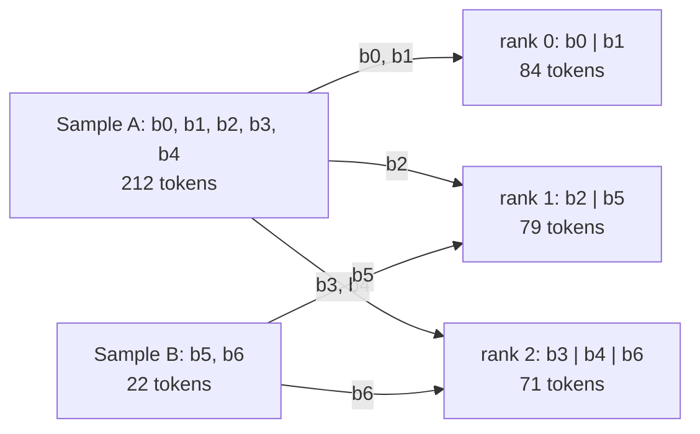
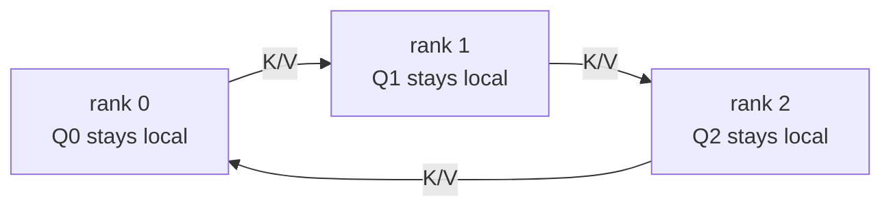

# cudnn_vsa

Packed multimodal attention for DiT/MMDiT training:
**cuDNN block-sparse fine attention + FA4 varlen coarse attention**.

## Install

With CUDA-enabled PyTorch installed, run from the repository root:

```bash
python -m pip install -r requirements.txt
```

## Use

Inputs are separate, contiguous BF16 `q`, `k`, `v`, `gate` tensors of shape
`[T, H, 128]`. Output preserves the input token order.

```python
import torch
from vsa import vsa_attention
from vsa_layout import Segment, build_vsa_layout

# One 720p 5s video and two independent 720p images, each with text.
H, D = 2, 128
layout = build_vsa_layout(
    samples=[
        [Segment("video", (31, 45, 80), sparsity=0.9), Segment("text", 2048)],
        [Segment("video", (1, 45, 80), sparsity=None), Segment("text", 2048)],
        [Segment("video", (1, 45, 80), sparsity=None), Segment("text", 2048)],
    ],
    head_num=H,
    dense_query_full=False,
    device="cuda",
)
q, k, v, gate = [
    torch.randn(layout.tokens, H, D, device="cuda", dtype=torch.bfloat16,
                requires_grad=True)
    for _ in range(4)
]
out = vsa_attention(q, k, v, gate, layout)
out.backward(torch.randn_like(out))
```

Each inner list is one joint sample; different samples cannot attend to each
other. With the default raster order, inputs follow the sample and segment
order in `samples`. Each sample contains at least one video, with optional
additional video/image, text, audio
or keyframe segments. Video sizes are `(F, H, W)` token grids in raster order;
`F=1` is an image. Other segment kinds take token counts and use `sparsity=None`.
Reuse the layout across layers with the same geometry and settings.

Add this directory to `PYTHONPATH`, or copy `vsa.py`, `vsa_core.py`,
`vsa_layout.py` and `vsa_kernels.py` into your project and adjust imports.

## Input order

`layout.input_order` explicitly declares the token order:

| `input_order` | Input tokens | Slot conversion |
| --- | --- | --- |
| `"raster"` (default) | Original sample/segment order, video in FHW order | Reorder into blocks and add padding |
| `"block"` | Compact canonical blocks, no padding | Add padding only; skip copies for full blocks |

### Raster input

The default `input_order="raster"` accepts the original FHW sequence, as in
the example above. `vsa_attention` reorders and pads it internally, then
restores the output to the same raster order. No preprocessing is required.

### Block input

Pass `input_order="block"` to `build_vsa_layout` when the caller already
supplies block-ordered tokens. Samples stay in declared order. Within each
sample, dense segments come first in chunks of at most 64 tokens, followed by
numeric-sparsity video segments in 4×4×4 tiles. Segment order is preserved
within each category; blocks never cross segment or sample boundaries.
`layout.input_rows[i]` gives the original raster row for supplied row `i`
(an identity map for raster inputs). Apply the same ordering to Q/K/V, gate,
positional coordinates and dO. Outputs and gradients preserve that order.

For raster data, call `to_block_order` once before the entire VSA stack.
This repository provides the fused reorder kernel separately from
`vsa_attention`: it permutes one token tensor in one kernel launch,
preserving its shape and dtype and adding **no padding**. Inputs that are
already in block order go directly to attention. Keep that order across layers.

`to_block_order(x, vsa_layout=layout)` accepts one contiguous CUDA
`[T_global, ...]` raster tensor. A full layout returns all rows in block order;
a Ring layout selects and reorders only this rank's rows in one kernel,
returning `[layout.tokens, ...]`. Both preserve dtype and trailing dimensions.
The inverse `to_raster_order(x, vsa_layout=layout)` requires a **full** layout.
Both helpers require `input_order="block"`: the layout describes the target
block order even when `x` enters in raster order.
Call the forward helper at the stack's input boundary and the inverse helper
at its output boundary if raster output is needed. Subsequent token-wise
projections produce Q/K/V/gate in block order directly. Positional coordinates
must follow the same order; callers can generate them in block order or
convert their coordinate tensor separately.

```python
import torch
from vsa import to_block_order, to_raster_order, vsa_attention
from vsa_layout import Segment, build_vsa_layout

H, D, C = 2, 128, 256
layout = build_vsa_layout(
    [[Segment("video", (5, 9, 11), sparsity=0.9), Segment("text", 67)]],
    head_num=H, input_order="block", device="cuda",
)
tokens = torch.randn(layout.tokens, C, device="cuda", dtype=torch.bfloat16,
                     requires_grad=True)
projection = torch.nn.Linear(C, 4 * H * D, device="cuda", dtype=torch.bfloat16)

# One reorder at the input boundary, before the layers' projections.
tokens_block = to_block_order(tokens, vsa_layout=layout)
assert tokens_block.shape == tokens.shape  # 562 valid tokens, no input padding.

# One example VSA layer; intermediate layers retain block order.
projected = projection(tokens_block).view(layout.tokens, 4, H, D)
q, k, v, gate = (x.contiguous() for x in projected.unbind(1))
out = vsa_attention(q, k, v, gate, layout)

# Restore once at the output boundary if raster output is required.
out_raster = to_raster_order(out, vsa_layout=layout)
out_raster.backward(torch.randn_like(out_raster))
```

The reorder's backward applies the inverse permutation to gradients. The
inverse helper restores original sample/segment/FHW order after the stack.

Internally, blocks occupy 64 slots: `slot_row` maps slots to input rows, using
`-1` for padding, and `row_slot` is the inverse map for valid rows. Block inputs
use fused Q/K/V padding and fused dQ/dK/dV restoration; padding is zero and
excluded from means and attention. `slots_are_input` skips conversion for
full block inputs. Full raster blocks still require the FHW permutation.

## Code structure

| File | Responsibility |
| --- | --- |
| `vsa.py` | Public attention entry and explicit block/raster reorder helpers |
| `vsa_core.py` | Routing, cuDNN BSA/FA4 calls, single-device execution and ring communication/autograd |
| `vsa_layout.py` | Static sample/block geometry, row maps, routing templates and coarse boundaries |
| `vsa_kernels.py` | Fused token reordering, slot gathers, Q/K/V padding, FP32 pooling and gated merge kernels |

Both input orders share the core's attention math, per-region budgets and
fine-before-coarse schedule. The core does not import the public entry.

## Ring context parallelism

Ordinary VSA and Ring use the same forward API:

```python
layout = build_vsa_layout(
    samples, head_num=H, input_order="block", device=device,
    ring_cp_group=group,  # Existing caller-owned group; None selects ordinary VSA.
)
out = vsa_attention(q, k, v, gate, layout)
```

Pass the existing process group when constructing the layout. Rank and size
come from that group; they are not separate builder arguments. Forward and
backward use the bound groups without additional Ring arguments. By default,
both use `ring_cp_group`. Optionally pass `ring_cp_bwd_group` to use another
caller-owned group for backward P2P and pooled-gradient reduce-scatter. Its
members and group-rank order must match the forward group; mismatches are
rejected when constructing the layout.
All group ranks use identical global sample/segment metadata and the same
heads. Layout rank and size refer to that group, including interleaved groups.
The caller creates the group once during parallel initialization and owns its
lifetime. Different micro-batches can build different layouts referencing the
same group or pair of groups. Constructing or releasing a layout never creates or destroys a
process group. Reuse a layout when geometry, policy, heads and device match.

`build_vsa_layout` is the only public layout builder. `ring_cp_group=None`
builds a full input (`layout.ring is None`); a member `ProcessGroup` builds a
local shard with its group reference and distribution metadata in `layout.ring`.
Both return `VSALayout`. A size-one group still builds a Ring shard.
Ring construction requires `input_order="block"`; full layouts default to
`"raster"`.
Full layouts work on CPU without distributed initialization; Ring layouts
require the caller's existing group. Nonmember group handles are rejected.
`to_block_order` accepts both full and Ring block layouts. `to_raster_order`
requires a full layout; it does not implicitly gather distributed outputs.

Full inputs and Ring shards share slot maps, routing-template construction and
coarse Q/KV metadata. `tokens`, `blocks` and row/slot maps describe the input
held locally; `groups`, `sample_slices` and `sample_lengths` describe global
samples. `layout.ring` holds `group`, `bwd_group`, group-local `size`/`rank`, global counts, block
ownership, peer lengths and the all-gather permutation. Coarse Q boundaries
are local and KV boundaries cover the corresponding global samples; full
layouts share the same Q/KV boundary and block-ID tensors. This metadata
unification preserves the separate single-device and Ring execution paths.
The groups and transport options are bound at construction and cannot be
reassigned on Ring metadata.

### Compact input and block ownership

Ring layouts require `input_order="block"`, including size-one groups. Each
rank supplies only its valid local tokens in increasing owned-block order,
without padding. Keep Q/K/V/gate, position coordinates and gradients in that
same order; outputs preserve it. Reuse the layout across layers.

Plan blocks in the order described in **Input order**, numbering them across
packed samples. For each sample, assign at most one **contiguous block interval**
to each rank. Visit ranks by cumulative valid-token load from all earlier
samples; ties use cumulative block count, then group rank. The least-loaded
rank with remaining capacity receives the first interval. Choose each cut
nearest to the cumulative per-rank token target, subject to the remaining
ranks' capacity and reserving data for ranks that have not received a block.
A rank can receive no blocks from an individual sample.

Every rank has a hard capacity of `C = ceil(global_blocks / R)` blocks. The
planner therefore keeps the same communication-buffer size as an even
block-count split while adjusting cuts for partial blocks and earlier samples.
Each block stays within one segment and sample; samples remain isolated during
routing and attention. Neither a sample's token count nor its block count
needs to be a multiple of R. The total block count must be at least R; smaller
packs are rejected on every rank. Every rank receives valid input tokens.
Internal buffers pad partial and dummy blocks to 64 slots.

Ownership is explicit: `p = layout.ring.global_to_gather[b]` maps global block
`b` to rank-major storage, so `owner = p // C` and `local_block = p % C`.
`layout.ring.block_ids` lists this rank's global IDs, with `-1` for dummy blocks.
All ranks derive the same maps from the sample geometry, without communication.

For a Ring shard, `layout.input_rows` maps local compact rows to the original
global sample/segment/FHW stream. `to_block_order` uses this map to fuse **shard
selection and reordering**: it reads only owned rows and does not materialize
an intermediate full block-ordered tensor. If every rank has the full raster
pack, prepare inputs once before the stack:

```python
from vsa import to_block_order

layout = build_vsa_layout(
    samples, head_num=H, input_order="block", device="cuda",
    ring_cp_group=group,
)
# tokens_global: [layout.ring.global_tokens, C], in sample/segment/FHW order.
# position_ids_global: [T_global] or [T_global, axes], aligned with those tokens.
tokens_local = to_block_order(tokens_global, vsa_layout=layout)
position_ids_local = to_block_order(position_ids_global, vsa_layout=layout)
# Build local RoPE cos/sin from position_ids_local; reuse across layers with
# the same RoPE configuration. Preserve each sample's original position values.
# Use the same helper for aligned target/mask tensors when needed.
assert tokens_local.shape == (layout.tokens, tokens_global.shape[1])
# Token-wise projections and all VSA layers now consume the local block order.
```

The helper adds no padding and performs no communication. Its backward scatters
into the original global shape, with zero gradients at unowned rows; it does
not reduce gradients across ranks. Data loading and final output gathering
remain caller-owned. Already local block-ordered tensors bypass this helper.
A global block-ordered tensor is not a raster input: distribute whole blocks
using their ownership maps without applying the FHW conversion again.
Any Ulysses all-to-all is also caller-owned and must preserve local block order.

### Worked example: two samples on three ranks

Pack these independent samples, with R=3:

- **A:** sparse video `(4, 6, 8)` with `sparsity=0.5`, then 20 text tokens.
  Block order places text first: `b0` has 20 tokens; the four video tiles
  `b1..b4` have 64, 64, 32 and 32 tokens.
- **B:** a dense image `(1, 3, 5)` with `sparsity=None`, then 7 text tokens.
  Both segments are dense, so their declared order is retained: `b5` has
  15 image tokens and `b6` has 7 text tokens.

Block IDs continue across samples. A has five blocks and B has two; neither
count is divisible by R. Arrows below show the one-time distribution at the
dataset/model boundary. The rank boxes contain **only valid input tokens**.



Each rank concatenates its blocks in increasing global-ID order, preserving
valid-token order within each block. Rank 0 supplies 20 tokens from `b0`,
then 64 from `b1`, with no gaps. After A, cumulative loads are `[84, 64, 64]`
tokens and `[2, 1, 2]` blocks. B starts at `b5` on rank 1: it ties rank 2 in
tokens but has fewer blocks. Rank 2 receives `b6`; rank 0 receives none of B.

Attention internally allocates `ceil(7 / 3) = 3` blocks of 64 slots per rank:

| Group rank | Global block IDs in local slot order | Valid sizes per slot block | Compact input rows | Internal slot rows |
| --- | --- | --- | ---: | ---: |
| 0 | `b0, b1, dummy` | `20, 64, 0` | 84 | 192 |
| 1 | `b2, b5, dummy` | `64, 15, 0` | 79 | 192 |
| 2 | `b3, b4, b6` | `32, 32, 7` | 71 | 192 |

Unused slots are zero-filled and excluded from attention and pooling. The
caller supplies 234 valid tokens in total, not 576 slot rows. Q/K/V/gate and
positions use the same local order; the output and its gradients retain it.

### Routing and top-k

The routing code follows this sequence:

1. `_build_sample_blocks` in [vsa_layout.py](vsa_layout.py) records a separate
   budget for each numeric-sparsity video region: `keep = max(1, ceil((1 -
   sparsity) * region_blocks))`. Dense KV blocks are always included. These
   budgets and sample boundaries are static; selected video block IDs change
   with Q/K on each forward call.
2. `ring_attention_slots` in [vsa_core.py](vsa_core.py) computes local Q/K/V
   block means in FP32, dividing by valid token counts. Padding is zero and
   dummy blocks have zero means. Pooled K/V is all-gathered in rank order,
   then `layout.ring.global_to_gather` restores global block order and removes
   dummy blocks. Routing uses local Q means and globally ordered K means.
3. `route` is shared by full and Ring layouts. The layout precomputes each
   sample's local routing rows and offsets into pooled Q/K; `route` calls
   `_route_group` for those rows. For each video KV region and head, it forms FP32 scores
   `Q_mean @ K_mean.T`, with TF32 and autocast disabled, then selects that
   region's `keep` largest scores independently for every Q block. Routing
   uses unscaled dot products; attention applies its softmax scale later.
   Every peer's candidate blocks in that region participate in this one
   selection. No score or top-k-index collective is needed because each Q
   block has one owner and the K means are already global.
4. `topk(..., sorted=False)` chooses region-relative IDs; `selected.sort(-1)`
   sorts those IDs, and `+ start` converts them to global block IDs. Dense
   keys and fully retained regions come from the layout's template. With
   `dense_query_full=True`, dense Q rows keep their full-sample template and
   skip top-k; sparse video Q rows keep their regional budgets. Layouts with
   no dynamic selections reuse the template directly. Routing runs under
   `no_grad`: gradients flow through the selected fine attention and the
   coarse branch, not through discrete top-k decisions.
5. `partition_indices` in [vsa_kernels.py](vsa_kernels.py) groups selected IDs
   using the same `global_to_gather` map as pooled K/V. With capacity C, mapped
   position `p` gives `owner = p // C` and `local_block = p % C`. It records
   each peer's valid count. A peer may contribute zero selected keys. These
   per-peer lists drive fine attention as K/V shards arrive.

For sample A above, four video blocks at sparsity 0.5 give `keep=2`. Suppose
one head of query block `b3` has these scores:

```text
Video KV block       b1    b2    b3    b4
Q_mean @ K_mean.T   0.2   0.8   0.1   0.9
Selected video IDs        b2          b4
Final global IDs:   [b0, b2, b4]   (b0 is the always-visible text block)
```

For R=3, the peer lists are rank 0 `[0]` (global `b0`), rank 1 `[0]` (global
`b2`) and rank 2 `[1]` (global `b4`). A Q block in sample A never considers B's
`b5/b6`. With multiple video regions, each region gets its own top-k budget;
there is no single top-k across all video regions in the pack.

### Execution

Single-device and ring execution share `block_means`, which returns
differentiable FP32 Q/K/V means. Single-device execution selects coarse blocks
and fuses routing detach and coarse dtype conversion in `routing_and_coarse_means`.
Ring execution pools all local slots, including zero-filled dummy blocks;
`_GatherMeans` communicates K means in FP32 for routing and V means in BF16
for coarse attention, packing their raw bytes into one all-gather. This byte
packing preserves each field's bits without quantizing K. V is cast inside the
communication autograd boundary; backward combines dK/dV into one FP32
reduce-scatter SUM and returns FP32 gradients to pooling. Forward pooled K/V
payload is 25% smaller than sending both in FP32; the forward and backward
collective counts remain one each. End-to-end latency must still be measured.

Pool local Q/K/V in FP32 and all-gather pooled K/V for global per-region top-k
routing and coarse attention. Fine attention keeps Q local and circulates
BF16 K/V shards. Selected global block IDs are partitioned by owner and
translated into local slot IDs; partial outputs and log-sum-exp are merged
in FP32. Fine-attention kernels use these IDs and valid block sizes; the
layout and router enforce sample boundaries and KV budgets.

For the example above, let `KV_r` be rank r's entire internal K/V shard,
including its slot padding. Q stays on its original rank throughout fine
attention; K/V moves to the next group rank:



| Fine-attention step | Rank 0 uses | Rank 1 uses | Rank 2 uses |
| --- | --- | --- | --- |
| 0: own shard | `Q0, KV0` | `Q1, KV1` | `Q2, KV2` |
| 1: after one hop | `Q0, KV2` | `Q1, KV0` | `Q2, KV1` |
| 2: after two hops | `Q0, KV1` | `Q1, KV2` | `Q2, KV0` |

Each step evaluates only the selected KV blocks owned by that peer. For
example, global `b5` maps to rank-major position 4: owner `4 // 3 = 1`,
local block `4 % 3 = 1`. When rank 2 receives `KV1`, its B query block `b6`
may attend to B's `b5`; its A query blocks cannot attend to `b5`. The **layout/router** enforce this
sample isolation through the block lists. The **transport** just moves
buffers; it does not interpret FHW coordinates or infer THD sample boundaries.
Partial outputs are weighted using their log-sum-exp normalizers so the final
fine output has one softmax normalization over all selected KV blocks.

After enqueuing the fine pass, `coarse_attention` uses local pooled Q and
global pooled K/V in BF16, with separate per-sample Q/KV boundaries. Q/K means
are cast at the coarse boundary; V means already arrive in BF16.
Coarse attention covers all blocks in each participating sample, independently
of the fine top-k lists. `vsa_attention` restores compact valid rows and merges
`fine + gate * coarse[query_block]`. Entirely dense samples use fine only.

Backward traverses the ring in reverse, using the final fine output and
log-sum-exp, and accumulates dQ/dK/dV in FP32. The pooled-mean gather has a
reduce-scatter adjoint. Empty or fine-only peers still participate in the
required collectives; saved receive buffers support retained-graph backward.

Set transport options on `build_vsa_layout`, alongside `ring_cp_group`.
`ring_cp_batch_p2p=None` uses individual P2P for lazy NCCL groups and batched
P2P for device-bound groups, resolved independently for forward and backward.
A boolean selects that mode for both groups explicitly.
`ring_cp_bwd_bucket_size="auto"` uses 64 query blocks per backward bucket for
SM100, H=2, one sample and 128 physical local blocks; other shapes use the
backend default. Pass `None` for the backend default everywhere, or a positive
integer to select a bucket size.

### Forward communication overlap

To use high-priority forward communication and ordinary-priority backward
communication, create two NCCL groups once during parallel initialization.
Reuse the pair across layouts and layers:

```python
import torch.distributed as dist

# Call on all WORLD ranks in the same group-creation order, before building layouts.
options = dist.ProcessGroupNCCL.Options()
options.is_high_priority_stream = True
forward_group = dist.new_group(ranks=ring_ranks, backend="nccl", pg_options=options)
backward_options = dist.ProcessGroupNCCL.Options()
backward_options.is_high_priority_stream = False
backward_group = dist.new_group(ranks=ring_ranks, backend="nccl", pg_options=backward_options)
# Member ranks construct their layouts with the same pair for every micro-batch.
layout = build_vsa_layout(
    samples, head_num=H, input_order="block", device="cuda",
    ring_cp_group=forward_group, ring_cp_bwd_group=backward_group,
)
out = vsa_attention(q, k, v, gate, layout)
```

Forward pooled all-gather and fine KV P2P use `forward_group`; backward fine
P2P and pooled-gradient reduce-scatter use `backward_group`. Leaving
`ring_cp_bwd_group=None` reuses the forward group, preserving the original
single-group behavior. VSA borrows both handles; the caller owns creation and
destruction and keeps them alive through backward and CUDA Graph replay.

Enqueuing P2P before BSA does not guarantee that its GPU kernel starts first.
BSA and NCCL can compete for SM resources, including shared memory. With
ordinary-priority streams, a pending NCCL kernel can wait until BSA's last
thread blocks. High priority lets pending NCCL work acquire freed resources
earlier; it does not preempt already running thread blocks. CUDA Graph replay
must honor captured node priorities (`cudaGraphInstantiateFlagUseNodePriority`);
check this in the PyTorch build used for training.

Priority belongs to the process group's internal NCCL stream. Changing only
the stream around `isend`/`irecv` is insufficient. VSA borrows the supplied
groups and does not replace them or modify global scheduling settings. The
benchmark's `--forward-only-high-priority` creates the pair above.
`--high-priority-group` instead uses one high-priority group in both directions;
omitting both flags uses one ordinary-priority group. Both priority flags are
mutually exclusive. A high-priority group also affects backward when reused
there, even if backward P2P was already overlapped.
The pooled collectives use synchronous APIs. Some PyTorch versions run them
on the current CUDA stream, so their kernel priorities can differ from the
group's asynchronous P2P stream. Inspect the captured nodes in the target build.
Compare full forward/backward latency as well as trace overlap: communication
still consumes SM and memory bandwidth, and pooled-mean collectives have their
own data dependencies.

### Why this design

- **Keep the sparse-attention unit intact.** Pooling, routing and cuDNN BSA
  operate on whole blocks. A contiguous FHW sequence shard can split one
  4×4×4 tile across ranks. Ordering and distributing whole blocks once at the
  dataset/model boundary gives every block a single owner; subsequent layers
  can pool and project local tokens directly. Compact input also keeps slot
  padding out of the surrounding projections and MLPs.
- **Keep each sample's local blocks contiguous.** Assigning a single interval
  per sample/rank preserves local block order and simplifies the dataset's
  slicing. Carry cumulative valid-token loads across samples so later samples
  favor less-loaded ranks. Adjust cuts within the fixed block capacity; partial
  tiles can have very different valid lengths. Layout construction computes
  one ownership map, reused by pooled gather, routing and every VSA layer.
- **Keep global routing information small.** Local Q blocks need pooled K
  from candidate blocks across the full sample to preserve the per-region
  top-k budgets. Coarse attention also needs pooled K/V. Gathering one summary
  per block provides that view, while fine attention streams token-level K/V
  through two receive/compute buffers instead of storing all peers' full K/V
  at once. Q, output accumulation and dQ stay local.
- **Keep communication shapes predictable.** Equal internal slot capacities
  make P2P transfers match and support CUDA Graph reuse. Valid sizes and
  routing counts exclude partial/dummy slots from the math. Sample boundaries
  remain explicit metadata even when one rank holds blocks from several
  samples. Ranks with only fine-attention queries still participate in the
  pooled-gradient collective when other samples use coarse attention.

The tradeoff is that fine attention circulates **whole padded K/V shards**,
even when routing selects few blocks from a peer. Sparsity reduces attention
work but does not proportionally reduce these transferred bytes. Pooled K/V
is still gathered globally, and additional ranks add communication steps.
The contiguous planner is a deterministic token-load heuristic under a hard
block-capacity constraint. It does not guarantee equal token totals, equal
attention work or higher MFU: sample lengths, sparsity and selected KV owners
also affect compute and overlap. Benchmark the complete workload when changing
its distribution policy.

## Attention semantics

`sparsity` is a video segment's **KV-block drop fraction**. By default, every
query block and head independently selects top-k blocks from **each** video KV
region, including cross-video attention:

```text
k = max(1, ceil((1 - sparsity) * video_region_blocks))
```

The KV segment sets the budget; Q/K determines the selected blocks.
`sparsity=None` makes a region dense: its KV blocks are always visible, with
padding only. Numeric sparsity uses 4×4×4 video tiles; `0` keeps all those blocks.

[FastH3](https://github.com/hao-ai-lab/FastVideo/blob/d5253fd71055927f12aa6c4aa679b93a00238851/fastvideo/attention/backends/video_sparse_attn_h3.py#L27-L31)
adds a query-side exception: dense queries see **all** KV blocks.
`dense_query_full=True` enables that exception; the default `False` applies
video KV sparsity to every query. Dense queries come from `sparsity=None` regions.

Example fine masks for one sample/head at sparsity 0.5. Both axes follow the
internal block order: **dense first, video second**. `■` visible; `□` masked.
Top-k selections are illustrative.

**`dense_query_full=False` (default)**

```text
           Dense KV    Video KV
           0 1         2 3 4 5
Dense Q0   ■ ■         □ ■ ■ □
Dense Q1   ■ ■         ■ □ □ ■
Video Q2   ■ ■         ■ □ ■ □
Video Q3   ■ ■         □ ■ □ ■
Video Q4   ■ ■         ■ ■ □ □
Video Q5   ■ ■         □ □ ■ ■
```

**`dense_query_full=True` (FastH3 dense-query rule)**

```text
           Dense KV    Video KV
           0 1         2 3 4 5
Dense Q0   ■ ■         ■ ■ ■ ■
Dense Q1   ■ ■         ■ ■ ■ ■
Video Q2   ■ ■         ■ □ ■ □
Video Q3   ■ ■         □ ■ □ ■
Video Q4   ■ ■         ■ ■ □ □
Video Q5   ■ ■         □ □ ■ ■
```

For samples with numeric sparsity, coarse attention covers BF16-pooled blocks
from **all segments**, producing `fine + gate * coarse[its_block]` per token.
A sample whose segments all have `sparsity=None` uses **full attention through
BSA**, with no coarse branch. This is how the independent images above are
handled; a dense image inside a VSA sample still participates in coarse.

## Performance

The benchmark packs one 720p 5-second video and two independent 720p images,
each with text: 121 video frames, 4× temporal and 16× spatial compression,
2048 text tokens per sample, 124944 tokens total, H=2/4, D=128, video sparsity
0.9, `dense_query_full=False`. VSA uses the default `input_order="raster"`.

```bash
# VSA forward/backward time, MFU and torch traces.
python -m benchmark.perf_vsa --peak-tflops 2500
# FA4 full vs VSA, alternating order on the same GPU.
python -m benchmark.compare --peak-tflops 2500 --warmup 30 --repeats 500 --rounds 2
```

Both use CUDA Graph and validate replay against eager execution. Timing covers
packing, pooling, routing, fine, coarse, restoration and merge.
`benchmark/results/perf_vsa/` contains `perf.json` and
`perf-default-h{2,4}-rank0.trace.json`; traces are collected after timing.
Use `--input-order block` to measure compact block inputs, `--eager` for eager
execution, or `--no-profile` to omit traces. Input generation/reordering is
outside timing. The comparison writes `benchmark/results/compare.json`.

`benchmark.perf_vsa` also runs distributed workloads with `--ring` (commands
below). Both modes share input generation, numerical checks, graph capture and
timing. `--cases` selects workloads, `--heads` selects one or more head counts, `--check-only`
runs reference and retained-backward checks, and `--output` accepts a JSON file
or directory. The `vsa-perf/v4` JSON uses `<case>-h<heads>` keys; each case records
checks, global useful FLOPs and per-GPU throughput/MFU. Ring timing samples are
reduced across ranks before summarizing. Ring defaults to H=2 and omits traces;
add `--profile` to save a trace per rank.

### Standalone Ring4 profile at the 720p44s shape

The `thd720p44s` case matches the attention geometry inside the 128-GPU
DiT U32/R4 configuration, after the Ulysses exchange. It runs only VSA:
pooling, routing, fine/coarse attention, gated merge and their backward,
with Ring communication. QKV/output projections, Ulysses, MoE and optimizer
work are outside this benchmark.

| Setting | Value |
|---|---|
| Video token grid | `265 x 45 x 80`, sparsity `0.9` |
| Independent image token grid | `1 x 45 x 80`, dense attention |
| Text | 2048 tokens per sample |
| Global packed tokens | 961696: video/text 956048, image/text 5648 |
| Ring size / heads / head dimension | `4 / 1 / 128` |
| Compact input tokens at Ring ranks 0/1/2/3 | `240436 / 240420 / 240420 / 240420` |
| Input order / precision | Compact block order / BF16 |

One head is correct here: the model's 32 heads have already been divided by
U32. Each Ring rank therefore receives about 240k tokens for that head,
not the approximately 7.5k rows before the Ulysses exchange. Input tensors
have no padding; VSA manages its internal 64-token attention slots.

```bash
torchrun --standalone --nproc-per-node=4 --module benchmark.perf_vsa --ring \
  --ring-size 4 --heads 1 --cases thd720p44s --batch-p2p --forward-only-high-priority \
  --bwd-bucket-size backend --warmup 10 --repeats 50 --profile \
  --peak-tflops 2500 --output benchmark/results/ring4_720p44s/perf.json
```

CUDA Graph is enabled by default. This command validates outputs and all
input gradients against single-device VSA, retained backward, and graph
replay with original/changed inputs before timing. It writes
`perf-group0.json` and `perf-group0-thd720p44s-h1-rank{0,1,2,3}.trace.json`.
Each trace captures one additional full forward/backward replay after the
timed samples. JSON reports phase latency, TFLOP/s/GPU and MFU together.
Inputs are seeded random tensors; matching geometry does not reproduce a
particular model layer's routing decisions.

The example uses four GPUs on one host. To measure a Ring spanning hosts,
use one process per host and the normal torchrun rendezvous arguments,
keeping the same benchmark flags. Record the actual fabric placement:
single-host NVLink overlap is not representative of a Ring crossing NVLink
domains, and a four-GPU run does not reproduce 32 concurrent Ring groups.
Standalone useful-FLOP MFU counts valid attention pairs only; the DiT model
ledger also includes projections/MoE and counts physical fine-attention
block slots, so their MFU values have different numerators.

### FLOP accounting and single-device measurements

MFU counts each method's valid attention GEMM FLOPs; backward is twice forward.
Padding, routing and non-GEMM operations are excluded from the FLOP numerator.
Set `--peak-tflops` to your GPU's dense BF16 peak.

Environment: GB200 (2500 TFLOP/s BF16), PyTorch 2.12.0a0/NV26.04, CUDA 13.2, cuDNN 9.22 / frontend 1.28.0, Triton 3.6, CuTe 4.6.2, FA4 4.0.0b35.

| Method | H | Forward ms | Forward MFU | Backward ms | Backward MFU | F+B ms | F+B MFU |
|---|---:|---:|---:|---:|---:|---:|---:|
| FA4 full | 2 | 9.319 | 57.05% | 25.652 | 41.45% | 34.959 | 45.62% |
| cuDNN VSA (raster) | 2 | 2.364 | 24.83% | 6.753 | 17.38% | 9.117 | 19.31% |
| FA4 full | 4 | 18.790 | 56.59% | 51.389 | 41.38% | 70.210 | 45.43% |
| cuDNN VSA (raster) | 4 | 4.726 | 24.82% | 13.444 | 17.45% | 18.164 | 19.38% |

CUDA Graph, 30 warmups per measurement, two rounds of 500 timed replays per
method. FA4 full and VSA alternate order on the same GPU. Each time column is
an independent median over 1000 replays. These are standalone operator
measurements; raster-to-slot reordering and padding are included in VSA time.

## Tests

The tests cover both input orders against independent token math, fused
single-tensor reorder round trips across row shapes/dtypes, padding and their adjoints,
and CUDA Graph replay of reorder/attention/restore with original and changed
inputs. GPU tests are skipped when CUDA is unavailable.

```bash
python -m pip install 'pytest>=8'
python -m pytest -q -m 'not fastvideo'

# Optional FastH3 reference
python -m pip install -r tests/requirements-fastvideo.txt
python -m pytest -q tests/test_fastvideo.py
```

For ring validation, all workers must have CUDA and NCCL. Small cases compare
output and Q/K/V/gate gradients with independent token math; 64k cases compare
against single-device VSA. Retained backward and CUDA Graph replay with
original/changed inputs are checked before timing. Repeat with
`--dense-query-full` for the alternate dense-query policy.

```bash
# Ragged samples and partial/dummy slots; every rank owns valid blocks.
torchrun --standalone --nproc-per-node=8 --module benchmark.perf_vsa --ring \
  --cases ragged
# Interleaved groups; partial_blocks has three blocks and requires R<=3.
torchrun --standalone --nproc-per-node=8 --module benchmark.perf_vsa --ring \
  --ring-size 2 --cases ragged partial_blocks dense
# Device-bound groups and batched P2P.
torchrun --standalone --nproc-per-node=4 --module benchmark.perf_vsa --ring \
  --eager-group --cases ragged dense
# Single/packed 64k workloads, plus timing after numerical checks.
torchrun --standalone --nproc-per-node=8 --module benchmark.perf_vsa --ring \
  --high-priority-group --cases single64k thd64k --warmup 30 --repeats 500
# Strict reproduction of the known fine-only-sample precision limit.
torchrun --standalone --nproc-per-node=8 --module benchmark.perf_vsa --ring \
  --ring-size 2 --cases fine_only_peer --check-only
```

Ring input defaults to block order and rejects raster order. The default ring
cases are `ragged`, `single64k` and `thd64k`. Each chosen case must contain at
least R global blocks; undersized packs raise an error instead of creating
empty ranks. The small `partial_blocks`, `fine_only_peer` and `dense` cases
contain three, two and six blocks respectively. For multiple
nodes, replace `--standalone` with the usual torchrun rendezvous arguments.
Each JSON result records numerical/graph checks and source hashes. Distributed
timing takes the maximum latency across ranks for each replay; per-GPU MFU
divides global valid attention GEMM FLOPs by that time and R times the dense
BF16 GPU peak. Optional `single720p30s` and `thd720p30s` cases use a
`181x45x80` video grid with 2048 text tokens; the packed case adds one dense
image with its own text.

The strict `fine_only_peer` case has a known BF16 precision limitation: dK
for a six-token fine-only sample can fall below the unchanged 0.99999 native
reference similarity threshold. The command above reports failure when it
reproduces the limit. This case remains part of the validation surface.

[MIT License](LICENSE).

## Acknowledgements

Thanks to [FastVideo / FastH3](https://github.com/hao-ai-lab/FastVideo/blob/d5253fd71055927f12aa6c4aa679b93a00238851/fastvideo/attention/backends/video_sparse_attn_h3.py)
for the VSA reference and semantics, and
[NVIDIA cuDNN BSA](https://github.com/NVIDIA/cudnn-frontend/blob/v1.28.0/python/cudnn/block_sparse_attention/_interface.py)
for the core block-sparse attention kernels used by this implementation.
