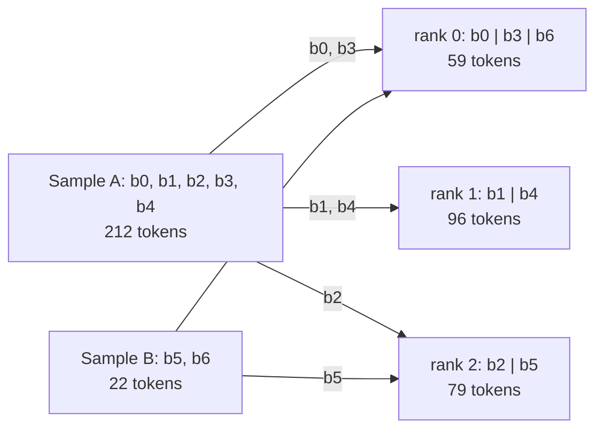
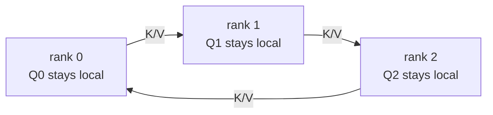

# cudnn_vsa

Packed multimodal attention for DiT/MMDiT training:
**cuDNN block-sparse fine attention + FA4 varlen coarse attention**.

## Install

With CUDA-enabled PyTorch installed, run from the repository root:

```bash
python -m pip install -r requirements.txt
```

## Use

Inputs are separate, contiguous BF16 `q`, `k`, `v`, `gate` tensors of shape
`[T, H, 128]`. Output preserves the input token order.

```python
import torch
from vsa import vsa_attention
from vsa_layout import Segment, build_vsa_layout

# One 720p 5s video and two independent 720p images, each with text.
H, D = 2, 128
layout = build_vsa_layout(
    samples=[
        [Segment("video", (31, 45, 80), sparsity=0.9), Segment("text", 2048)],
        [Segment("video", (1, 45, 80), sparsity=None), Segment("text", 2048)],
        [Segment("video", (1, 45, 80), sparsity=None), Segment("text", 2048)],
    ],
    head_num=H,
    dense_query_full=False,
    device="cuda",
)
q, k, v, gate = [
    torch.randn(layout.tokens, H, D, device="cuda", dtype=torch.bfloat16,
                requires_grad=True)
    for _ in range(4)
]
out = vsa_attention(q, k, v, gate, layout)
out.backward(torch.randn_like(out))
```

Each inner list is one joint sample; different samples cannot attend to each
other. With the default raster order, inputs follow the sample and segment
order in `samples`. Each sample contains at least one video, with optional
additional video/image, text, audio
or keyframe segments. Video sizes are `(F, H, W)` token grids in raster order;
`F=1` is an image. Other segment kinds take token counts and use `sparsity=None`.
Reuse the layout across layers with the same geometry and settings.

Add this directory to `PYTHONPATH`, or copy `vsa.py`, `vsa_core.py`,
`vsa_layout.py` and `vsa_kernels.py` into your project and adjust imports.

## Input order

`layout.input_order` explicitly declares the token order:

| `input_order` | Input tokens | Slot conversion |
| --- | --- | --- |
| `"raster"` (default) | Original sample/segment order, video in FHW order | Reorder into blocks and add padding |
| `"block"` | Compact canonical blocks, no padding | Add padding only; skip copies for full blocks |

### Raster input

The default `input_order="raster"` accepts the original FHW sequence, as in
the example above. `vsa_attention` reorders and pads it internally, then
restores the output to the same raster order. No preprocessing is required.

### Block input

Pass `input_order="block"` to `build_vsa_layout` when the caller already
supplies block-ordered tokens. Samples stay in declared order. Within each
sample, dense segments come first in chunks of at most 64 tokens, followed by
numeric-sparsity video segments in 4×4×4 tiles. Segment order is preserved
within each category; blocks never cross segment or sample boundaries.
`layout.input_rows[i]` gives the original raster row for supplied row `i`
(an identity map for raster inputs). Apply the same ordering to Q/K/V, gate,
positional coordinates and dO. Outputs and gradients preserve that order.

For raster data, call `to_block_order` once before the entire VSA stack.
This repository provides the fused reorder kernel separately from
`vsa_attention`: it permutes one token tensor in one kernel launch,
preserving its shape and dtype and adding **no padding**. Inputs that are
already in block order go directly to attention. Keep that order across layers.

`to_block_order(x, vsa_layout=layout)` takes and returns a single contiguous
CUDA `[T, ...]` tensor. The inverse `to_raster_order(x, vsa_layout=layout)` has
the same interface. Both require a full layout with `input_order="block"`:
the layout describes the block order even when `x` enters in raster order.
Call the forward helper at the stack's input boundary and the inverse helper
at its output boundary if raster output is needed. Subsequent token-wise
projections produce Q/K/V/gate in block order directly. Positional coordinates
must follow the same order; callers can generate them in block order or
convert their coordinate tensor separately.

```python
import torch
from vsa import to_block_order, to_raster_order, vsa_attention
from vsa_layout import Segment, build_vsa_layout

H, D, C = 2, 128, 256
layout = build_vsa_layout(
    [[Segment("video", (5, 9, 11), sparsity=0.9), Segment("text", 67)]],
    head_num=H, input_order="block", device="cuda",
)
tokens = torch.randn(layout.tokens, C, device="cuda", dtype=torch.bfloat16,
                     requires_grad=True)
projection = torch.nn.Linear(C, 4 * H * D, device="cuda", dtype=torch.bfloat16)

# One reorder at the input boundary, before the layers' projections.
tokens_block = to_block_order(tokens, vsa_layout=layout)
assert tokens_block.shape == tokens.shape  # 562 valid tokens, no input padding.

# One example VSA layer; intermediate layers retain block order.
projected = projection(tokens_block).view(layout.tokens, 4, H, D)
q, k, v, gate = (x.contiguous() for x in projected.unbind(1))
out = vsa_attention(q, k, v, gate, layout)

# Restore once at the output boundary if raster output is required.
out_raster = to_raster_order(out, vsa_layout=layout)
out_raster.backward(torch.randn_like(out_raster))
```

The reorder's backward applies the inverse permutation to gradients. The
inverse helper restores original sample/segment/FHW order after the stack.

Internally, blocks occupy 64 slots: `slot_row` maps slots to input rows, using
`-1` for padding, and `row_slot` is the inverse map for valid rows. Block inputs
use fused Q/K/V padding and fused dQ/dK/dV restoration; padding is zero and
excluded from means and attention. `slots_are_input` skips conversion for
full block inputs. Full raster blocks still require the FHW permutation.

## Code structure

| File | Responsibility |
| --- | --- |
| `vsa.py` | Public attention entry and explicit block/raster reorder helpers |
| `vsa_core.py` | Routing, cuDNN BSA/FA4 calls, single-device execution and ring communication/autograd |
| `vsa_layout.py` | Static sample/block geometry, row maps, routing templates and coarse boundaries |
| `vsa_kernels.py` | Fused token reordering, slot gathers, Q/K/V padding, FP32 pooling and gated merge kernels |

Both input orders share the core's attention math, per-region budgets and
fine-before-coarse schedule. The core does not import the public entry.

## Ring context parallelism

Use the same `vsa_attention` entry with a `RingVSALayout` and an explicit
`ring_cp_group`. Build the layout with `build_ring_vsa_layout(samples,
head_num=H, ring_size=dist.get_world_size(group), ring_rank=dist.get_rank(group),
device=device)`, then call
`vsa_attention(q, k, v, gate, layout, ring_cp_group=group)`.
All group ranks use identical global sample/segment metadata and the same
heads. Layout rank and size refer to that group, including interleaved groups.
The caller creates and owns the process group; `ring_cp_group=None` uses
single-device attention.

### Compact input and block ownership

Ring layouts require `input_order="block"`, including size-one groups. Each
rank supplies only its valid local tokens in increasing owned-block order,
without padding. Keep Q/K/V/gate, position coordinates and gradients in that
same order; outputs preserve it. Reuse the layout across layers.

Plan blocks in the order described in **Input order**, numbering them across
the packed samples. Global block `b` belongs to group rank `b % R`, at local
slot block `b // R`. For R=2, ranks own blocks `[0, 2, 4, ...]` and
`[1, 3, 5, ...]`. Every block stays within one segment and sample; samples
remain isolated during routing and attention. Neither a sample's token count
nor its block count needs to be a multiple of R. Ranks may own different
numbers of valid tokens or no valid tokens at all. Internal communication
buffers use `ceil(global_blocks / R)` blocks per rank, with zero padding for
partial and dummy blocks.

`RingVSALayout.input_rows` maps local compact rows to the original global
sample/segment/FHW coordinates. It is a shard map, whereas the full block
`VSALayout.input_rows` is a permutation of all tokens. If the model starts
in raster order, use `to_block_order` with a **full block VSALayout** once at
the input boundary, then distribute whole blocks according to their owners.
The dataset/model layer owns that distribution and final output gathering.
Generate or convert positions consistently. Equal contiguous token slices of
the full stream do not implement cyclic block ownership. Any Ulysses all-to-all
is also caller-owned and must preserve the required local block order.

### Worked example: two samples on three ranks

Pack these independent samples, with R=3:

- **A:** sparse video `(4, 6, 8)` with `sparsity=0.5`, then 20 text tokens.
  Block order places text first: `b0` has 20 tokens; the four video tiles
  `b1..b4` have 64, 64, 32 and 32 tokens.
- **B:** a dense image `(1, 3, 5)` with `sparsity=None`, then 7 text tokens.
  Both segments are dense, so their declared order is retained: `b5` has
  15 image tokens and `b6` has 7 text tokens.

Block IDs continue across samples. A has five blocks and B has two; neither
count is divisible by R. Arrows below show the one-time distribution at the
dataset/model boundary. The rank boxes contain **only valid input tokens**.



Each rank concatenates its blocks in increasing global-ID order, preserving
valid-token order within each block. For example, rank 0 supplies 20 tokens
from `b0`, then 32 from `b3`, then 7 from `b6`, with no gaps. B starts at `b5`
on rank 2; ownership does not restart at rank 0 for each sample.

Attention internally allocates `ceil(7 / 3) = 3` blocks of 64 slots per rank:

| Group rank | Global block IDs in local slot order | Valid sizes per slot block | Compact input rows | Internal slot rows |
| --- | --- | --- | ---: | ---: |
| 0 | `b0, b3, b6` | `20, 32, 7` | 59 | 192 |
| 1 | `b1, b4, dummy` | `64, 32, 0` | 96 | 192 |
| 2 | `b2, b5, dummy` | `64, 15, 0` | 79 | 192 |

Unused slots are zero-filled and excluded from attention and pooling. The
caller supplies 234 valid tokens in total, not 576 slot rows. Q/K/V/gate and
positions use the same local order; the output and its gradients retain it.

### Execution

Pool local Q/K/V in FP32 and all-gather pooled K/V for global per-region top-k
routing and coarse attention. Fine attention keeps Q local and circulates
BF16 K/V shards. Selected global block IDs are partitioned by owner and
translated into local slot IDs; partial outputs and log-sum-exp are merged
in FP32. Fine-attention kernels use these IDs and valid block sizes; the
layout and router enforce sample boundaries and KV budgets.

For the example above, let `KV_r` be rank r's entire internal K/V shard,
including its slot padding. Q stays on its original rank throughout fine
attention; K/V moves to the next group rank:



| Fine-attention step | Rank 0 uses | Rank 1 uses | Rank 2 uses |
| --- | --- | --- | --- |
| 0: own shard | `Q0, KV0` | `Q1, KV1` | `Q2, KV2` |
| 1: after one hop | `Q0, KV2` | `Q1, KV0` | `Q2, KV1` |
| 2: after two hops | `Q0, KV1` | `Q1, KV2` | `Q2, KV0` |

Each step evaluates only the selected KV blocks owned by that peer. For
example, global `b5` maps to owner `5 % 3 = 2`, local block `5 // 3 = 1`.
When rank 0 receives `KV2`, its B query block `b6` may attend to B's `b5`;
its A query blocks cannot attend to `b5`. The **layout/router** enforce this
sample isolation through the block lists. The **transport** just moves
buffers; it does not interpret FHW coordinates or infer THD sample boundaries.
Partial outputs are weighted using their log-sum-exp normalizers so the final
fine output has one softmax normalization over all selected KV blocks.

Backward traverses the ring in reverse, using the final fine output and
log-sum-exp, and accumulates dQ/dK/dV in FP32. The pooled-mean gather has a
reduce-scatter adjoint. Empty or fine-only peers still participate in the
required collectives; saved receive buffers support retained-graph backward.

`ring_cp_batch_p2p=None` uses individual P2P for lazy NCCL groups and batched
P2P for device-bound groups. A boolean selects either mode explicitly.
Caller-created high-priority NCCL groups can improve overlap.
`ring_cp_bwd_bucket_size="auto"` uses 64 query blocks per backward bucket for
SM100, H=2, one sample and 128 physical local blocks; other shapes use the
backend default. Pass `None` for the backend default everywhere, or a positive
integer to select a bucket size.

### Why this design

- **Keep the sparse-attention unit intact.** Pooling, routing and cuDNN BSA
  operate on whole blocks. A contiguous FHW sequence shard can split one
  4×4×4 tile across ranks. Ordering and distributing whole blocks once at the
  dataset/model boundary gives every block a single owner; subsequent layers
  can pool and project local tokens directly. Compact input also keeps slot
  padding out of the surrounding projections and MLPs.
- **Use a simple, reusable ownership map.** `owner = b % R` and
  `local_block = b // R` let every rank translate global routing decisions
  without exchanging token-location maps on each layer. Consecutive blocks
  from a long sample spread across ranks. Continuing the cycle across samples
  distributes the total block count with at most one block's difference
  between ranks, including short samples and partial tiles. Token counts and
  compute can still differ, as the example shows.
- **Keep global routing information small.** Local Q blocks need pooled K
  from candidate blocks across the full sample to preserve the per-region
  top-k budgets. Coarse attention also needs pooled K/V. Gathering one summary
  per block provides that view, while fine attention streams token-level K/V
  through two receive/compute buffers instead of storing all peers' full K/V
  at once. Q, output accumulation and dQ stay local.
- **Keep communication shapes predictable.** Equal internal slot capacities
  make P2P transfers match and support CUDA Graph reuse. Valid sizes and
  routing counts exclude partial/dummy slots from the math. Sample boundaries
  remain explicit metadata even when one rank holds blocks from several
  samples; empty ranks still participate in the communication schedule.

The tradeoff is that fine attention circulates **whole padded K/V shards**,
even when routing selects few blocks from a peer. Sparsity reduces attention
work but does not proportionally reduce these transferred bytes. Pooled K/V
is still gathered globally, and additional ranks add communication steps.
Cyclic ownership is therefore a simple block-count distribution, not a
guarantee of balanced compute or higher MFU for every workload.
The cyclic rule is a layout policy: another whole-block partition would need
corresponding ownership and index mappings in this implementation.

## Attention semantics

`sparsity` is a video segment's **KV-block drop fraction**. By default, every
query block and head independently selects top-k blocks from **each** video KV
region, including cross-video attention:

```text
k = max(1, ceil((1 - sparsity) * video_region_blocks))
```

The KV segment sets the budget; Q/K determines the selected blocks.
`sparsity=None` makes a region dense: its KV blocks are always visible, with
padding only. Numeric sparsity uses 4×4×4 video tiles; `0` keeps all those blocks.

[FastH3](https://github.com/hao-ai-lab/FastVideo/blob/d5253fd71055927f12aa6c4aa679b93a00238851/fastvideo/attention/backends/video_sparse_attn_h3.py#L27-L31)
adds a query-side exception: dense queries see **all** KV blocks.
`dense_query_full=True` enables that exception; the default `False` applies
video KV sparsity to every query. Dense queries come from `sparsity=None` regions.

Example fine masks for one sample/head at sparsity 0.5. Both axes follow the
internal block order: **dense first, video second**. `■` visible; `□` masked.
Top-k selections are illustrative.

**`dense_query_full=False` (default)**

```text
           Dense KV    Video KV
           0 1         2 3 4 5
Dense Q0   ■ ■         □ ■ ■ □
Dense Q1   ■ ■         ■ □ □ ■
Video Q2   ■ ■         ■ □ ■ □
Video Q3   ■ ■         □ ■ □ ■
Video Q4   ■ ■         ■ ■ □ □
Video Q5   ■ ■         □ □ ■ ■
```

**`dense_query_full=True` (FastH3 dense-query rule)**

```text
           Dense KV    Video KV
           0 1         2 3 4 5
Dense Q0   ■ ■         ■ ■ ■ ■
Dense Q1   ■ ■         ■ ■ ■ ■
Video Q2   ■ ■         ■ □ ■ □
Video Q3   ■ ■         □ ■ □ ■
Video Q4   ■ ■         ■ ■ □ □
Video Q5   ■ ■         □ □ ■ ■
```

For samples with numeric sparsity, coarse attention covers BF16-pooled blocks
from **all segments**, producing `fine + gate * coarse[its_block]` per token.
A sample whose segments all have `sparsity=None` uses **full attention through
BSA**, with no coarse branch. This is how the independent images above are
handled; a dense image inside a VSA sample still participates in coarse.

## Performance

The benchmark packs one 720p 5-second video and two independent 720p images,
each with text: 121 video frames, 4× temporal and 16× spatial compression,
2048 text tokens per sample, 124944 tokens total, H=2/4, D=128, video sparsity
0.9, `dense_query_full=False`. VSA uses the default `input_order="raster"`.

```bash
# VSA forward/backward time, MFU and torch traces.
python -m benchmark.perf_vsa --peak-tflops 2500
# FA4 full vs VSA, alternating order on the same GPU.
python -m benchmark.compare --peak-tflops 2500 --warmup 30 --repeats 500 --rounds 2
```

Both use CUDA Graph and validate replay against eager execution. Timing covers
packing, pooling, routing, fine, coarse, restoration and merge.
`benchmark/results/perf_vsa/` contains `perf.json` and
`perf-default-h{2,4}-rank0.trace.json`; traces are collected after timing.
Use `--input-order block` to measure compact block inputs, `--eager` for eager
execution, or `--no-profile` to omit traces. Input generation/reordering is
outside timing. The comparison writes `benchmark/results/compare.json`.

`benchmark.perf_vsa` also runs distributed workloads with `--ring` (commands
below). Both modes share input generation, numerical checks, graph capture and
timing. `--cases` selects workloads, `--heads` selects one or more head counts, `--check-only`
runs reference and retained-backward checks, and `--output` accepts a JSON file
or directory. The `vsa-perf/v4` JSON uses `<case>-h<heads>` keys; each case records
checks, global useful FLOPs and per-GPU throughput/MFU. Ring timing samples are
reduced across ranks before summarizing. Ring defaults to H=2 and omits traces;
add `--profile` to save a trace per rank.

MFU counts each method's valid attention GEMM FLOPs; backward is twice forward.
Padding, routing and non-GEMM operations are excluded from the FLOP numerator.
Set `--peak-tflops` to your GPU's dense BF16 peak.

Environment: GB200 (2500 TFLOP/s BF16), PyTorch 2.12.0a0/NV26.04, CUDA 13.2, cuDNN 9.22 / frontend 1.28.0, Triton 3.6, CuTe 4.6.2, FA4 4.0.0b35.

| Method | H | Forward ms | Forward MFU | Backward ms | Backward MFU | F+B ms | F+B MFU |
|---|---:|---:|---:|---:|---:|---:|---:|
| FA4 full | 2 | 9.319 | 57.05% | 25.652 | 41.45% | 34.959 | 45.62% |
| cuDNN VSA (raster) | 2 | 2.364 | 24.83% | 6.753 | 17.38% | 9.117 | 19.31% |
| FA4 full | 4 | 18.790 | 56.59% | 51.389 | 41.38% | 70.210 | 45.43% |
| cuDNN VSA (raster) | 4 | 4.726 | 24.82% | 13.444 | 17.45% | 18.164 | 19.38% |

CUDA Graph, 30 warmups per measurement, two rounds of 500 timed replays per
method. FA4 full and VSA alternate order on the same GPU. Each time column is
an independent median over 1000 replays. These are standalone operator
measurements; raster-to-slot reordering and padding are included in VSA time.

## Tests

The tests cover both input orders against independent token math, fused
single-tensor reorder round trips across row shapes/dtypes, padding and their adjoints,
and CUDA Graph replay of reorder/attention/restore with original and changed
inputs. GPU tests are skipped when CUDA is unavailable.

```bash
python -m pip install 'pytest>=8'
python -m pytest -q -m 'not fastvideo'

# Optional FastH3 reference
python -m pip install -r tests/requirements-fastvideo.txt
python -m pytest -q tests/test_fastvideo.py
```

For ring validation, all workers must have CUDA and NCCL. Small cases compare
output and Q/K/V/gate gradients with independent token math; 64k cases compare
against single-device VSA. Retained backward and CUDA Graph replay with
original/changed inputs are checked before timing. Repeat with
`--dense-query-full` for the alternate dense-query policy.

```bash
# Ragged samples, partial blocks and ranks with no valid tokens.
torchrun --standalone --nproc-per-node=8 --module benchmark.perf_vsa --ring \
  --cases ragged empty_peers dense
# Interleaved groups; repeat with --ring-size 1 and 4.
torchrun --standalone --nproc-per-node=8 --module benchmark.perf_vsa --ring \
  --ring-size 2 --cases ragged empty_peers dense
# Device-bound groups and batched P2P.
torchrun --standalone --nproc-per-node=8 --module benchmark.perf_vsa --ring \
  --eager-group --cases ragged empty_peers dense
# Single/packed 64k workloads, plus timing after numerical checks.
torchrun --standalone --nproc-per-node=8 --module benchmark.perf_vsa --ring \
  --high-priority-group --cases single64k thd64k --warmup 30 --repeats 500
# Strict reproduction of the known fine-only-sample precision limit.
torchrun --standalone --nproc-per-node=8 --module benchmark.perf_vsa --ring \
  --ring-size 2 --cases fine_only_peer --check-only
# Strict empty-peer precision reproduction with one attention head.
torchrun --standalone --nproc-per-node=4 --module benchmark.perf_vsa --ring \
  --heads 1 --cases empty_peers --check-only
```

Ring input defaults to block order and rejects raster order. For multiple
nodes, replace `--standalone` with the usual torchrun rendezvous arguments.
Each JSON result records numerical/graph checks and source hashes. Distributed
timing takes the maximum latency across ranks for each replay; per-GPU MFU
divides global valid attention GEMM FLOPs by that time and R times the dense
BF16 GPU peak. Optional `single720p30s` and `thd720p30s` cases use a
`181x45x80` video grid with 2048 text tokens; the packed case adds one dense
image with its own text.

The strict `fine_only_peer` case has a known BF16 precision limitation: dK
for a six-token fine-only sample can fall below the unchanged 0.99999 native
reference similarity threshold. The command above reports failure when it
reproduces the limit. This case remains part of the validation surface.
The H=1, R=4 `empty_peers` case also has a BF16 dQ precision limit below the
same threshold. Both commands retain their strict checks and report failure.

[MIT License](LICENSE).

## Acknowledgements

Thanks to [FastVideo / FastH3](https://github.com/hao-ai-lab/FastVideo/blob/d5253fd71055927f12aa6c4aa679b93a00238851/fastvideo/attention/backends/video_sparse_attn_h3.py)
for the VSA reference and semantics, and
[NVIDIA cuDNN BSA](https://github.com/NVIDIA/cudnn-frontend/blob/v1.28.0/python/cudnn/block_sparse_attention/_interface.py)
for the core block-sparse attention kernels used by this implementation.
