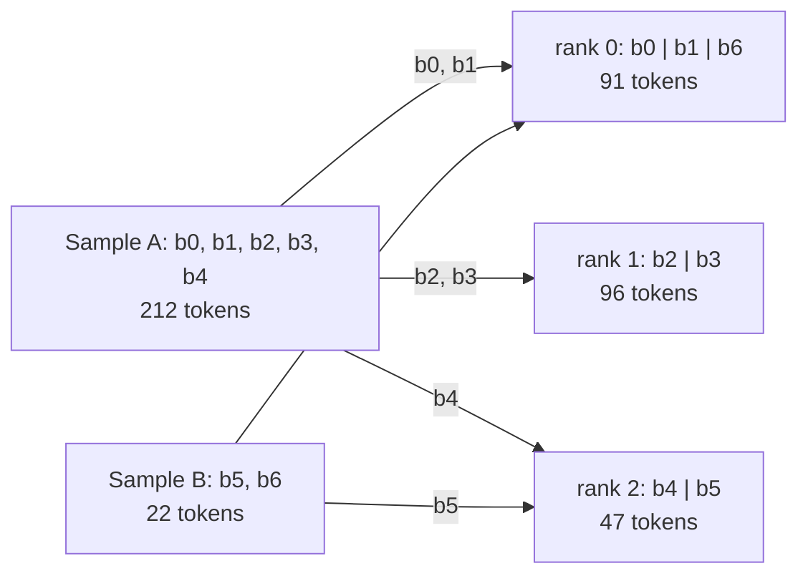
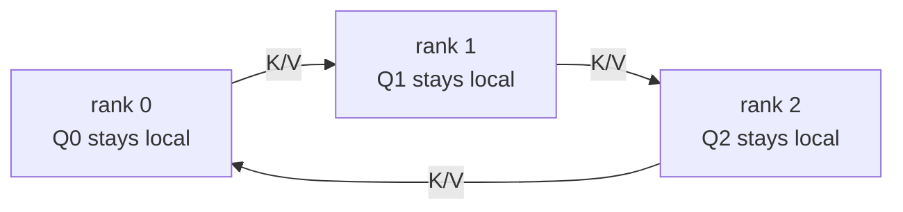

# cudnn_vsa

[English](README.md) | [简体中文](README.zh-CN.md)

<!-- Keep README.md and README.zh-CN.md synchronized, including examples and benchmark data. -->

用于 DiT/MMDiT 训练的打包多模态注意力：
**cuDNN 块稀疏细粒度注意力（fine attention）+ FA4 变长粗粒度注意力（coarse attention）**。

## 安装

安装支持 CUDA 的 PyTorch 后，在仓库根目录运行：

```bash
python -m pip install -r requirements.txt
```

## 使用

输入为相互独立、内存连续的 BF16 张量 `q`、`k`、`v`、`gate`，形状均为
`[T, H, 128]`。输出保持输入的 token 顺序。

```python
import torch
from vsa import vsa_attention
from vsa_layout import Segment, build_vsa_layout

# One 720p 5s video and two independent 720p images, each with text.
H, D = 2, 128
layout = build_vsa_layout(
    samples=[
        [Segment("video", (31, 45, 80), sparsity=0.9), Segment("text", 2048)],
        [Segment("video", (1, 45, 80), sparsity=None), Segment("text", 2048)],
        [Segment("video", (1, 45, 80), sparsity=None), Segment("text", 2048)],
    ],
    head_num=H,
    dense_query_full=False,
    device="cuda",
)
q, k, v, gate = [
    torch.randn(layout.tokens, H, D, device="cuda", dtype=torch.bfloat16,
                requires_grad=True)
    for _ in range(4)
]
out = vsa_attention(q, k, v, gate, layout)
out.backward(torch.randn_like(out))
```

每个内层列表表示一个联合样本；不同样本之间不能互相进行注意力计算。
使用默认的 raster 顺序时，输入按照 `samples` 中的样本和 segment 声明顺序排列。
每个样本至少包含一个视频，也可以包含额外的视频/图像、文本、音频或关键帧 segment。
视频尺寸为按 raster 顺序排列的 `(F, H, W)` token 网格；`F=1` 表示图像。
其他 segment 类型使用 token 数量指定长度，并设置 `sparsity=None`。
几何形状和设置相同的各层可以复用 layout。

将此目录加入 `PYTHONPATH`，或者把 `vsa.py`、`vsa_core.py`、
`vsa_layout.py` 和 `vsa_kernels.py` 复制到项目中并调整 import。

## 输入顺序

`layout.input_order` 显式声明 token 顺序：

| `input_order` | 输入 token | Slot 转换 |
| --- | --- | --- |
| `"raster"`（默认） | 原始样本/segment 顺序，视频按 FHW 顺序排列 | 重排为 block 并添加 padding |
| `"block"` | 按下述 block 顺序排列的有效 token，不含 padding | 仅添加 padding；本地所有 slot 都有效时跳过转换 |

### Raster 输入

默认的 `input_order="raster"` 接受原始 FHW 序列，如上面的示例所示。
`vsa_attention` 在内部进行重排和 padding，然后将输出恢复为相同的 raster 顺序。
无需预处理。

### Block 输入

`input_order="block"` 描述 `vsa_attention` 所期望的 token 顺序；
设置此标志本身不会重排张量。全局 block 顺序如下：

1. 保持样本的声明顺序。
2. 在每个样本内，先放置 `sparsity=None` 的 segment，再放置 `sparsity` 为数值的视频
   segment。每个类别内部保持 segment 的声明顺序。稠密图像/视频属于第一类；
   数值 `sparsity=0` 仍属于第二类。
3. 将每个 None-sparsity segment 切成每块最多 64 个 token 的连续片段。
   对 `sparsity` 为数值的视频，按 F/H/W 顺序遍历 4×4×4 tile 的起点
   （W 变化最快），再按相同顺序遍历每个 tile 内的有效 token。
   边缘 tile 裁剪到实际尺寸，拼接有效 token 时不留空隙。
   Block 不会跨越 segment 或样本边界。

Ring 输入仅保留本 rank 拥有的 block，按全局 block ID 递增排列。
每个 block 内的 token 顺序不变。`layout.input_rows[i]` 将提供的第 `i` 行
映射到原始**全局 raster** 行；完整的 raster layout 使用恒等映射。
Q/K/V、gate、position IDs 和 dO 必须采用提供给注意力的相同顺序。
输出和输入梯度保持该顺序。

例如，声明 `video=(1, 2, 5), sparsity=0.9`，后面跟随三个文本 token。
将原始 raster 行编号为 `0..12`：视频行为 `0..9`，文本行为 `10..12`。
紧凑的 block 序列为：

| Block | 按输入顺序列出的原始 raster 行 | 有效 token 数 |
| --- | --- | ---: |
| b0：文本 | `10, 11, 12` | 3 |
| b1：第一个视频 tile | `0, 1, 2, 3, 5, 6, 7, 8` | 8 |
| b2：边缘视频 tile | `4, 9` | 2 |

对于完整 layout，输入有 13 行，注意力分配 3×64 个 slot。
如果该视频使用 `sparsity=None`，则两个 segment 都是稠密的：视频仍在文本之前，
按原始 raster 顺序形成分别包含 10 和 3 个 token 的两个 block。

对于 raster 数据，在整个 VSA 层堆栈之前调用一次 `to_block_order`。
本仓库提供独立于 `vsa_attention` 的融合重排 kernel：通过一次 kernel launch
从一个 token 张量中 gather 所需行，保留 dtype 和后续维度，并且**不添加 padding**。
已经按 block 排列的输入可以直接进入注意力。各层之间保持该顺序。

`to_block_order(x, vsa_layout=layout)` 接受一个内存连续的 CUDA
`[T_global, ...]` raster 张量。完整 layout 返回按 block 顺序排列的所有行；
Ring layout 仅选择并重排本 rank 的行，返回 `[layout.tokens, ...]`。
完整 layout 保持第一维长度不变；Ring layout 使用本地有效 token 数。
两种情况下，结果在数值上都等于 `x[layout.input_rows]`。
逆操作 `to_raster_order(x, vsa_layout=layout)` 要求使用**完整** layout。
两个辅助函数都要求 `input_order="block"`：即使 `x` 以 raster 顺序输入，
layout 描述的也是目标 block 顺序。
在层堆栈的输入边界调用正向重排函数；如果需要 raster 输出，则在输出边界调用逆操作。
后续逐 token 的投影会直接生成按 block 排列的 Q/K/V/gate。
位置坐标必须采用相同顺序；调用方可以按 block 顺序生成坐标，
也可以单独转换坐标张量。

```python
import torch
from vsa import to_block_order, to_raster_order, vsa_attention
from vsa_layout import Segment, build_vsa_layout

H, D, C = 2, 128, 256
layout = build_vsa_layout(
    [[Segment("video", (5, 9, 11), sparsity=0.9), Segment("text", 67)]],
    head_num=H, input_order="block", device="cuda",
)
tokens_raster = torch.randn(layout.tokens, C, device="cuda", dtype=torch.bfloat16,
                            requires_grad=True)
projection = torch.nn.Linear(C, 4 * H * D, device="cuda", dtype=torch.bfloat16)

# One reorder at the input boundary, before the layers' projections.
tokens_block = to_block_order(tokens_raster, vsa_layout=layout)
assert tokens_block.shape == tokens_raster.shape  # Full layout: 562 valid tokens.

# One example VSA layer; intermediate layers retain block order.
projected = projection(tokens_block).view(layout.tokens, 4, H, D)
q, k, v, gate = (x.contiguous() for x in projected.unbind(1))
out = vsa_attention(q, k, v, gate, layout)

# Restore once at the output boundary if raster output is required.
out_raster = to_raster_order(out, vsa_layout=layout)
out_raster.backward(torch.randn_like(out_raster))
```

对于这个完整 layout，反向执行逆置换；`to_raster_order` 在层堆栈之后
恢复原始样本/segment/FHW 顺序。对于 Ring layout，反向将梯度 scatter 到
全局 raster 形状，未归本 rank 所有的行填零；不会执行跨 rank 归约。
恢复完整的 Ring 输出需要调用方负责通信；`to_raster_order` 仅接受完整 layout。

内部每个 block 占用 64 个 slot：`slot_row` 将 slot 映射到输入行，
用 `-1` 表示 padding；`row_slot` 是有效行的逆映射。
Block 输入使用融合的 Q/K/V padding 和融合的 dQ/dK/dV 恢复；
padding 值为零，不参与均值和注意力计算。
`slots_are_input` 仅在 block 输入满足 `tokens == blocks * 64`，
且没有不完整 block 或占位 block（dummy block）时跳过转换。
Raster 输入即使所有 block 都满，也仍使用 raster-to-slot 路径。

## 代码结构

| 文件 | 职责 |
| --- | --- |
| `vsa.py` | 公共注意力入口，以及显式的 block/raster 重排辅助函数 |
| `vsa_core.py` | 路由、cuDNN BSA/FA4 调用、单设备执行，以及 Ring 通信和 autograd |
| `vsa_layout.py` | 静态样本/block 几何信息、行映射、路由模板和 coarse 边界 |
| `vsa_kernels.py` | 融合 token 重排、slot gather、Q/K/V padding、FP32 pooling 和门控合并 kernel |

两种输入顺序共享 core 中的注意力数学计算、各 region 的预算，以及先 fine 后 coarse 的调度。
Core 不导入公共入口。

## Ring 上下文并行

普通 VSA 和 Ring 使用相同的 forward API：

```python
layout = build_vsa_layout(
    samples, head_num=H, input_order="block", device=device,
    ring_cp_group=group,  # Existing caller-owned group; None selects ordinary VSA.
    ring_partition="cyclic",  # Default; "contiguous" is also supported.
)
out = vsa_attention(q, k, v, gate, layout)
```

两种模式下 `build_vsa_layout` 都返回 `VSALayout`。
`ring_cp_group=None` 构建完整 layout（`layout.ring is None`），
不需要初始化分布式环境，也支持在 CPU 上构建。
传入当前进程所属的进程组会构建本地 Ring 分片，包括大小为 1 的进程组，
并且要求 `input_order="block"`。Rank 和 size 从传入的进程组获取；
非成员进程的句柄会被拒绝。

组内所有 rank 都需提供相同的全局样本几何信息和 head 数。
在并行初始化阶段创建一次进程组，并在不同 micro-batch 的 layout 之间共享；
各层复用各自的 layout。VSA 借用进程组句柄，从不创建或销毁进程组。
默认情况下，前向和反向共享 `ring_cp_group`。
可选的 `ring_cp_bwd_group` 必须具有相同的成员及 rank 顺序。
进程组和传输选项在构建时绑定；在反向和 CUDA Graph replay 完成之前，
必须保持进程组存活。流优先级的配置见**前向通信重叠**。

完整 layout 和 Ring 分片共享 slot 映射、路由模板及 coarse 元数据。
`tokens`、`blocks` 和行/slot 映射描述本地输入；
`groups`、`sample_slices` 和 `sample_lengths` 描述全局样本。
`layout.ring` 保存绑定的进程组、本地 rank/size、全局 token 数、
block 归属、各 peer 的长度和 all-gather 置换。
Coarse Q 边界是本地的；KV 边界覆盖对应的全局样本。
完整 layout 的 Q/KV 共享边界张量和 block ID 张量。

### 紧凑输入与 block 归属

Ring layout 要求 `input_order="block"`，大小为 1 的进程组也一样。
每个 rank 仅提供本地有效 token，按所拥有 block 的递增顺序排列，不含 padding。
Q/K/V/gate、位置坐标和梯度都保持相同顺序；输出也保持该顺序。
各层之间复用 layout。

按照**输入顺序**一节描述的顺序规划 block，并在打包的各个样本之间连续编号。
`ring_partition` 独立于 `input_order` 选择 block 的归属方式，
并记录在 `layout.ring.partition` 中：

| `ring_partition` | 全局 block 归属 |
| --- | --- |
| `"cyclic"`（默认） | Block `b` 属于 rank `b % R`；全局编号跨样本连续递增 |
| `"contiguous"` | 每个样本向每个 rank 分配至多一段连续的 block 区间 |

轮转分配将相邻 Q/KV block 分散到不同 rank，可以减少稀疏计算集中在某个 peer 的情况。
两种策略都不保证动态 top-k 工作量均衡。它们共享相同的路由、注意力和通信 kernel。
组内所有 rank 必须选择相同策略。切换策略时需要重新构建 layout 并重新切分输入；
不能将已有本地张量直接按另一种策略解释。

连续分配时，第一个样本从 rank 0 开始。
对于 N 个 block，计算 `base, extra = divmod(N, R)`，从当前起始 rank 循环遍历。
前 `extra` 个 rank 各获得 `base + 1` 个连续 block，其他 rank 各获得 `base` 个。
然后将起始 rank 前移 `extra`，并对 R 取模：下一个样本从上一个样本中
第一个分到较少 block 的 rank 开始。若 N 可被 R 整除，起始 rank 保持不变。
某个 rank 可以不拥有某个样本的任何 block。

这种轮转使各 rank 的单样本 block 数和累计 block 数都相差不超过一个，
无需搜索全局负载最少的 rank。每个 rank 使用 `C = ceil(global_blocks / R)`
个内部 block。有效 token 长度不影响归属；不完整 block 可能造成 token 负载不均。
每个 block 都只属于一个 segment 和一个样本；路由和注意力计算始终保持样本隔离。
样本的 token 数和 block 数都无需是 R 的倍数。
总 block 数必须至少为 R；更小的 pack 会在所有 rank 上被拒绝。
每个 rank 都会收到有效输入 token。内部缓冲区将不完整 block 和 dummy block
补齐到 64 个 slot。

归属通过显式映射表示：`p = layout.ring.global_to_gather[b]` 将全局 block
`b` 映射到以 rank 为主序的存储位置，因此 `owner = p // C`，
`local_block = p % C`。`layout.ring.block_ids` 列出本 rank 的全局 ID，
dummy block 使用 `-1`。所有 rank 都根据样本几何信息生成相同的映射，无需通信。

对于 Ring 分片，`layout.input_rows` 将本地紧凑行映射到原始全局
样本/segment/FHW 序列。`to_block_order` 使用该映射融合**分片选择和重排**：
只读取本 rank 拥有的行，不生成完整的 block 顺序中间张量。
如果每个 rank 都持有完整的 raster pack，在层堆栈之前准备一次输入即可：

```python
from vsa import to_block_order

layout = build_vsa_layout(
    samples, head_num=H, input_order="block", device="cuda",
    ring_cp_group=group,
)
# tokens_global: [layout.ring.global_tokens, hidden_size], in sample/segment/FHW order.
# position_ids_global: [T_global] or [T_global, axes], aligned with those tokens.
tokens_local = to_block_order(tokens_global, vsa_layout=layout)
position_ids_local = to_block_order(position_ids_global, vsa_layout=layout)
# Build local RoPE cos/sin from position_ids_local; reuse across layers with
# the same RoPE configuration. Preserve each sample's original position values.
# Use the same helper for aligned target/mask tensors when needed.
assert tokens_local.shape == (layout.tokens, tokens_global.shape[1])
# Token-wise projections and all VSA layers now consume the local block order.
```

该辅助函数不添加 padding，也不执行通信。
反向将梯度 scatter 到原始全局形状，未归本 rank 所有的行梯度为零；
不会执行跨 rank 梯度归约。数据加载和最终输出 gather 仍由调用方负责。
已经按本地 block 顺序排列的张量无需经过该辅助函数。
全局 block 顺序张量不属于 raster 输入：应使用归属映射分发完整 block，
无需再次执行 FHW 转换。任何 Ulysses all-to-all 也由调用方负责，
并且必须保持本地 block 顺序。

### 示例：三个 rank 上的两个样本

打包以下相互独立的样本，R=3。下图使用 `ring_partition="contiguous"`：

- **A：** 稀疏视频 `(4, 6, 8)`，`sparsity=0.5`，后面跟随 20 个文本 token。
  Block 顺序将文本放在前面：`b0` 有 20 个 token；四个视频 tile
  `b1..b4` 分别有 64、64、32 和 32 个 token。
- **B：** 稠密图像 `(1, 3, 5)`，`sparsity=None`，后面跟随 7 个文本 token。
  两个 segment 都是稠密的，因此保持声明顺序：`b5` 有 15 个图像 token，
  `b6` 有 7 个文本 token。

Block ID 跨样本连续编号。A 有五个 block，B 有两个，都不能被 R 整除。
下图的箭头表示在数据集/模型边界执行的一次性分发。
Rank 方框内**仅包含有效输入 token**。



每个 rank 按全局 ID 递增顺序拼接自己的 block，保持每个 block 内的有效 token 顺序。
Rank 0 先提供 `b0` 的 20 个 token，再提供 `b1` 的 64 个和 `b6` 的 7 个，中间没有空隙。
A 从 rank 0 开始，向 rank 0/1/2 分配 `[2, 2, 1]` 个 block。
因此 B 从 rank 2 开始：将 `b5` 分给 rank 2，`b6` 分给 rank 0。
累计 block 数变为 `[3, 2, 2]`，第三个样本将从 rank 1 开始。
无需计算 token 负载或对 rank 排序。此例中 A 的不完整 block 有意造成 token 总数不均；
归属策略均衡的是 block 数量。

按 rank 顺序拼接各 rank 的输出，会得到 block 序列
`[b0, b1, b6, b2, b3, b4, b5]`。
要恢复全局顺序，需要使用归属映射和行映射；`input_rows` 给出每个本地行
在全局 raster 顺序中的目标位置。仅按 rank 顺序拼接，不足以直接使用
完整 layout 的逆重排辅助函数。

注意力在内部为每个 rank 分配 `ceil(7 / 3) = 3` 个 block，每个 block 有 64 个 slot：

| 组内 rank | 按本地 slot 顺序排列的全局 block ID | 每个 slot block 的有效大小 | 紧凑输入行数 | 内部 slot 行数 |
| --- | --- | --- | ---: | ---: |
| 0 | `b0, b1, b6` | `20, 64, 7` | 91 | 192 |
| 1 | `b2, b3, dummy` | `64, 32, 0` | 96 | 192 |
| 2 | `b4, b5, dummy` | `32, 15, 0` | 47 | 192 |

未使用的 slot 填零，不参与注意力和 pooling。
调用方总共提供 234 个有效 token，而非 576 行 slot。
Q/K/V/gate 和位置使用相同的本地顺序；输出及其梯度保持该顺序。

使用默认的 `ring_partition="cyclic"` 时，同样的全局 block 会分配为：

| 组内 rank | 拥有的全局 block | 有效 token 数 |
| --- | --- | ---: |
| 0 | `b0, b3, b6` | 59 |
| 1 | `b1, b4` | 96 |
| 2 | `b2, b5` | 79 |

总数仍为 234 个 token，每个 rank 的内部容量仍为三个 block。
后面的路由示例使用连续分配图中的归属关系。

### 路由与 top-k

路由代码按以下顺序执行：

1. [vsa_layout.py](vsa_layout.py) 中的 `_build_sample_blocks` 为每个
   `sparsity` 为数值的视频 region 记录独立预算：`keep = max(1, ceil((1 -
   sparsity) * region_blocks))`。稠密 KV block 始终被包含。
   这些预算和样本边界是静态的；选中的视频 block ID 会随每次前向的 Q/K 改变。
2. [vsa_core.py](vsa_core.py) 中的 `ring_attention_slots` 使用 FP32 计算本地
   Q/K/V 的 block 均值，除数为有效 token 数。Padding 为零，dummy block 的均值为零。
   池化后的 K/V 按 rank 顺序执行 all-gather，然后由
   `layout.ring.global_to_gather` 恢复全局 block 顺序并移除 dummy block。
   路由使用本地 Q 均值和按全局顺序排列的 K 均值。
3. 完整 layout 和 Ring layout 共享 `route`。
   Layout 预先计算每个样本的本地路由行，以及它们在池化 Q/K 中的偏移；
   `route` 对这些行调用 `_route_group`。对于每个视频 KV region 和 head，
   在禁用 TF32 和 autocast 的情况下计算 FP32 分数 `Q_mean @ K_mean.T`，
   然后为每个 Q block 独立选择该 region 中分数最大的 `keep` 个 block。
   路由使用未缩放的点积；注意力随后再应用 softmax scale。
   该 region 内所有 peer 的候选 block 都参与这一次选择。
   每个 Q block 只有一个 owner，且 K 均值已是全局的，因此不需要对分数或 top-k
   索引执行 collective。
4. `topk(..., sorted=False)` 选出 region 内的相对 ID；`selected.sort(-1)`
   对这些 ID 排序，再通过 `+ start` 转换成全局 block ID。
   稠密 key 和完整保留的 region 来自 layout 的模板。
   当 `dense_query_full=True` 时，稠密 Q 行保留覆盖整个样本的模板并跳过 top-k；
   稀疏视频 Q 行仍使用各 region 的预算。不含动态选择的 layout 直接复用模板。
   路由在 `no_grad` 下执行：梯度通过选中的 fine attention 和 coarse 分支传播，
   不通过离散的 top-k 决策传播。
5. [vsa_kernels.py](vsa_kernels.py) 中的 `partition_indices` 使用与池化 K/V
   相同的 `global_to_gather` 映射对选中的 ID 分组。
   容量为 C 时，映射位置 `p` 对应 `owner = p // C` 和 `local_block = p % C`。
   该操作记录各 peer 的有效数量。某个 peer 可以没有任何被选中的 key。
   随着 K/V 分片到达，这些按 peer 划分的列表用于驱动 fine attention。

对于上面的样本 A，四个视频 block、稀疏度 0.5 对应 `keep=2`。
假设 query block `b3` 的某个 head 得到以下分数：

```text
Video KV block       b1    b2    b3    b4
Q_mean @ K_mean.T   0.2   0.8   0.1   0.9
Selected video IDs        b2          b4
Final global IDs:   [b0, b2, b4]   (b0 is the always-visible text block)
```

当 R=3 时，peer 列表分别为 rank 0 的 `[0]`（全局 `b0`）、rank 1 的 `[0]`
（全局 `b2`）和 rank 2 的 `[0]`（全局 `b4`）。
样本 A 中的 Q block 永远不会将 B 的 `b5/b6` 作为候选。
存在多个视频 region 时，每个 region 都有自己的 top-k 预算；
不会对整个 pack 中的所有视频 region 统一执行一次 top-k。

### 执行流程

单设备执行和 Ring 执行共享 `block_means`，该函数返回可微的 FP32 Q/K/V 均值。
单设备执行会选择 coarse block，并在 `routing_and_coarse_means` 中融合
路由所需的 detach 和 coarse 的 dtype 转换。
Ring 执行对所有本地 slot 做 pooling，包括填零的 dummy block；
`_GatherMeans` 以 FP32 传输用于路由的 K 均值，以 BF16 传输用于 coarse attention
的 V 均值，将其原始字节打包为一次 all-gather。
这种字节打包保留各字段的 bit，不会量化 K。
V 的类型转换位于通信 autograd 边界内；反向将 dK/dV 合并为一次 FP32
reduce-scatter SUM，并向 pooling 返回 FP32 梯度。
相比 K/V 都以 FP32 发送，前向池化 K/V 的传输量减少 25%；
前向和反向的 collective 次数仍各为一次。端到端延迟仍需实际测量。

对于上面的示例，令 `KV_r` 表示 rank r 的整个内部 K/V 分片，包含 slot padding。
在整个 fine attention 过程中，Q 保持在原 rank，K/V 传给组内下一个 rank：



| Fine attention 步骤 | Rank 0 使用 | Rank 1 使用 | Rank 2 使用 |
| --- | --- | --- | --- |
| 0：自己的分片 | `Q0, KV0` | `Q1, KV1` | `Q2, KV2` |
| 1：经过一跳 | `Q0, KV2` | `Q1, KV0` | `Q2, KV1` |
| 2：经过两跳 | `Q0, KV1` | `Q1, KV2` | `Q2, KV0` |

每一步只计算该 peer 拥有且被选中的 KV block。
例如，全局 `b5` 映射到以 rank 为主序的位置 7：owner 为 `7 // 3 = 2`，
本地 block 为 `7 % 3 = 1`。当 rank 0 收到 `KV2` 时，其中属于 B 的 query block
`b6` 可以关注 B 的 `b5`，而属于 A 的 query block 不能关注 `b5`。
**Layout/router** 通过 block 列表保证样本隔离。
**传输层**仅移动缓冲区，不解释 FHW 坐标，也不推断 THD 的样本边界。
各部分输出使用各自的 log-sum-exp 归一化量加权合并，
使最终 fine 输出在所有选中的 KV block 上具有统一的 softmax 归一化。

将 fine 阶段入队后，`coarse_attention` 使用本地池化 Q 和全局池化 K/V，
精度为 BF16，并为每个样本分别设置 Q/KV 边界。
Q/K 均值在 coarse 边界转换类型；V 均值到达时已经是 BF16。
Coarse attention 覆盖每个参与样本的所有 block，不受 fine top-k 列表限制。
`vsa_attention` 恢复紧凑的有效行，并合并为
`fine + gate * coarse[query_block]`。完全稠密的样本仅使用 fine。

反向以相反方向遍历 Ring，使用最终 fine 输出和 log-sum-exp，
以 FP32 累加 dQ/dK/dV。池化均值 gather 的伴随操作是 reduce-scatter。
没有本地 coarse query 的 rank 仍会参与必要的 collective；
保存的接收缓冲区支持保留计算图后的再次反向。

在 `build_vsa_layout` 中与 `ring_cp_group` 一起设置传输选项。
`ring_cp_batch_p2p=None` 对延迟初始化的 NCCL 进程组使用独立 P2P，
对绑定设备的进程组使用批量 P2P，前向和反向分别解析。
传入布尔值可以为两个进程组显式选择同一种模式。
在 SM100、H=2、单样本、128 个物理本地 block 的情况下，
`ring_cp_bwd_bucket_size="auto"` 为每个反向 bucket 使用 64 个 query block；
其他形状使用后端默认值。传入 `None` 可使所有情况都使用后端默认值，
也可以传入正整数指定 bucket 大小。

### 前向通信重叠

要为 Ring P2P 通信使用高优先级 NCCL 流，在并行初始化时创建一次进程组，
然后在不同 layout 和层之间复用：

```python
import torch.distributed as dist

# Call on all WORLD ranks in the same group-creation order, before building layouts.
options = dist.ProcessGroupNCCL.Options()
options.is_high_priority_stream = True
group = dist.new_group(ranks=ring_ranks, backend="nccl", pg_options=options)
# Member ranks reuse this group for every micro-batch's layout.
layout = build_vsa_layout(
    samples, head_num=H, input_order="block", device="cuda",
    ring_cp_group=group,
)
out = vsa_attention(q, k, v, gate, layout)
```

默认情况下，前向和反向使用相同的进程组。
要为反向选择不同的 NCCL 流优先级，可以创建成员和 rank 顺序相同的第二个进程组，
并通过 `ring_cp_bwd_group` 传入。
前向池化 all-gather 和 fine KV P2P 使用 `ring_cp_group`；
反向 fine P2P 和池化梯度 reduce-scatter 使用 `ring_cp_bwd_group`。
VSA 借用这些句柄；调用方负责创建和销毁，并保持它们存活到反向及 CUDA Graph replay 完成。

在 BSA 之前将 P2P 入队，并不保证它的 GPU kernel 先开始执行。
BSA 和 NCCL 可能竞争 SM 资源，包括共享内存。
使用普通优先级流时，等待中的 NCCL kernel 可能要等到 BSA 的最后一批线程块才开始执行。
高优先级让等待中的 NCCL 工作更早获得释放的资源；它不会抢占已经运行的线程块。
CUDA Graph replay 必须遵守捕获的节点优先级
（`cudaGraphInstantiateFlagUseNodePriority`）；应在训练使用的 PyTorch 构建中确认这一点。

优先级属于进程组内部的 NCCL 流。仅改变 `isend`/`irecv` 外围的流并不足够。
VSA 借用传入的进程组，不会替换它们，也不会修改全局调度设置。
Benchmark 的 `--high-priority-group` 使用上述配置。
`--forward-only-high-priority` 创建一个高优先级前向进程组和一个普通优先级反向进程组；
两个标志都不设置时，则使用一个普通优先级进程组。这两个标志互斥。
如果反向复用了高优先级进程组，即使反向 P2P 已经实现重叠，也仍会受到高优先级的影响。
池化 collective 使用同步 API。一些 PyTorch 版本会在当前 CUDA 流上运行这些操作，
因此它们的 kernel 优先级可能与进程组的异步 P2P 流不同。
应检查目标构建中捕获的节点。
除了 trace 中的重叠情况，还要比较完整前向/反向延迟：
通信仍会消耗 SM 和内存带宽，池化均值 collective 也有自己的数据依赖。

### 设计原因

- **保持稀疏注意力计算单元完整。** Pooling、路由和 cuDNN BSA 都以完整 block 为单位。
  连续 FHW 序列的分片可能将一个 4×4×4 tile 切到不同 rank 上。
  在数据集/模型边界一次性排列并分发完整 block，可以让每个 block 只有一个 owner；
  后续各层可直接对本地 token 做 pooling 和投影。
  紧凑输入也让外围投影和 MLP 不必处理 slot padding。
- **保持每个样本的本地 block 连续。** 为每个样本/rank 分配一个区间，
  可以保持本地 block 顺序并简化数据集切片。
  按 block 数划分，并在不同样本间轮转额外 block 的接收者，
  只需保存一个起始 rank 就能均衡累计 block 数，无需依赖不完整 block 的长度。
  Layout 构建时计算一次归属映射，供池化 gather、路由和每个 VSA 层复用。
- **控制全局路由信息的大小。** 为保持各 region 的 top-k 预算，
  本地 Q block 需要整个样本内所有候选 block 的池化 K。
  Coarse attention 也需要池化 K/V。
  Gather 每个 block 的一个汇总即可提供这些信息；fine attention 则通过两个
  接收/计算缓冲区轮转 token 级 K/V，无需同时保存所有 peer 的完整 K/V。
  Q、输出累加和 dQ 保持本地。
- **使通信形状可预测。** 相同的内部 slot 容量保证 P2P 传输匹配，支持 CUDA Graph 复用。
  有效大小和路由计数将不完整/dummy slot 排除在数学计算之外。
  即使一个 rank 持有多个样本的 block，样本边界也仍通过显式元数据保留。
  当其他样本使用 coarse attention 时，仅有 fine-attention query 的 rank
  仍会参与池化梯度 collective。

代价是 fine attention 会轮转**整个带 padding 的 K/V 分片**，
即使路由只选择了某个 peer 的少量 block。
稀疏度减少了注意力计算量，但不会按比例减少这些传输字节。
池化 K/V 仍需全局 gather，更多 rank 会增加通信步数。
Block 数均衡不保证有效 token 总数或注意力工作量相等：不完整 block、样本长度、
稀疏度和选中的 KV owner 都会影响计算和重叠。
改变分配策略时，应对完整工作负载进行 benchmark。

## 注意力语义

`sparsity` 表示视频 segment 的 **KV block 丢弃比例**。
默认情况下，每个 query block 和 head 都独立地从**每个**视频 KV region 选择 top-k block，
包括跨视频注意力：

```text
k = max(1, ceil((1 - sparsity) * video_region_blocks))
```

预算由 KV segment 决定；选中的 block 由 Q/K 决定。
`sparsity=None` 将 region 设为稠密：它的 KV block 始终可见，仅进行 padding。
数值稀疏度使用 4×4×4 视频 tile；`0` 保留这些 tile 的全部 block。

[FastH3](https://github.com/hao-ai-lab/FastVideo/blob/d5253fd71055927f12aa6c4aa679b93a00238851/fastvideo/attention/backends/video_sparse_attn_h3.py#L27-L31)
增加了 query 侧的例外规则：稠密 query 可以看到**全部** KV block。
`dense_query_full=True` 启用该例外；默认值 `False` 对每个 query 都应用视频 KV 稀疏度。
稠密 query 来自 `sparsity=None` 的 region。

下面给出一个样本/head 在稀疏度为 0.5 时的 fine mask 示例。
两个坐标轴都遵循内部 block 顺序：**先放 None-sparsity segment，再放数值稀疏度视频 segment**。
`■` 表示可见，`□` 表示被 mask。Top-k 选择仅用于示意。

**`dense_query_full=False`（默认）**

```text
           Dense KV    Video KV
           0 1         2 3 4 5
Dense Q0   ■ ■         □ ■ ■ □
Dense Q1   ■ ■         ■ □ □ ■
Video Q2   ■ ■         ■ □ ■ □
Video Q3   ■ ■         □ ■ □ ■
Video Q4   ■ ■         ■ ■ □ □
Video Q5   ■ ■         □ □ ■ ■
```

**`dense_query_full=True`（FastH3 稠密 query 规则）**

```text
           Dense KV    Video KV
           0 1         2 3 4 5
Dense Q0   ■ ■         ■ ■ ■ ■
Dense Q1   ■ ■         ■ ■ ■ ■
Video Q2   ■ ■         ■ □ ■ □
Video Q3   ■ ■         □ ■ □ ■
Video Q4   ■ ■         ■ ■ □ □
Video Q5   ■ ■         □ □ ■ ■
```

对于含数值稀疏度的样本，coarse attention 覆盖**所有 segment** 的 BF16 池化 block，
为每个 token 生成 `fine + gate * coarse[its_block]`。
如果样本的所有 segment 都是 `sparsity=None`，则通过 **BSA 执行完整注意力**，
不使用 coarse 分支。前面独立图像的处理方式就是如此；
VSA 样本内部的稠密图像仍会参与 coarse。

## 性能

MFU 统计有效注意力 GEMM FLOPs；反向 FLOPs 是前向的两倍。
Padding、路由和非 GEMM 操作不计入 FLOP 分子。
单 GPU TFLOP/s 用全局 FLOPs 除以延迟和 GPU 数量；
MFU 再将该值除以稠密 BF16 峰值（`--peak-tflops`）。各阶段的中位数独立计算。
一次性输入分片/重排、graph capture 和 profiling 不计入计时；
注意力内部的 slot 转换和 padding 计入计时。

环境：GB200（2500 TFLOP/s BF16）、PyTorch 2.12.0a0/NV26.04、CUDA 13.2、cuDNN 9.22 / frontend 1.28.0、Triton 3.6、CuTe 4.6.2、FA4 4.0.0b35。

`benchmark.perf_vsa` 支持普通和分布式工作负载（`--ring`）。
两种模式共享输入生成、数值检查、graph capture 和计时逻辑。
`--cases` 选择工作负载，`--heads` 选择 head 数，`--check-only` 执行参考实现对比
和保留计算图后的再次反向检查，`--output` 接受 JSON 文件或目录。
`vsa-perf/v4` JSON 使用 `<case>-h<heads>` 作为 key；每个 case 记录检查结果、
全局有效 FLOPs，以及单 GPU 吞吐/MFU。
Ring 的计时样本先跨 rank 归约，再汇总。Ring 默认使用 H=2，且不生成 trace；
添加 `--profile` 可为每个 rank 保存一份 trace。
比较性能时，在两种模式中显式使用相同的 `--seed`：
普通 VSA 的默认值为 2026，Ring 为 937。
相同的 seed、几何形状和 head 数会生成相同的全局 Q/K/V/gate 张量及上游输出梯度（dY）。

### 单设备 720p5s：FA4 完整注意力与 VSA

Benchmark 打包一个 720p、5 秒视频和两个独立的 720p 图像，每个样本都带文本：
视频有 121 帧，时间压缩 4×、空间压缩 16×，每个样本有 2048 个文本 token，
总共 124944 个 token，H=2/4，D=128，视频稀疏度为 0.9，
`dense_query_full=False`。VSA 使用默认的 `input_order="raster"`。

```bash
# VSA forward/backward time, MFU and torch traces.
python -m benchmark.perf_vsa --peak-tflops 2500
# FA4 full vs VSA, alternating order on the same GPU.
python -m benchmark.compare --peak-tflops 2500 --warmup 30 --repeats 500 --rounds 2
```

两者都使用 CUDA Graph，并对照 eager 执行验证 replay。
VSA 的计时覆盖 slot 转换、pooling、路由、fine、coarse、恢复和合并。
`benchmark/results/perf_vsa/` 包含 `perf.json` 和
`perf-default-h{2,4}-rank0.trace.json`；trace 在计时之后采集。
使用 `--input-order block` 测量紧凑 block 输入，使用 `--eager` 进行 eager 执行，
或使用 `--no-profile` 不采集 trace。输入生成/重排不计入计时。
对比结果写入 `benchmark/results/compare.json`。

| 方法 | H | 前向 ms | 前向 MFU | 反向 ms | 反向 MFU | 前向+反向 ms | 前向+反向 TFLOP/s | 前向+反向 MFU |
|---|---:|---:|---:|---:|---:|---:|---:|---:|
| FA4 完整注意力 | 2 | 9.357 | 56.82% | 25.409 | 41.85% | 34.772 | 1146.72 | 45.87% |
| cuDNN VSA（raster） | 2 | 2.366 | 24.81% | 6.746 | 17.40% | 9.114 | 482.91 | 19.32% |
| FA4 完整注意力 | 4 | 19.001 | 55.96% | 50.988 | 41.71% | 70.019 | 1138.94 | 45.56% |
| cuDNN VSA（raster） | 4 | 4.665 | 25.15% | 13.352 | 17.57% | 18.017 | 488.36 | 19.53% |

使用 CUDA Graph，每次测量预热 30 次，每种方法测两轮，每轮计时 replay 500 次。
FA4 完整注意力和 VSA 在同一 GPU 上交替执行。
每个时间列都是独立计算的 1000 次 replay 中位数。
这些是独立算子测量；VSA 时间包含 raster-to-slot 重排和 padding。

### 单 head 720p44s：普通 VSA 与 Ring4

`thd720p44s` case 的注意力几何形状，与 128 GPU DiT U32/R4 配置中
Ulysses 交换后的形状一致。它仅运行 VSA：pooling、路由、fine/coarse attention、
门控合并及其反向，并包含 Ring 通信。
QKV/输出投影、Ulysses、MoE 和优化器工作不属于此 benchmark 的范围。

| 设置 | 值 |
|---|---|
| 视频 token 网格 | `265 x 45 x 80`，稀疏度 `0.9` |
| 独立图像 token 网格 | `1 x 45 x 80`，稠密注意力 |
| 文本 | 每个样本 2048 个 token |
| 全局打包 token 数 | 961696：视频/文本 956048，图像/文本 5648 |
| Ring size / head 数 / head 维度 | `4 / 1 / 128` |
| 轮转分配时 rank 0/1/2/3 的紧凑 token 数 | `240436 / 240420 / 240420 / 240420` |
| 连续分配时 rank 0/1/2/3 的紧凑 token 数 | `243904 / 242880 / 242832 / 232080` |
| 输入顺序 / 精度 | 紧凑 block 顺序 / BF16 |

这里使用一个 head 是正确的：模型的 32 个 head 已经被 U32 划分。
连续分配时，各 Ring rank 接收该 head 的 232k–244k 个有效 token，平均为 240,424。
各 rank 拥有 `4051 / 4050 / 4050 / 4050` 个 block；
有效 token 数不相等是由不完整 block 引起的。
这些是 Ulysses 交换后的 token 数；输入张量没有 padding，
VSA 管理其内部的 64-token 注意力 slot。

```bash
# Full sequence on one GPU, with the same global inputs and block order.
python -m benchmark.perf_vsa --heads 1 --cases thd720p44s --seed 937 \
  --input-order block --warmup 10 --repeats 50 --profile \
  --peak-tflops 2500 --output benchmark/results/single_720p44s/perf.json

# Compare both ownership policies on the same four GPUs and global inputs.
for partition in cyclic contiguous; do
  torchrun --standalone --nproc-per-node=4 --module benchmark.perf_vsa --ring \
    --ring-size 4 --ring-partition "$partition" --heads 1 --cases thd720p44s \
    --seed 937 --batch-p2p --high-priority-group --bwd-bucket-size backend \
    --warmup 10 --repeats 50 --profile --peak-tflops 2500 \
    --output "benchmark/results/ring4_720p44s/$partition/perf.json"
done
```

默认启用 CUDA Graph。两个命令都会在计时之前，将输出和所有输入梯度与单设备 VSA 对比，
并检查保留计算图后的再次反向，以及使用原始/修改后输入的 graph replay。
Ring 命令写出 `perf-group0.json` 和
`perf-group0-thd720p44s-h1-rank{0,1,2,3}.trace.json`。
每个 trace 在计时样本之后额外采集一次完整前向/反向 replay。
JSON 记录 `ring_partition`、阶段延迟、TFLOP/s/GPU 和 MFU。
输入是使用指定 seed 生成的随机张量；几何形状一致并不代表复现了某个模型层的路由决策。

两种支持的归属策略在另一次分配的四张 GB200 上比较，执行顺序为
轮转 / 连续 / 连续 / 轮转。每次运行预热 10 次，计时 graph replay 50 次；
每次 replay 使用各 rank 的最大延迟，表中值为两次运行中位数的中位数。
所有参考实现对比和 graph 检查均通过。

| Ring4 归属策略 | 前向 ms | 反向 ms | 前向+反向 ms | 前向+反向 TFLOP/s/GPU | 前向+反向 MFU |
|---|---:|---:|---:|---:|---:|
| 连续 | 16.090 | 51.370 | 66.661 | 477.54 | 19.10% |
| 轮转 | 16.186 | 51.691 | 67.197 | 473.73 | 18.95% |

总时间 0.8% 的差异适用于这些随机输入。
实际模型的路由可能将选中的 KV block 集中到某个 peer，因此也应在模型中测试两种策略。
此次节点分配没有重测普通 VSA；下面相同条件下的普通/Ring 对比是另一次独立测量。

以下结果在一次分配的四张 GB200 上测得，使用上述软件环境。
普通 VSA 在一张 GPU 上运行完整序列，不使用进程组；
表中的 Ring4 使用**连续分配**、全部四张 GPU，以及上述高优先级进程组和后端默认反向 bucket。
两者都使用 **961,696 个全局 token、H=1、D=128、紧凑 block 输入和 seed 937**。
全局输入 hash 和有效 FLOP 数一致。

| 阶段 | 普通 VSA ms | 普通 VSA TFLOP/s | 普通 VSA MFU | Ring4 ms | Ring4 TFLOP/s/GPU | Ring4 MFU | 并行效率 |
|---|---:|---:|---:|---:|---:|---:|---:|
| 前向 | 58.193 | 729.38 | 29.18% | 15.556 | 682.14 | 27.29% | 93.52% |
| 反向 | 179.412 | 473.15 | 18.93% | 50.403 | 421.05 | 16.84% | 88.99% |
| 前向 + 反向 | 237.707 | 535.68 | 21.43% | 65.210 | 488.17 | 19.53% | 91.13% |

每种模式运行两次，每次预热 10 次，计时 CUDA Graph replay 50 次。
Ring 计时取每次 replay 中各 rank 的最大延迟；
表中报告每种模式两次运行中位数的中位数。

全局工作量固定时，加速比为 `T1 / T4`，并行效率为 `T1 / (4 * T4)`，
等价于 `MFU4 / MFU1`。这里完整前反向达到 **3.645x 加速和 91.13% 并行效率**。
该对比包含通信、kernel 形状变化、额外累加和负载不均衡的影响，
没有单独分离通信成本。仅有 P2P 重叠并不能证明通信开销为零。

示例使用同一主机上的四张 GPU。要测量跨主机 Ring，
使用每张 GPU 一个进程及常规 torchrun rendezvous 参数，并保持相同的 benchmark 标志。
应记录实际互连拓扑和节点分布：单主机 NVLink 的重叠表现不能代表跨 NVLink 域的 Ring，
四张 GPU 的运行也无法复现 32 个并发 Ring 组。
独立算子的有效 FLOP MFU 仅统计有效注意力对；DiT 模型的统计还包括投影/MoE，
并计算物理 fine-attention block slot，因此两者的 MFU 分子不同。

## 测试

测试覆盖两种输入顺序与独立 token 级数学实现的对比、
不同行形状/dtype 的融合单张量重排往返、padding 及其伴随操作，
以及使用原始和修改后输入的重排/注意力/恢复 CUDA Graph replay。
CUDA 不可用时跳过 GPU 测试。

```bash
python -m pip install 'pytest>=8'
python -m pytest -q -m 'not fastvideo'

# Optional FastH3 reference
python -m pip install -r tests/requirements-fastvideo.txt
python -m pytest -q tests/test_fastvideo.py
```

进行 Ring 验证时，所有 worker 都必须具备 CUDA 和 NCCL。
小规模 case 将输出及 Q/K/V/gate 梯度与独立 token 级数学实现对比；
64k case 则与单设备 VSA 对比。
计时之前会检查保留计算图后的再次反向，以及使用原始/修改后输入的 CUDA Graph replay。
添加 `--dense-query-full` 重复运行，可验证另一种稠密 query 策略。

```bash
# Ragged samples and partial/dummy slots; every rank owns valid blocks.
torchrun --standalone --nproc-per-node=8 --module benchmark.perf_vsa --ring \
  --cases ragged
# Interleaved groups; partial_blocks has three blocks and requires R<=3.
torchrun --standalone --nproc-per-node=8 --module benchmark.perf_vsa --ring \
  --ring-size 2 --cases ragged partial_blocks dense
# Device-bound groups and batched P2P.
torchrun --standalone --nproc-per-node=4 --module benchmark.perf_vsa --ring \
  --eager-group --cases ragged dense
# Single/packed 64k workloads, plus timing after numerical checks.
torchrun --standalone --nproc-per-node=8 --module benchmark.perf_vsa --ring \
  --high-priority-group --cases single64k thd64k --warmup 30 --repeats 500
# Strict reproduction of the known fine-only-sample numerical failure.
torchrun --standalone --nproc-per-node=8 --module benchmark.perf_vsa --ring \
  --ring-size 2 --cases fine_only_peer --check-only
```

Ring 输入默认为 block 顺序，不接受 raster 顺序。
默认 Ring case 是 `ragged`、`single64k` 和 `thd64k`。
每个选中的 case 至少需要 R 个全局 block；不足时会报错，不会创建空 rank。
小规模 case `partial_blocks`、`fine_only_peer` 和 `dense` 分别包含三个、两个和六个 block。
多节点运行时，将 `--standalone` 替换为常规 torchrun rendezvous 参数。
每个 JSON 结果都记录数值/graph 检查和源码 hash。
分布式计时取每次 replay 的各 rank 最大延迟；单 GPU MFU 用全局有效注意力 GEMM FLOPs
除以该时间、R 及稠密 BF16 GPU 峰值的乘积。
使用 `thd720p44s` 进行前述长序列 profile。

严格的 BF16 `fine_only_peer` case 仍有未解决的数值失败：
六 token、仅使用 fine 分支的样本，其 dQ 和 dK 相对原生参考实现的相似度
可能低于 0.99999 阈值。上面的命令会报告此失败；case 和阈值保持不变。

[MIT 许可证](LICENSE)。

## 致谢

感谢 [FastVideo / FastH3](https://github.com/hao-ai-lab/FastVideo/blob/d5253fd71055927f12aa6c4aa679b93a00238851/fastvideo/attention/backends/video_sparse_attn_h3.py)
提供 VSA 参考实现和语义，以及
[NVIDIA cuDNN BSA](https://github.com/NVIDIA/cudnn-frontend/blob/v1.28.0/python/cudnn/block_sparse_attention/_interface.py)
提供本实现使用的核心块稀疏注意力 kernel。
