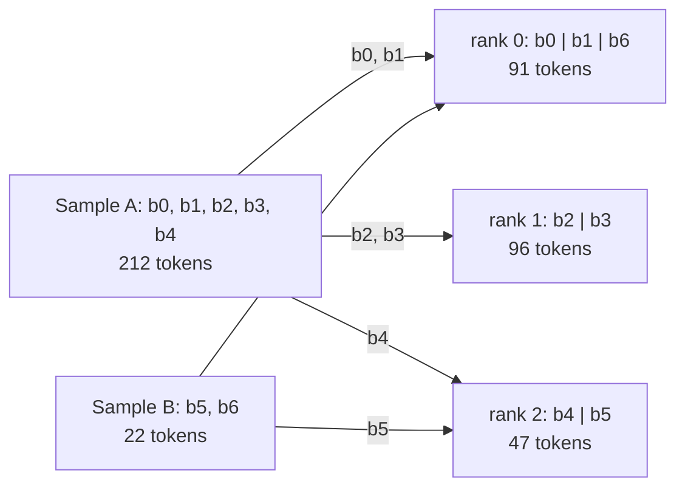
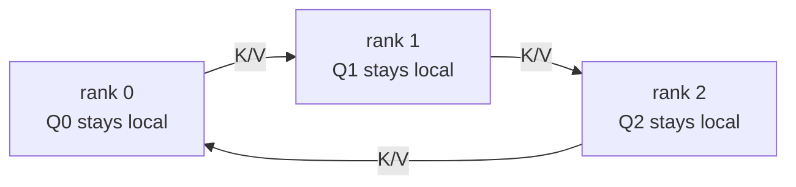

# cudnn_vsa

[English](README.md) | [简体中文](README.zh-CN.md)

<!-- Keep README.md and README.zh-CN.md synchronized, including examples and benchmark data. -->

用于 DiT/MMDiT 训练的打包多模态注意力：
**cuDNN 块稀疏细粒度注意力（fine attention）+ FA4 变长粗粒度注意力（coarse attention）**。

## 安装

安装支持 CUDA 的 PyTorch 后，在仓库根目录运行：

```bash
python -m pip install -r requirements.txt
```

## 使用

输入为相互独立、内存连续的 BF16 张量 `q`、`k`、`v`、`gate`，形状均为
`[T, H, 128]`。输出保持输入的 token 顺序。

```python
import torch
from vsa import vsa_attention
from vsa_layout import Segment, build_vsa_layout

# One 720p 5s video and two independent 720p images, each with text.
H, D = 2, 128
layout = build_vsa_layout(
    samples=[
        [Segment("video", (31, 45, 80), sparsity=0.9), Segment("text", 2048)],
        [Segment("video", (1, 45, 80), sparsity=None), Segment("text", 2048)],
        [Segment("video", (1, 45, 80), sparsity=None), Segment("text", 2048)],
    ],
    head_num=H,
    dense_query_full=False,
    device="cuda",
)
q, k, v, gate = [
    torch.randn(layout.tokens, H, D, device="cuda", dtype=torch.bfloat16,
                requires_grad=True)
    for _ in range(4)
]
out = vsa_attention(q, k, v, gate, layout)
out.backward(torch.randn_like(out))
```

每个内层列表是独立样本，attention 不跨样本。输入按声明的样本/segment 顺序排列，
视频内部使用 FHW raster 顺序。每个样本至少包含一个视频：`(F, H, W)` 表示
其 token 网格，`F=1` 表示图像。文本、音频和关键帧 segment 使用 token 数，
且 `sparsity=None`；也可添加更多视频/图像 segment。
几何形状和设置相同时，各层复用 layout。

将此目录加入 `PYTHONPATH`，或者把 `vsa.py`、`vsa_core.py`、
`vsa_layout.py` 和 `vsa_kernels.py` 复制到项目中并调整 import。

## 输入顺序

`layout.input_order` 显式声明 token 顺序：

| `input_order` | 输入 token | Slot 转换 |
| --- | --- | --- |
| `"raster"`（默认） | 原始样本/segment 顺序，视频按 FHW 顺序排列 | 重排为 block 并添加 padding |
| `"block"` | 按下述 block 顺序排列的有效 token，不含 padding | 仅添加 padding；本地所有 slot 都有效时跳过转换 |

### Raster 输入

默认的 `input_order="raster"` 接受原始 FHW 序列，如上面的示例所示。
`vsa_attention` 在内部进行重排和 padding，然后将输出恢复为相同的 raster 顺序。
无需预处理。

### Block 输入

在**层堆栈之前重排一次**，之后各层保持 block 顺序。
`input_order="block"` 声明预期的输入顺序，不会自动重排数据。
给定全局 raster token 及其原始 position IDs：

```python
from vsa import raster_to_block_wo_padding, block_wo_padding_to_raster

layout = build_vsa_layout(samples, head_num=H, input_order="block", device="cuda")
tokens_block = raster_to_block_wo_padding(tokens_global, vsa_layout=layout)
position_ids_block = raster_to_block_wo_padding(position_ids_global, vsa_layout=layout)
# Run the layers in block order, then restore once if raster output is needed:
# out_raster = block_wo_padding_to_raster(out_block, vsa_layout=layout)
```

`raster_to_block_wo_padding` 接受一个内存连续的 CUDA `[T_global, ...]` 张量，
返回 `[layout.tokens, ...]`，保持 dtype 和后续维度不变。
融合 gather **不添加 padding**。位置、target 和 mask 使用相同映射；
Q/K/V/gate 及梯度遵循重排后的 token 顺序。输入已经是 block 顺序时跳过转换。

完整 layout 重排全部 token；Ring layout 同时选择本 rank 拥有的 block。
两个辅助函数都要求 layout 的 `input_order="block"`，即使
`raster_to_block_wo_padding` 读取的是 raster 输入。`block_wo_padding_to_raster`
仅接受完整 layout。Ring VSA 已将各 KV 分片的 attention 贡献合并为本地 Q token
的完整输出。只有在层堆栈结束后需要完整的全局 raster 张量时，调用方才需收集各 rank
的输出 token 分片并恢复全局行顺序；否则输出继续保持分片。

<details>
<summary>精确的 block 顺序与小例子</summary>

1. 保持样本顺序。每个样本内先放 `sparsity=None` 的 segment，再放数值稀疏度的视频，
   每类内部保持 segment 的声明顺序。
2. None 稀疏度的 segment 按连续最多 64 个 token 分块；数值稀疏度的视频按
   4×4×4 tile 分块。Tile 起点和 tile 内有效 token 均按 F/H/W 顺序遍历
   （W 最快变化），边缘 tile 直接截断，不补 padding。
3. Block 不跨 segment 或样本边界。数值 `sparsity=0` 仍使用 tile；
   `sparsity=None` 使用稠密连续块。Ring 按全局 block ID 递增顺序保留拥有的 block，
   每个 block 内部顺序不变。

对于 `video=(1, 2, 5), sparsity=0.9` 后接三个文本 token，raster 行
`0..9` 是视频，`10..12` 是文本。Block 序列为：

| Block | 按输入顺序排列的原始 raster 行 | 有效 token 数 |
| --- | --- | ---: |
| b0：文本 | `10, 11, 12` | 3 |
| b1：第一个视频 tile | `0, 1, 2, 3, 5, 6, 7, 8` | 8 |
| b2：边缘视频 tile | `4, 9` | 2 |

输入只有 13 行，attention 内部分配 3×64 个 slot。将这个视频的稀疏度改成
`None` 后，保留视频在文本之前的顺序，产生大小为 10 和 3 的两个 block。
`layout.input_rows` 将每个输入行映射回全局 raster 行；
`raster_to_block_wo_padding(x, vsa_layout=layout)` 的值等于 `x[layout.input_rows]`。

</details>

## 注意力语义

`sparsity` 表示视频 segment 的 **KV block 丢弃比例**。
默认情况下，每个 query block 和 head 都独立地从**每个**视频 KV region 选择 top-k block，
包括跨视频注意力：

```text
k = max(1, ceil((1 - sparsity) * video_region_blocks))
```

预算由 KV segment 决定；选中的 block 由 Q/K 决定。
`sparsity=None` 将 region 设为稠密：它的 KV block 始终可见，仅进行 padding。
数值稀疏度使用 4×4×4 视频 tile；`0` 保留这些 tile 的全部 block。

[FastH3](https://github.com/hao-ai-lab/FastVideo/blob/d5253fd71055927f12aa6c4aa679b93a00238851/fastvideo/attention/backends/video_sparse_attn_h3.py#L27-L31)
增加了 query 侧的例外规则：稠密 query 可以看到**全部** KV block。
`dense_query_full=True` 启用该例外；默认值 `False` 对每个 query 都应用视频 KV 稀疏度。
稠密 query 来自 `sparsity=None` 的 region。

下面给出一个样本/head 在稀疏度为 0.5 时的 fine mask 示例。
两个坐标轴都遵循内部 block 顺序：**先放 None-sparsity segment，再放数值稀疏度视频 segment**。
`■` 表示可见，`□` 表示被 mask。Top-k 选择仅用于示意。

**`dense_query_full=False`（默认）**

```text
           Dense KV    Video KV
           0 1         2 3 4 5
Dense Q0   ■ ■         □ ■ ■ □
Dense Q1   ■ ■         ■ □ □ ■
Video Q2   ■ ■         ■ □ ■ □
Video Q3   ■ ■         □ ■ □ ■
Video Q4   ■ ■         ■ ■ □ □
Video Q5   ■ ■         □ □ ■ ■
```

**`dense_query_full=True`（FastH3 稠密 query 规则）**

```text
           Dense KV    Video KV
           0 1         2 3 4 5
Dense Q0   ■ ■         ■ ■ ■ ■
Dense Q1   ■ ■         ■ ■ ■ ■
Video Q2   ■ ■         ■ □ ■ □
Video Q3   ■ ■         □ ■ □ ■
Video Q4   ■ ■         ■ ■ □ □
Video Q5   ■ ■         □ □ ■ ■
```

对于含数值稀疏度的样本，coarse attention 覆盖**所有 segment** 的 BF16 池化 block，
为每个 token 生成 `fine + gate * coarse[its_block]`。
如果样本的所有 segment 都是 `sparsity=None`，则通过 **BSA 执行完整注意力**，
不使用 coarse 分支。前面独立图像的处理方式就是如此；
VSA 样本内部的稠密图像仍会参与 coarse。

## 无 CP、Ulysses CP 和混合 CP 示例

下面的示例使用两个带残差连接的 attention 层，并执行一次优化器更新。
三种模式使用同一个 VSA API。整个进程 world 是一个上下文并行组；
`H` 必须能被 Ulysses 大小 `U` 整除，world size 必须等于 `U * R`。

| 模式 | 层堆栈之前的输入准备 | 传入 VSA 的 Q/K/V/gate |
| --- | --- | --- |
| 无 CP（`U=1, R=1`） | 保持 raster 顺序，或一次性重排为 block 顺序 | 全部 token 和全部 head |
| 仅 Ulysses（`U>1, R=1`） | 选择 raster 或 block 顺序，再将序列切成 U 个 token 分片 | All-to-All 后的全部 token 和 H/U 个 head |
| Ring + Ulysses（`U>1, R>1`） | 一次性选择并重排 Ring 拥有的完整 block，再将每个紧凑 Ring 序列切成 U 个 token 分片 | All-to-All 后本 Ring 分片的有效 token 和 H/U 个 head |

Ulysses 的 token 切分边界可以位于 block 内部：All-to-All 会在 VSA 执行前
恢复序列。它的通信支持两种输入顺序，但恢复的序列必须与
`layout.input_order` 一致。Ring 要求 block 顺序。
为使 Ulysses 消息大小一致，只在序列尾部添加**传输 padding**；
进入 attention 前将其移除，计算 loss 时也排除这些行。
这与 VSA 内部每个 block 的 64-slot padding 不同。

### 无 CP

将后面的共用 Python 示例保存为本仓库中的 `demo_cp.py`，然后运行：

```bash
python demo_cp.py
python demo_cp.py --input-order block
```

### 仅 Ulysses CP

四张 GPU 在层堆栈前切分 token，每层内部通过交换将 token 分片转换为 head 分片。
raster 和 block 输入均支持：

```bash
torchrun --standalone --nproc-per-node=4 demo_cp.py --ulysses-size 4
torchrun --standalone --nproc-per-node=4 demo_cp.py --ulysses-size 4 --input-order block
```

### Ring + Ulysses CP

八张 GPU 使用 `U=4, R=2` 时，Ulysses 组为 `[0,1,2,3]` 和
`[4,5,6,7]`；Ring 组为 `[0,4]`、`[1,5]`、`[2,6]`、`[3,7]`。
每对 Ring rank 处理相同的 head 分片，分别拥有互补的 block。
两种 block 归属策略使用相同的输入准备和 attention 调用：

```bash
torchrun --standalone --nproc-per-node=8 demo_cp.py \
  --ulysses-size 4 --ring-size 2 --input-order block --ring-partition cyclic
torchrun --standalone --nproc-per-node=8 demo_cp.py \
  --ulysses-size 4 --ring-size 2 --input-order block --ring-partition contiguous
```

### 共用示例

示例使用 PyTorch 支持自动求导的 All-to-All、复制的模型权重，以及每个 rank 上
相同的完整 raster 数据。Ulysses、投影、loss 归一化和梯度归约属于调用方代码。
为便于阅读，示例先物化 Ring 分片再切 Ulysses；数据加载也可以合并两种映射，
直接提取最终的本地行。

<details>
<summary>完整 Python 示例：demo_cp.py</summary>

```python
import argparse
import os

import torch
import torch.distributed as dist
import torch.nn.functional as F
from torch.distributed.nn.functional import all_to_all_single

from vsa import raster_to_block_wo_padding, vsa_attention
from vsa_layout import Segment, build_vsa_layout


def exchange_heads(mixed, group):
    # [A,H,4,D] -> four [U*A,H/U,D] tensors; backward exchanges gradients.
    if group is None:
        return mixed.unbind(2)
    u = dist.get_world_size(group)
    a, h, n, d = mixed.shape
    send = mixed.reshape(a, u, h // u, n, d).transpose(0, 1).contiguous()
    recv = all_to_all_single(torch.empty_like(send), send, group=group)
    return recv.reshape(u * a, h // u, n, d).unbind(2)


def exchange_tokens(out, group):
    # [U*A,H/U,D] -> [A,H,D], reversing the forward head exchange.
    if group is None:
        return out
    u = dist.get_world_size(group)
    t, h, d = out.shape
    send = out.reshape(u, t // u, h, d).contiguous()
    recv = all_to_all_single(torch.empty_like(send), send, group=group)
    return recv.permute(1, 0, 2, 3).reshape(t // u, u * h, d)


parser = argparse.ArgumentParser()
parser.add_argument("--ulysses-size", type=int, default=1)
parser.add_argument("--ring-size", type=int, default=1)
parser.add_argument("--input-order", choices=("raster", "block"), default="raster")
parser.add_argument("--ring-partition", choices=("cyclic", "contiguous"), default="cyclic")
args = parser.parse_args()
U, R, H, D = args.ulysses_size, args.ring_size, 8, 128
C = H * D
world = int(os.environ.get("WORLD_SIZE", "1"))
if U < 1 or R < 1 or H % U or world != U * R:
    parser.error("Require U >= 1, R >= 1, H % U == 0 and WORLD_SIZE == U * R")
if R > 1 and args.input_order != "block":
    parser.error("Ring requires --input-order block")
device = torch.device("cuda", int(os.environ.get("LOCAL_RANK", "0")))
torch.cuda.set_device(device)
rank = 0
if world > 1:
    dist.init_process_group("nccl")
    rank = dist.get_rank()

# All ranks create all subgroups in the same order, once before the layers.
ulysses_group = ring_group = None
if U > 1:
    for r in range(R):
        group = dist.new_group(list(range(r * U, (r + 1) * U)))
        if rank // U == r:
            ulysses_group = group
if R > 1:
    for u in range(U):
        group = dist.new_group([r * U + u for r in range(R)])
        if rank % U == u:
            ring_group = group

samples = [
    [Segment("video", (5, 9, 11), sparsity=0.9), Segment("text", 67)],
    [Segment("video", (1, 3, 5)), Segment("text", 7)],
]
T = sum(segment.tokens for sample in samples for segment in sample)  # 584
layout = build_vsa_layout(
    samples, head_num=H // U, input_order=args.input_order, device=device,
    ring_cp_group=ring_group, ring_partition=args.ring_partition,
)
torch.manual_seed(1234)  # Identical mock input and replicated weights on all ranks.
tokens_global = torch.randn(T, C, device=device, dtype=torch.bfloat16)
# Row IDs illustrate the mapping; use the model's original coordinates for RoPE.
position_ids_global = torch.arange(T, device=device)

# One reorder/whole-block Ring selection, before any layer's Q/K/V projection.
tokens_attention = tokens_global
position_ids_attention = position_ids_global
if args.input_order == "block":
    tokens_attention = raster_to_block_wo_padding(tokens_global, vsa_layout=layout)
    position_ids_attention = raster_to_block_wo_padding(position_ids_global, vsa_layout=layout)

# Equal Ulysses capacity across Ring owners, including partial edge blocks.
max_tokens = layout.tokens
if layout.ring is not None:
    max_tokens = int(layout.ring.peer_block_sizes.sum(dim=1).max().item())
A = (max_tokens + U - 1) // U
tail = U * A - layout.tokens
start = (rank % U) * A
x = F.pad(tokens_attention, (0, 0, 0, tail))[start:start + A].contiguous()
position_ids_local = F.pad(position_ids_attention, (0, tail), value=-1)[start:start + A]
valid = torch.arange(start, start + A, device=device) < layout.tokens

layers = torch.nn.ModuleList([
    torch.nn.ModuleList([
        torch.nn.Linear(C, 4 * C, bias=False, device=device, dtype=torch.bfloat16),
        torch.nn.Linear(C, C, bias=False, device=device, dtype=torch.bfloat16),
    ]) for _ in range(2)
])
optimizer = torch.optim.SGD(layers.parameters(), lr=1e-3)
for qkvg_projection, output_projection in layers:
    mixed = qkvg_projection(x).view(A, H, 4, D)
    q, k, v, gate = (
        t[:layout.tokens].contiguous() for t in exchange_heads(mixed, ulysses_group)
    )
    # If applying RoPE here, use position_ids_attention for these unpadded rows.
    out = vsa_attention(q, k, v, gate, layout)
    out = F.pad(out, (0, 0, 0, 0, 0, tail))
    out = exchange_tokens(out, ulysses_group).reshape(A, C)
    x = (x + output_projection(out)).masked_fill(~valid[:, None], 0)

# Sum local contributions to a global-token-normalized illustrative loss.
loss = x.float().square().masked_fill(~valid[:, None], 0).sum() / (T * C)
loss.backward()
if world > 1:
    # SUM, not average: each local loss already uses the global denominator.
    for parameter in layers.parameters():
        dist.all_reduce(parameter.grad, op=dist.ReduceOp.SUM)
optimizer.step()
reported_loss = loss.detach()
if world > 1:
    dist.all_reduce(reported_loss, op=dist.ReduceOp.SUM)
if rank == 0:
    print(f"U={U}, R={R}, order={args.input_order}, loss={reported_loss.item():.6f}")
if world > 1:
    dist.destroy_process_group()
```

</details>

本例中，每层将 `[A, 1024]` 投影为形状为 `[A, 8, 128]` 的 Q/K/V/gate。
Ulysses 交换并移除传输 padding 后，每个张量的形状是
`[layout.tokens, 8/U, 128]`；逆向交换和输出投影将其恢复为 `[A, 1024]`。
无 CP 时，`A = layout.tokens = 584`。
输出在各层之间保持本 rank 的输入顺序。对 target 和 mask 应用相同的行选择；
保留原始 position 值，不要对本地分片重新编号。
只有应用在层堆栈结束后需要完整全局张量时，才收集各 rank 的输出 token 分片；
attention 内部的 Ring 结果合并已由 VSA 完成。
使用训练框架的参数梯度归约时，应以其替代示例中的手动归约，避免重复归约梯度。

## Ring 上下文并行

将已有的 Ring 进程组传给同一个 layout 构建函数和 attention API：

```python
layout = build_vsa_layout(
    samples, head_num=H, input_order="block", device="cuda",
    ring_cp_group=group, ring_partition="cyclic",  # Or "contiguous".
)
# Global raster inputs -> this Ring rank's compact block stream, once per pack.
tokens_local = raster_to_block_wo_padding(tokens_global, vsa_layout=layout)
position_ids_local = raster_to_block_wo_padding(position_ids_global, vsa_layout=layout)
# After token-wise projection and any caller-owned Ulysses exchange:
out = vsa_attention(q, k, v, gate, layout)
```

这里的 `H` 是 VSA 收到的 head 数（使用 Ulysses 时为 `H_total // U`）。
`ring_cp_group=None` 创建完整的 `VSALayout`（`layout.ring is None`），
无需初始化分布式环境，也支持 CPU。传入成员进程组会创建本地 Ring layout，
rank 和 size 从进程组获取。非成员句柄会被拒绝；即使组大小为 1 也要求 block 输入。

进程组只创建一次，在不同 micro-batch 的 layout 之间共享；每个 layout 在层间复用。
组内所有成员必须使用相同的全局样本形状、head 数和分配策略。
VSA 借用进程组，调用方应使其存活到反向和 CUDA Graph replay 完成。
前反向默认共享 `ring_cp_group`；也可通过 `ring_cp_bwd_group` 传入成员和
rank 顺序完全相同的另一组。

### Block 归属

Ring 输入仅包含拥有的 block 的有效 token，按全局 block ID 递增排列。
`raster_to_block_wo_padding` 融合分片选择与重排，不物化完整的全局 block 中间张量，也不通信。
已有本地 block 输入时跳过转换。全局数据已经按 block 排列时，直接分发拥有的 block，
不要再次执行 raster 转换。

`ring_partition` 独立于 `input_order` 选择归属方式，结果记录在
`layout.ring.partition` 中：

| `ring_partition` | 全局 block 归属 |
| --- | --- |
| `"cyclic"`（默认） | Block `b` 属于 rank `b % R`，全局编号跨样本连续 |
| `"contiguous"` | 每个样本给每个 rank 至多一个连续 block 区间 |

连续分配从 rank 0 开始。对每个样本的 N 个 block，计算
`base, extra = divmod(N, R)`：从当前起始 rank 循环访问各 rank，前 `extra` 个
各获得 `base + 1` 个连续 block，其余各获得 `base` 个。
随后起点前进 `extra` 并对 R 取模，使下一个样本从上一个样本分得较少的第一个
rank 开始。`extra=0` 时起点不变。

两种策略均保证每个样本及累计的 block 数相差不超过一个，
但不保证有效 token 数或动态 top-k 工作量均衡。循环分配将相邻 block 分散到不同 rank；
连续分配让每个样本的本地区间便于切片。两者使用相同的 attention kernel。
修改策略时必须重建 layout 并重新分片输入。

整个 pack 至少需要 R 个 block，使每个 Ring rank 都有有效数据。
单个样本的 token/block 数无需被 R 整除，也可以不出现在部分 rank 上。
内部每个 rank 分配 `C = ceil(global_blocks / R)` 个 block，每个 block 有
64 个 slot；不完整和 dummy slot 不参与数学计算。

### 示例：三个 rank 上的两个样本

打包以下相互独立的样本，R=3。下图使用 `ring_partition="contiguous"`：

- **A：** 稀疏视频 `(4, 6, 8)`，`sparsity=0.5`，后面跟随 20 个文本 token。
  Block 顺序将文本放在前面：`b0` 有 20 个 token；四个视频 tile
  `b1..b4` 分别有 64、64、32 和 32 个 token。
- **B：** 稠密图像 `(1, 3, 5)`，`sparsity=None`，后面跟随 7 个文本 token。
  两个 segment 都是稠密的，因此保持声明顺序：`b5` 有 15 个图像 token，
  `b6` 有 7 个文本 token。

Block ID 跨样本连续编号。A 有五个 block，B 有两个，都不能被 R 整除。
下图的箭头表示在数据集/模型边界执行的一次性分发。
Rank 方框内**仅包含有效输入 token**。



每个 rank 按全局 ID 递增顺序拼接自己的 block，保持每个 block 内的有效 token 顺序。
Rank 0 先提供 `b0` 的 20 个 token，再提供 `b1` 的 64 个和 `b6` 的 7 个，中间没有空隙。
A 从 rank 0 开始，向 rank 0/1/2 分配 `[2, 2, 1]` 个 block。
因此 B 从 rank 2 开始：将 `b5` 分给 rank 2，`b6` 分给 rank 0。
累计 block 数变为 `[3, 2, 2]`，第三个样本将从 rank 1 开始。
无需计算 token 负载或对 rank 排序。此例中 A 的不完整 block 有意造成 token 总数不均；
归属策略均衡的是 block 数量。

按 rank 顺序拼接各 rank 的输出，会得到 block 序列
`[b0, b1, b6, b2, b3, b4, b5]`。
要恢复全局顺序，需要使用归属映射和行映射；`input_rows` 给出每个本地行
在全局 raster 顺序中的目标位置。仅按 rank 顺序拼接，不足以直接使用
完整 layout 的逆重排辅助函数。

注意力在内部为每个 rank 分配 `ceil(7 / 3) = 3` 个 block，每个 block 有 64 个 slot：

| 组内 rank | 按本地 slot 顺序排列的全局 block ID | 每个 slot block 的有效大小 | 紧凑输入行数 | 内部 slot 行数 |
| --- | --- | --- | ---: | ---: |
| 0 | `b0, b1, b6` | `20, 64, 7` | 91 | 192 |
| 1 | `b2, b3, dummy` | `64, 32, 0` | 96 | 192 |
| 2 | `b4, b5, dummy` | `32, 15, 0` | 47 | 192 |

未使用的 slot 填零，不参与注意力和 pooling。
调用方总共提供 234 个有效 token，而非 576 行 slot。
Q/K/V/gate 和位置使用相同的本地顺序；输出及其梯度保持该顺序。

使用默认的 `ring_partition="cyclic"` 时，同样的全局 block 会分配为：

| 组内 rank | 拥有的全局 block | 有效 token 数 |
| --- | --- | ---: |
| 0 | `b0, b3, b6` | 59 |
| 1 | `b1, b4` | 96 |
| 2 | `b2, b5` | 79 |

总数仍为 234 个 token，每个 rank 的内部容量仍为三个 block。
后面的路由示例使用连续分配图中的归属关系。

### 路由与 top-k

1. [vsa_layout.py](vsa_layout.py) 的 `_build_sample_blocks` 固定样本边界及每个视频的
   `keep = max(1, ceil((1 - sparsity) * region_blocks))` 预算。
   选中的 ID 随每次前向的 Q/K 改变；稠密 KV 始终保留。
2. [vsa_core.py](vsa_core.py) 的 `ring_attention_slots` 按有效 token 数计算本地
   Q/K/V 的 FP32 均值，dummy 均值为零。K/V 汇总按 rank 顺序 all-gather，
   再由 `global_to_gather` 恢复全局 block 顺序并移除 dummy。
   本地 Q 均值由此获得自己样本内的全部候选 K 均值。
3. 共用的 `route` / `_route_group` 禁用 TF32/autocast，计算未缩放的 FP32
   `Q_mean @ K_mean.T`。每个 Q block/head 在每个视频 region 内，跨所有 peer
   独立选择 top-k。`topk(..., sorted=False)` 返回相对 ID，再通过
   `selected.sort(-1)` 和 `+ start` 得到排序后的全局 ID。
   稠密 KV 和完整保留的 region 使用静态模板；豁免的稠密 Q 行
   （`dense_query_full=True`）跳过 top-k。没有动态选择时直接复用模板。
   路由运行在 `no_grad` 下；梯度通过 fine/coarse attention，不经过离散选择。
   全局 K 均值使额外的分数/索引 collective 不再需要。Softmax 缩放在 attention 中进行。
4. [vsa_kernels.py](vsa_kernels.py) 的 `partition_indices` 使用 `global_to_gather`，
   将选中的全局 ID 映射为各 owner 的本地 block ID 和有效数量。
   某个 peer 可以没有选中的 key；K/V 到达时，fine attention 使用这些列表。

对于上面的样本 A，四个视频 block、稀疏度 0.5 对应 `keep=2`。
假设 query block `b3` 的某个 head 得到以下分数：

```text
Video KV block       b1    b2    b3    b4
Q_mean @ K_mean.T   0.2   0.8   0.1   0.9
Selected video IDs        b2          b4
Final global IDs:   [b0, b2, b4]   (b0 is the always-visible text block)
```

当 R=3 时，peer 列表分别为 rank 0 的 `[0]`（全局 `b0`）、rank 1 的 `[0]`
（全局 `b2`）和 rank 2 的 `[0]`（全局 `b4`）。
样本 A 中的 Q block 永远不会将 B 的 `b5/b6` 作为候选。
存在多个视频 region 时，每个 region 都有自己的 top-k 预算；
不会对整个 pack 中的所有视频 region 统一执行一次 top-k。

### 执行流程

两种模式共用可微的 FP32 `block_means`。单设备执行选取 coarse block，
通过 `routing_and_coarse_means` 融合路由 detach 和 coarse 类型转换。
Ring 对全部本地 slot 做 pooling，包括零值 dummy。
`_GatherMeans` 将 **FP32 K + BF16 V** 按原始字节打包为一次 all-gather，
不量化 K。V 在通信 autograd 边界内转换；反向将 dK/dV 合并为一次
**FP32 reduce-scatter SUM**，向 pooling 返回 FP32 梯度。
前向汇总的传输量比 FP32 K/V 少 25%；collective 次数仍为前向一次、反向一次。

对于上面的示例，令 `KV_r` 表示 rank r 的整个内部 K/V 分片，包含 slot padding。
在整个 fine attention 过程中，Q 保持在原 rank，K/V 传给组内下一个 rank：



| Fine attention 步骤 | Rank 0 使用 | Rank 1 使用 | Rank 2 使用 |
| --- | --- | --- | --- |
| 0：自己的分片 | `Q0, KV0` | `Q1, KV1` | `Q2, KV2` |
| 1：经过一跳 | `Q0, KV2` | `Q1, KV0` | `Q2, KV1` |
| 2：经过两跳 | `Q0, KV1` | `Q1, KV2` | `Q2, KV0` |

每一步只计算该 peer 拥有且被选中的 KV block。
例如，全局 `b5` 映射到以 rank 为主序的位置 7：owner 为 `7 // 3 = 2`，
本地 block 为 `7 % 3 = 1`。当 rank 0 收到 `KV2` 时，其中属于 B 的 query block
`b6` 可以关注 B 的 `b5`，而属于 A 的 query block 不能关注 `b5`。
**Layout/router** 通过 block 列表保证样本隔离。
**传输层**仅移动缓冲区，不解释 FHW 坐标，也不推断 THD 的样本边界。
各部分输出使用各自的 log-sum-exp 归一化量加权合并，
使最终 fine 输出在所有选中的 KV block 上具有统一的 softmax 归一化。

将 fine 阶段入队后，`coarse_attention` 使用本地池化 Q 和全局池化 K/V，
精度为 BF16，并为每个样本分别设置 Q/KV 边界。
Q/K 均值在 coarse 边界转换类型；V 均值到达时已经是 BF16。
Coarse attention 覆盖每个参与样本的所有 block，不受 fine top-k 列表限制。
`vsa_attention` 恢复紧凑的有效行，并合并为
`fine + gate * coarse[query_block]`。完全稠密的样本仅使用 fine。

反向以相反方向遍历 Ring，使用最终 fine 输出和 log-sum-exp，
以 FP32 累加 dQ/dK/dV。池化均值 gather 的伴随操作是 reduce-scatter。
没有本地 coarse query 的 rank 仍会参与必要的 collective；
保存的接收缓冲区支持保留计算图后的再次反向。

在 `build_vsa_layout` 中与 `ring_cp_group` 一起设置传输选项。
`ring_cp_batch_p2p=None` 对延迟初始化的 NCCL 进程组使用独立 P2P，
对绑定设备的进程组使用批量 P2P，前向和反向分别解析。
传入布尔值可以为两个进程组显式选择同一种模式。
在 SM100、H=2、单样本、128 个物理本地 block 的情况下，
`ring_cp_bwd_bucket_size="auto"` 为每个反向 bucket 使用 64 个 query block；
其他形状使用后端默认值。传入 `None` 可使所有情况都使用后端默认值，
也可以传入正整数指定 bucket 大小。

### 前向通信重叠

要为 Ring P2P 通信使用高优先级 NCCL 流，在并行初始化时创建一次进程组，
然后在不同 layout 和层之间复用：

```python
import torch.distributed as dist

# Call on all WORLD ranks in the same group-creation order, before building layouts.
options = dist.ProcessGroupNCCL.Options()
options.is_high_priority_stream = True
group = dist.new_group(ranks=ring_ranks, backend="nccl", pg_options=options)
# Member ranks reuse this group for every micro-batch's layout.
layout = build_vsa_layout(
    samples, head_num=H, input_order="block", device="cuda",
    ring_cp_group=group,
)
out = vsa_attention(q, k, v, gate, layout)
```

`ring_cp_group` 承担前向池化 all-gather 和 fine P2P；
`ring_cp_bwd_group` 承担反向 P2P 和池化梯度 reduce-scatter。
默认使用同一个句柄。需要不同的反向优先级时，创建成员及 rank 顺序完全相同的第二个组。

在 BSA 之前将 P2P 入队，并不保证它的 GPU kernel 先开始执行。
BSA 和 NCCL 可能竞争 SM 资源，包括共享内存。
使用普通优先级流时，等待中的 NCCL kernel 可能要等到 BSA 的最后一批线程块才开始执行。
高优先级让等待中的 NCCL 工作更早获得释放的资源；它不会抢占已经运行的线程块。
CUDA Graph replay 必须遵守捕获的节点优先级
（`cudaGraphInstantiateFlagUseNodePriority`）；应在训练使用的 PyTorch 构建中确认这一点。

优先级属于进程组内部的 NCCL 流。仅改变 `isend`/`irecv` 外围的流并不足够。
VSA 借用传入的进程组，不会替换它们，也不会修改全局调度设置。
Benchmark 的 `--high-priority-group` 使用上述配置。
`--forward-only-high-priority` 创建一个高优先级前向进程组和一个普通优先级反向进程组；
两个标志都不设置时，则使用一个普通优先级进程组。这两个标志互斥。
如果反向复用了高优先级进程组，即使反向 P2P 已经实现重叠，也仍会受到高优先级的影响。
池化 collective 使用同步 API。一些 PyTorch 版本会在当前 CUDA 流上运行这些操作，
因此它们的 kernel 优先级可能与进程组的异步 P2P 流不同。
应检查目标构建中捕获的节点。
除了 trace 中的重叠情况，还要比较完整前向/反向延迟：
通信仍会消耗 SM 和内存带宽，池化均值 collective 也有自己的数据依赖。

### 设计原因

- **完整 block 归属**让 pooling、路由和 BSA 的每个计算单元留在一个 Ring rank 上。
  紧凑输入避免投影和 MLP 处理 attention slot padding；重排在模型边界只做一次。
- **两种归属策略**适配不同工作负载。循环分配将相邻 block 分散开；
  连续分配为每个样本/rank 保留一个区间，并轮转余数 block 的接收者。
  两者均只计算一次归属，所有层复用映射。
- **全局 block 汇总**让本地 Q 在完整样本内选择 top-k 并计算 coarse attention。
  Fine attention 通过两个接收/计算缓冲区轮转 token 级 K/V；Q、输出累加和 dQ 留在本地。
- **相同的内部容量**保证 P2P 形状匹配，支持 CUDA Graph 复用。
  有效大小和显式样本边界排除 padding、避免跨样本 attention，
  同样适用于 fine-only 与 coarse 样本分布在多个 rank 的情况。

Fine attention 传输**整个带 padding 的 K/V 分片**，即使只选择了某个 peer 的少数 block。
稀疏度减少计算量，不会减少这些字节；池化 K/V 仍需全局 gather，Ring 越大跳数越多。
不完整 block、样本长度、稀疏度和选中的 owner 都会影响负载均衡与重叠。
应对两种策略比较完整工作负载的延迟；block 数均衡或 trace 中可见 P2P 重叠，
都不能单独保证吞吐提升。

## 性能

MFU 统计有效注意力 GEMM FLOPs；反向 FLOPs 是前向的两倍。
Padding、路由和非 GEMM 操作不计入 FLOP 分子。
单 GPU TFLOP/s 用全局 FLOPs 除以延迟和 GPU 数量；
MFU 再将该值除以稠密 BF16 峰值（`--peak-tflops`）。各阶段的中位数独立计算。
一次性输入分片/重排、graph capture 和 profiling 不计入计时；
注意力内部的 slot 转换和 padding 计入计时。

环境：GB200（2500 TFLOP/s BF16）、PyTorch 2.12.0a0/NV26.04、CUDA 13.2、cuDNN 9.22 / frontend 1.28.0、Triton 3.6、CuTe 4.6.2、FA4 4.0.0b35。

`benchmark.perf_vsa` 支持普通和分布式工作负载（`--ring`）。
两种模式共享输入生成、数值检查、graph capture 和计时逻辑。
`--cases` 选择工作负载，`--heads` 选择 head 数，`--check-only` 执行参考实现对比
和保留计算图后的再次反向检查，`--output` 接受 JSON 文件或目录。
`vsa-perf/v4` JSON 使用 `<case>-h<heads>` 作为 key；每个 case 记录检查结果、
全局有效 FLOPs，以及单 GPU 吞吐/MFU。
Ring 计时先取每次 replay 的各 rank 最大延迟，再汇总。Ring 默认使用 H=2，且不生成 trace；
添加 `--profile` 可为每个 rank 保存一份 trace。
比较性能时，在两种模式中显式使用相同的 `--seed`：
普通 VSA 的默认值为 2026，Ring 为 937。
相同的 seed、几何形状和 head 数会生成相同的全局 Q/K/V/gate 张量及上游输出梯度（dY）。

### 单设备 720p5s：FA4 完整注意力与 VSA

Benchmark 打包一个 720p、5 秒视频和两个独立的 720p 图像，每个样本都带文本：
视频有 121 帧，时间压缩 4×、空间压缩 16×，每个样本有 2048 个文本 token，
总共 124944 个 token，H=2/4，D=128，视频稀疏度为 0.9，
`dense_query_full=False`。VSA 使用默认的 `input_order="raster"`。

```bash
# VSA forward/backward time, MFU and torch traces.
python -m benchmark.perf_vsa --peak-tflops 2500
# FA4 full vs VSA, alternating order on the same GPU.
python -m benchmark.compare --peak-tflops 2500 --warmup 30 --repeats 500 --rounds 2
```

两者都使用 CUDA Graph，并对照 eager 执行验证 replay。
VSA 的计时覆盖 slot 转换、pooling、路由、fine、coarse、恢复和合并。
`benchmark/results/perf_vsa/` 包含 `perf.json` 和
`perf-default-h{2,4}-rank0.trace.json`；trace 在计时之后采集。
使用 `--input-order block` 测量紧凑 block 输入，使用 `--eager` 进行 eager 执行，
或使用 `--no-profile` 不采集 trace。输入生成/重排不计入计时。
对比结果写入 `benchmark/results/compare.json`。

| 方法 | H | 前向 ms | 前向 MFU | 反向 ms | 反向 MFU | 前向+反向 ms | 前向+反向 TFLOP/s | 前向+反向 MFU |
|---|---:|---:|---:|---:|---:|---:|---:|---:|
| FA4 完整注意力 | 2 | 9.357 | 56.82% | 25.409 | 41.85% | 34.772 | 1146.72 | 45.87% |
| cuDNN VSA（raster） | 2 | 2.366 | 24.81% | 6.746 | 17.40% | 9.114 | 482.91 | 19.32% |
| FA4 完整注意力 | 4 | 19.001 | 55.96% | 50.988 | 41.71% | 70.019 | 1138.94 | 45.56% |
| cuDNN VSA（raster） | 4 | 4.665 | 25.15% | 13.352 | 17.57% | 18.017 | 488.36 | 19.53% |

使用 CUDA Graph，每次测量预热 30 次，每种方法测两轮，每轮计时 replay 500 次。
FA4 完整注意力和 VSA 在同一 GPU 上交替执行。
每个时间列都是独立计算的 1000 次 replay 中位数。
这些是独立算子测量；VSA 时间包含 raster-to-slot 重排和 padding。

### 单 head 720p44s：普通 VSA 与 Ring4

`thd720p44s` case 的注意力几何形状，与 128 GPU DiT U32/R4 配置中
Ulysses 交换后的形状一致。它仅运行 VSA：pooling、路由、fine/coarse attention、
门控合并及其反向，并包含 Ring 通信。
QKV/输出投影、Ulysses、MoE 和优化器工作不属于此 benchmark 的范围。

| 设置 | 值 |
|---|---|
| 视频 token 网格 | `265 x 45 x 80`，稀疏度 `0.9` |
| 独立图像 token 网格 | `1 x 45 x 80`，稠密注意力 |
| 文本 | 每个样本 2048 个 token |
| 全局打包 token 数 | 961696：视频/文本 956048，图像/文本 5648 |
| Ring size / head 数 / head 维度 | `4 / 1 / 128` |
| 循环分配时 rank 0/1/2/3 的紧凑 token 数 | `240436 / 240420 / 240420 / 240420` |
| 连续分配时 rank 0/1/2/3 的紧凑 token 数 | `243904 / 242880 / 242832 / 232080` |
| 输入顺序 / 精度 | 紧凑 block 顺序 / BF16 |

这里使用一个 head 是正确的：模型的 32 个 head 已经被 U32 划分。
连续分配时，各 Ring rank 接收该 head 的 232k–244k 个有效 token，平均为 240,424。
各 rank 拥有 `4051 / 4050 / 4050 / 4050` 个 block；
有效 token 数不相等是由不完整 block 引起的。
这些是 Ulysses 交换后的 token 数；输入张量没有 padding，
VSA 管理其内部的 64-token 注意力 slot。

```bash
# Full sequence on one GPU, with the same global inputs and block order.
python -m benchmark.perf_vsa --heads 1 --cases thd720p44s --seed 937 \
  --input-order block --warmup 10 --repeats 50 --profile \
  --peak-tflops 2500 --output benchmark/results/single_720p44s/perf.json

# Compare both ownership policies on the same four GPUs and global inputs.
for partition in cyclic contiguous; do
  torchrun --standalone --nproc-per-node=4 --module benchmark.perf_vsa --ring \
    --ring-size 4 --ring-partition "$partition" --heads 1 --cases thd720p44s \
    --seed 937 --batch-p2p --high-priority-group --bwd-bucket-size backend \
    --warmup 10 --repeats 50 --profile --peak-tflops 2500 \
    --output "benchmark/results/ring4_720p44s/$partition/perf.json"
done
```

默认启用 CUDA Graph。两个命令都会在计时之前，将输出和所有输入梯度与单设备 VSA 对比，
并检查保留计算图后的再次反向，以及使用原始/修改后输入的 graph replay。
Ring 命令写出 `perf-group0.json` 和
`perf-group0-thd720p44s-h1-rank{0,1,2,3}.trace.json`。
每个 trace 在计时样本之后额外采集一次完整前向/反向 replay。
JSON 记录 `ring_partition`、阶段延迟、TFLOP/s/GPU 和 MFU。
输入是使用指定 seed 生成的随机张量；几何形状一致并不代表复现了某个模型层的路由决策。

#### 循环分配与连续分配

两种支持的归属策略在另一次分配的四张 GB200 上比较，执行顺序为
循环 / 连续 / 连续 / 循环。每次运行预热 10 次，计时 graph replay 50 次；
每次 replay 使用各 rank 的最大延迟，表中值为两次运行中位数的中位数。
所有参考实现对比和 graph 检查均通过。

| Ring4 归属策略 | 前向 ms | 反向 ms | 前向+反向 ms | 前向+反向 TFLOP/s/GPU | 前向+反向 MFU |
|---|---:|---:|---:|---:|---:|
| 连续 | 16.090 | 51.370 | 66.661 | 477.54 | 19.10% |
| 循环 | 16.186 | 51.691 | 67.197 | 473.73 | 18.95% |

总时间 0.8% 的差异适用于这些随机输入。
实际模型的路由可能将选中的 KV block 集中到某个 peer，因此也应在模型中测试两种策略。
此次节点分配没有重测普通 VSA；下面相同条件下的普通/Ring 对比是另一次独立测量。

#### 普通 VSA 与 Ring4

以下结果在一次分配的四张 GB200 上测得，使用上述软件环境。
普通 VSA 在一张 GPU 上运行完整序列，不使用进程组；
表中的 Ring4 使用**连续分配**、全部四张 GPU，以及上述高优先级进程组和后端默认反向 bucket。
两者都使用 **961,696 个全局 token、H=1、D=128、紧凑 block 输入和 seed 937**。
全局输入 hash 和有效 FLOP 数一致。

| 阶段 | 普通 VSA ms | 普通 VSA TFLOP/s | 普通 VSA MFU | Ring4 ms | Ring4 TFLOP/s/GPU | Ring4 MFU | 并行效率 |
|---|---:|---:|---:|---:|---:|---:|---:|
| 前向 | 58.193 | 729.38 | 29.18% | 15.556 | 682.14 | 27.29% | 93.52% |
| 反向 | 179.412 | 473.15 | 18.93% | 50.403 | 421.05 | 16.84% | 88.99% |
| 前向 + 反向 | 237.707 | 535.68 | 21.43% | 65.210 | 488.17 | 19.53% | 91.13% |

每种模式运行两次，每次预热 10 次，计时 CUDA Graph replay 50 次。
Ring 计时取每次 replay 中各 rank 的最大延迟；
表中报告每种模式两次运行中位数的中位数。

全局工作量固定时，加速比为 `T1 / T4`，并行效率为 `T1 / (4 * T4)`，
等价于 `MFU4 / MFU1`。这里完整前反向达到 **3.645x 加速和 91.13% 并行效率**。
该对比包含通信、kernel 形状变化、额外累加和负载不均衡的影响，
没有单独分离通信成本。仅有 P2P 重叠并不能证明通信开销为零。

示例使用同一主机上的四张 GPU。要测量跨主机 Ring，
使用每张 GPU 一个进程及常规 torchrun rendezvous 参数，并保持相同的 benchmark 标志。
应记录实际互连拓扑和节点分布：单主机 NVLink 的重叠表现不能代表跨 NVLink 域的 Ring，
四张 GPU 的运行也无法复现 32 个并发 Ring 组。
独立算子的有效 FLOP MFU 仅统计有效注意力对；DiT 模型的统计还包括投影/MoE，
并计算物理 fine-attention block slot，因此两者的 MFU 分子不同。

## 测试

测试覆盖两种输入顺序与独立 token 级数学实现的对比、
不同行形状/dtype 的融合单张量重排往返、padding 及其伴随操作，
以及使用原始和修改后输入的重排/注意力/恢复 CUDA Graph replay。
CUDA 不可用时跳过 GPU 测试。

```bash
python -m pip install 'pytest>=8'
python -m pytest -q -m 'not fastvideo'

# Optional FastH3 reference
python -m pip install -r tests/requirements-fastvideo.txt
python -m pytest -q tests/test_fastvideo.py
```

进行 Ring 验证时，所有 worker 都必须具备 CUDA 和 NCCL。
小规模 case 将输出及 Q/K/V/gate 梯度与独立 token 级数学实现对比；
64k case 则与单设备 VSA 对比。
计时之前会检查保留计算图后的再次反向，以及使用原始/修改后输入的 CUDA Graph replay。
添加 `--dense-query-full` 重复运行，可验证另一种稠密 query 策略。

```bash
# Ragged samples and partial/dummy slots; every rank owns valid blocks.
torchrun --standalone --nproc-per-node=8 --module benchmark.perf_vsa --ring \
  --cases ragged
# Interleaved groups; partial_blocks has three blocks and requires R<=3.
torchrun --standalone --nproc-per-node=8 --module benchmark.perf_vsa --ring \
  --ring-size 2 --cases ragged partial_blocks dense
# Device-bound groups and batched P2P.
torchrun --standalone --nproc-per-node=4 --module benchmark.perf_vsa --ring \
  --eager-group --cases ragged dense
# Single/packed 64k workloads, plus timing after numerical checks.
torchrun --standalone --nproc-per-node=8 --module benchmark.perf_vsa --ring \
  --high-priority-group --cases single64k thd64k --warmup 30 --repeats 500
# Strict reproduction of the known fine-only-sample numerical failure.
torchrun --standalone --nproc-per-node=8 --module benchmark.perf_vsa --ring \
  --ring-size 2 --cases fine_only_peer --check-only
```

Ring 测试使用 block 输入。默认 case 为 `ragged`、`single64k` 和 `thd64k`；
每个 case 至少需要 R 个全局 block。小规模 case `partial_blocks`、
`fine_only_peer` 和 `dense` 分别包含 3、2 和 6 个 block。
多节点运行时，将 `--standalone` 替换为 torchrun rendezvous 参数。
JSON 记录数值/graph 检查和源码 hash；计时与 MFU 遵循**性能**一节的定义。
长序列 profile 使用 `thd720p44s`。

严格的 BF16 `fine_only_peer` case 仍有未解决的数值失败：
六 token、仅使用 fine 分支的样本，其 dQ 和 dK 相对原生参考实现的相似度
可能低于 0.99999 阈值。上面的命令会报告此失败；case 和阈值保持不变。

## 代码结构

| 文件 | 职责 |
| --- | --- |
| `vsa.py` | 公共注意力入口，以及显式的 block/raster 重排辅助函数 |
| `vsa_core.py` | 路由、cuDNN BSA/FA4 调用、单设备执行，以及 Ring 通信和 autograd |
| `vsa_layout.py` | 静态样本/block 几何信息、行映射、路由模板和 coarse 边界 |
| `vsa_kernels.py` | 融合 token 重排、slot gather、Q/K/V padding、FP32 pooling 和门控合并 kernel |

两种输入顺序共享 core 中的注意力数学计算、各 region 的预算，以及先 fine 后 coarse 的调度。
Core 不导入公共入口。

<details>
<summary>重排算子与 layout 映射</summary>

| 转换 | 执行位置 | 前向 / 输出恢复 |
| --- | --- | --- |
| Raster → 带 padding 的 block | 每次使用 raster 输入的 VSA 调用内部 | Q/K/V 分别调用 `raster_to_block_w_padding`；`block_w_padding_to_raster` 恢复 raster 输出 |
| Raster → 紧凑 block | 层堆栈之前执行一次 | `raster_to_block_wo_padding`，Ring 时同时选择拥有的 block；`block_wo_padding_to_raster` 恢复完整 layout |
| 紧凑 block → 带 padding 的 block | 每次使用 block 输入的 VSA 调用内部 | `block_wo_padding_to_block_w_padding`；`block_w_padding_to_block_wo_padding` 去掉输出 padding |

名称注明源顺序、目标顺序和 padding：`w_padding` 表示带 block padding，
`wo_padding` 表示不带。带 `_qkv` 后缀的
`block_wo_padding_to_block_w_padding_qkv` 融合三个张量，供 `vsa_attention` 使用；
无后缀的版本转换单个张量。融合版让 Q/K/V 共用一次映射读取和 kernel 调用，
反向也如此；分别处理则需要三次调用。融合范围是 padding/恢复，不包含 QKV 线性投影。
Slot 辅助函数位于 `vsa_kernels.py`，
两个 raster/紧凑 block 边界转换函数位于 `vsa.py`。

逐层转换在 `vsa_attention` 内部执行，位于 Ulysses head 交换之后（若使用 Ulysses）。
转换由输入顺序决定，Ulysses 本身不要求其中某种顺序。Ring 要求紧凑 block 输入。
这里的 padding 是 VSA 内部每块 64 个 slot 的 padding，与调用方的 Ulysses 尾部
padding 分开处理。

三类转换均支持 autograd。Slot 转换的反向使用逆行映射，紧凑 Q/K/V 的梯度融合恢复。
层堆栈边界重排的反向将梯度 scatter 到原始 raster 形状。
Ring 未拥有的行梯度为零，不执行跨 rank 归约。这个输入重排的伴随操作不会收集
输出 token 分片。层堆栈结束后，可选的完整全局输出重建由调用方负责；
Ring 内部的 attention 结果合并已由 VSA 完成。

`layout.input_rows` 将输入行映射到全局 raster 行（完整 raster layout 为恒等映射）。
`tokens`、`blocks` 和 row/slot 映射描述本地输入；
`groups`、`sample_slices` 和 `sample_lengths` 描述全局样本。
`slot_row` 将每块 64 个 slot 映射到输入行（`-1` 表示 padding），
`row_slot` 是有效行上的逆映射。Padding 填零，不参与均值和 attention。

底层有三套 kernel：`_reorder_tokens_kernel`（边界 gather/scatter）、
`_gather`（单张量 slot 转换）和 `_gather_qkv`（融合 Q/K/V slot 转换）。
相反方向复用这些 kernel。只有 block 输入满足 `tokens == blocks * 64`、
没有不完整/dummy block 时，`slots_are_input` 才跳过 slot 转换；
raster 输入始终经过 raster-to-slot 路径。

`layout.ring` 保存进程组/选项、rank/size、全局 token 数、block 归属、
peer 大小和 all-gather 排列。容量为 C 时，
`p = layout.ring.global_to_gather[b]` 给出 `owner = p // C` 和
`local_block = p % C`。`layout.ring.block_ids` 列出本地 block 的全局 ID，
dummy block 用 `-1` 表示。所有 rank 根据几何形状生成这些映射，无需通信。
Coarse Q 边界是本地的，KV 边界覆盖全局样本；
完整 layout 共享 Q/KV 边界和 block-ID 张量。

</details>

## 致谢

感谢 [FastVideo / FastH3](https://github.com/hao-ai-lab/FastVideo/blob/d5253fd71055927f12aa6c4aa679b93a00238851/fastvideo/attention/backends/video_sparse_attn_h3.py)
提供 VSA 参考实现和语义，以及
[NVIDIA cuDNN BSA](https://github.com/NVIDIA/cudnn-frontend/blob/v1.28.0/python/cudnn/block_sparse_attention/_interface.py)
提供本实现使用的核心块稀疏注意力 kernel。

[MIT 许可证](LICENSE)。
